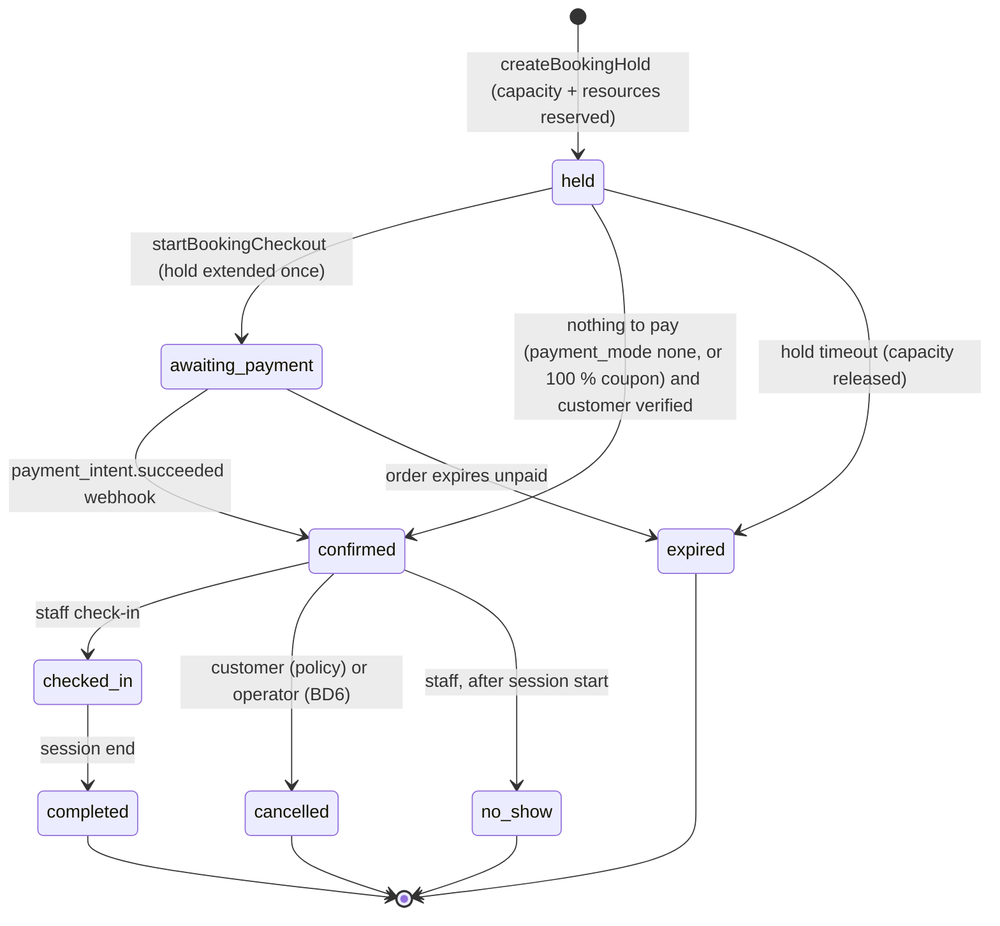
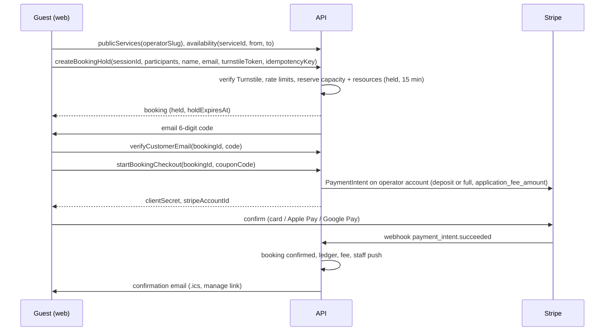

# Booking plan

Operators publish bookable **services** (tandem skydive, AFF first jump course, scenic flight, dive trip, tour), set up
when they run and how many people fit, and customers book and pay online, with or without an account, without ever
being double-booked. Index: [README.md](README.md). Tasks and executor rules: [`../MODERNISATION_PLAN.md`](../MODERNISATION_PLAN.md). Builds on
[COMMERCE_FOUNDATION.md](COMMERCE_FOUNDATION.md) (customers, sales orders, payments, coupons, ledger, platform fee).

Drafted 2026-10-11 against backend `0774b40` and client `dcc46d1`. Owner decisions recorded 2026-10-11 (§2).

## 1. Requirements coverage

| Owner requirement | Where |
|---|---|
| Operators add services customers can book | §3.1; B1.2, B2.3 |
| Book without logging in; captcha, OTP and/or deposit | §3.5, §3.6; B1.5, B1.6, B2.1 |
| Operators set up availability and booking slots | §3.2; B1.3, B2.3 |
| Reserve slots and prevent double-booking | §3.3, §3.4; B1.4 |
| Coupons usable for bookings | COMMERCE C2.7; applied in B1.6 |
| Transaction fee | Every online booking payment goes through COMMERCE checkout, so the platform fee applies automatically |

## 2. Decisions

All decided by the owner on 2026-10-11.

| ID | Decision | Decided | Notes | Tasks |
|---|---|---|---|---|
| BD1 | Where guests can book | **Public booking pages in the web app only** (shareable link, embeddable in the operator's website); the native app requires sign-in | Cloudflare Turnstile has no native SDK (a WebView is needed, and the common wrapper relays through a third-party domain); guests arrive from websites and ads anyway | B1.1, B1.5, B2.1, B2.5 |
| BD2 | Guest verification | **Turnstile when a hold is created + 6-digit email code before payment** | SMS codes rejected for now (per-message cost, phone required); can be added per operator later | B1.5, B2.1 |
| BD3 | Payment at booking | Per-service setting `none`, `deposit_fixed`, `deposit_percent`, `full`; **default `full`** | `none` only for verified customers | B1.6 |
| BD4 | Collecting the remaining balance | **At the desk on the day** (a desk payment: 1 % offline fee per CD3) **plus an optional "pay balance online" link** in the reminder email | Auto-charging saved cards rejected (off-session payments and 3-D Secure fallbacks) | B1.7, B1.8 |
| BD5 | Resource modelling | **Individual resource units, optional per service**, with database-enforced non-overlap across services | Capacity-only and full rostering rejected | B1.2–B1.4, B2.3 |
| BD6 | Default cancellation policy | **Customer cancels ≥ 72 h before: full refund; 24–72 h: deposit kept; < 24 h: no refund. Operator cancels (weather, aircraft): customer chooses reschedule or full refund** | The platform fee is refunded with the money (CD4) | B1.7, B2.2, B2.4 |
| BD7 | How bookings reach the manifest | **Check-in, then one action creates passengers and slots on a chosen load** (tandem: passenger + instructor slot) without charging wallets | Sessions that are trips (dive boats, tours) come after Phase 7 (D5/D6) | B3.2 |

## 3. Design

### 3.1 Concepts

| Concept | Table | Meaning |
|---|---|---|
| Service | `services` | What is sold: name, slug, `description_md`, media (reuses the webshop media table, or a banner until S1.2 lands), `duration_minutes`, `price_cents` per participant, `payment_mode` + deposit (BD3), `min_participants`/`max_participants` per booking, `booking_window` (opens N days ahead, closes M hours before), `cancellation_policy` jsonb (BD6), `participant_rules` jsonb (`min_age`, `max_body_mass_kg`), optional `participant_form_template_id` (existing `FormTemplate`), optional `ticket_type_id` (manifest link, BD7), `status` (`draft`, `published`, `archived`) |
| Resource | `resources` | One bookable unit: "Instructor: Sam", "Boat: Reef Runner", "Rig T-3". `kind` (free text per operator), optional link to a `DropzoneUser` or `Plane` |
| Requirement | `service_resource_requirements` | Per booking participant (or per booking) the service needs N units of a resource kind, e.g. 1 × "tandem instructor" per participant |
| Availability rule | `availability_rules` | Recurring weekly pattern per service: weekdays, first start, last start, interval, capacity per session, valid from/until |
| Exception | `availability_exceptions` | Dates closed, or extra/changed sessions on a date |
| Session | `booking_sessions` | A concrete occurrence generated from rules: `starts_at`, `ends_at` (timestamptz), `capacity`, `reserved_count`, `state` (`open`, `closed`, `cancelled`). The thing customers pick. Named "session", not "slot", because `slots` are manifest seats |
| Booking | `bookings` | One customer's reservation on one session: `customer_id`, `participants_count`, `state` (§3.4), `hold_expires_at`, `sales_order_line_id`, `manage_token` (Rails `generates_token_for`), `source` (`web`, `app`, `staff`) |
| Participant | `booking_participants` | Name, contact, `body_mass_kg`, date of birth, form answers, `checked_in_at`, link to the manifest slot/passenger after check-in |
| Allocation | `resource_allocations` | A resource unit held for `[starts_at, ends_at)` by a booking, or blocked (leave, maintenance) |

Times: sessions are generated in the operator's time zone (`dropzones.time_zone`) as local wall-clock times and stored
as UTC; daylight-saving transitions are covered by spec (a 09:00 rule stays 09:00 local across the change).

### 3.2 Availability and session generation

- Staff define rules and exceptions; `GenerateBookingSessionsJob` materialises sessions for a rolling horizon (default
  120 days, operator setting), nightly and whenever a rule or exception changes.
- Regeneration never deletes or moves a session with bookings. It may raise capacity, lower it only down to
  `reserved_count`, and close it. Sessions removed by a rule change that have bookings are flagged for staff
  ("orphaned sessions" list) instead of being cancelled silently.
- Staff can also add one-off sessions and edit a single session's capacity or close it.
- Public availability for a date range: open sessions inside the booking window with
  `capacity − reserved_count ≥ requested participants` **and** enough free resource units of each required kind for
  that interval. Computed in SQL; cached for 30 seconds per service and day, invalidated on any reservation.

### 3.3 Preventing double-booking

Three independent guarantees, each enforced by PostgreSQL rather than by application checks:

1. **Session capacity**: `reserved_count` counts active holds and confirmed bookings. Reservation is a single
   conditional update,
   `UPDATE booking_sessions SET reserved_count = reserved_count + :n WHERE id = :id AND state = 'open' AND reserved_count + :n <= capacity`;
   zero rows updated means sold out. A `CHECK (reserved_count BETWEEN 0 AND capacity)` constraint backs it up.
   Releases decrement in the same transaction as the booking's state change, so the counter never drifts; a nightly
   job compares it with `SUM(participants_count)` of active bookings and reports any difference.
2. **Resource units**: `resource_allocations` has an exclusion constraint
   `EXCLUDE USING gist (resource_id WITH =, tstzrange(starts_at, ends_at) WITH &&) WHERE (released_at IS NULL)`
   (extension `btree_gist`; Rails `add_exclusion_constraint`). Allocation picks free units of the required kind with
   `FOR UPDATE SKIP LOCKED` and inserts; a constraint violation means another booking won the race, so it tries the next
   unit, then reports sold out. Staff blocks (leave, maintenance) are allocations too, so they are covered by the same
   constraint.
3. **Duplicate submissions**: every booking mutation takes a client-generated idempotency key (unique per operator), and
   the sales order's own idempotency key covers checkout retries.

Holds keep abandoned checkouts from blocking capacity: a hold lasts `hold_minutes` (operator setting, default 15,
range 5–30) and is extended once by 10 minutes when payment starts. `ExpireBookingHoldsJob` runs every minute, and a
reservation attempt on a full session first expires stale holds on that session inside the same transaction, so a
missed job run never causes a false "sold out". Abuse limits for guests (§3.5) cap how many holds one person can create.

Race scenarios the B1.4 specs must cover:

| Scenario | Expected result |
|---|---|
| 20 concurrent requests for the last 2 places | Exactly 2 succeed (or 1 if a request asks for 2) |
| Two services sharing 4 instructors, 6 concurrent tandem holds at the same time | At most 4 hold instructors; the rest are sold out on both services |
| Hold expires while the customer is in 3-D Secure, payment succeeds afterwards | Re-reserve; if the session is now full, automatic full refund (fee included) and an apology email (COMMERCE §3.5 late-payment rule) |
| Staff lowers capacity during a checkout | Capacity cannot drop below `reserved_count`; the mutation errors with the current count |
| Same request submitted twice (double tap, retry) | One booking (idempotency key) |
| Duplicate webhook | One confirmation |
| Reschedule to a full session | Fails without releasing the original session |
| Session crosses a daylight-saving change | Correct UTC times, allocations compared in UTC |

### 3.4 Booking lifecycle

Capacity and allocations are released on `expired` and `cancelled`, never on `no_show` or `completed`. Rescheduling
reserves the new session first, then releases the old one, in one transaction.

### 3.5 Guests, verification and abuse limits

- Public GraphQL fields and mutations are marked `authenticate: false` (graphql_devise already supports this, see
  `login_with_apple` in `app/graphql/types/mutation_type.rb`) and only expose published services of operators with
  `booking_enabled`. Operators get a `slug` for URLs.
- `createBookingHold` (guest) requires a valid Turnstile token (verified server-side with Cloudflare's siteverify API,
  `TURNSTILE_SECRET_KEY`), name and email. It creates or finds the `customer` and the hold.
- Before payment (or confirmation when nothing is paid), the guest enters a 6-digit code emailed to them: stored as an
  HMAC, valid 10 minutes, 5 attempts, resend after 60 seconds. A verified email stays verified for that customer for
  12 months (no code on the next booking in the same browser session).
- Limits (GraphQL field extension `RateLimited`, counters in `Rails.cache`, Solid Cache in production): holds per IP 10/hour,
  active holds per email 2, code sends per email 5/hour, participants per hold `max_participants`.
- The confirmation email carries a **manage link** (`Booking.generates_token_for(:manage, expires_in: …)`, valid until
  30 days after the session): view, add participant details, cancel or reschedule within policy. No account needed.
- Logged-in users skip Turnstile and the code (their account email is already confirmed).
- Personal data of guest customers is anonymised 24 months after their last booking (job), keeping amounts for the
  ledger. The retention period is an operator-visible constant, not a setting, until someone asks.

### 3.6 Checkout, deposits and accounting

- A booking is a `Sellable` (COMMERCE §3.5): `reserve!` is the hold, `on_paid!` confirms, `on_refunded!` cancels or
  reduces participants. Lines are priced per participant; the deposit or full amount is the amount charged now, and
  the balance due is stored on the booking.
- Coupons (`applies_to: services` or specific services) discount the booking; deposits are computed on the discounted
  total.
- Ledger (COMMERCE §3.2): online payment → `customer_deposits`; check-in or session end recognises `service_revenue`
  and tax; balance paid at the desk → `cash` to `service_revenue`; forfeited deposit on late cancellation →
  `cancellation_revenue`. Desk payments go through COMMERCE `recordDeskPayment` and accrue the 1 % offline fee (CD3).
- Cancellation refunds follow the service's policy at the time of booking (copied onto the booking), BD6 for operator
  cancellations.

### 3.7 Staff features

Calendar (day/week) of sessions with fill level, bookings list with filters, booking detail (participants, payments,
notes), manual booking for phone or walk-in customers (pay now by card, pay at desk, or no payment), move to another
session, cancel a booking or a whole session (weather: notifies every customer with reschedule and refund options),
check-in on the day, mark no-show. New paid bookings notify staff with `readBookings` by push.

### 3.8 Customer notifications

Emails (ActionMailer, SMTP already configured): verification code, confirmation with `.ics` attachment and manage link,
reminder 24 hours before (with the balance link if BD4 a), cancellation/reschedule confirmations, operator
cancellation notice. Logged-in customers also get in-app/push notifications through the existing `Notification` model.

### 3.9 Permissions

`manageServices` (services, resources, availability), `readBookings`, `manageBookings` (manual bookings, move, cancel,
check-in, no-show). Defaults: owner/admin all; `manifest` role `readBookings` + `manageBookings`. Refunds use
COMMERCE's `refundOrders`.

### 3.10 Guest booking flow

## 4. Tasks

The tasks (B1.1–B3.4) are Phase B of the plan, [`../MODERNISATION_PLAN.md`](../MODERNISATION_PLAN.md), where their status
is tracked and the Execution order places them. They use the renamed code (GENERALISATION §3: `Operator`,
`Membership`, `Vehicle`, `Guest`); this design's prose predates the rename and reads through that map.
