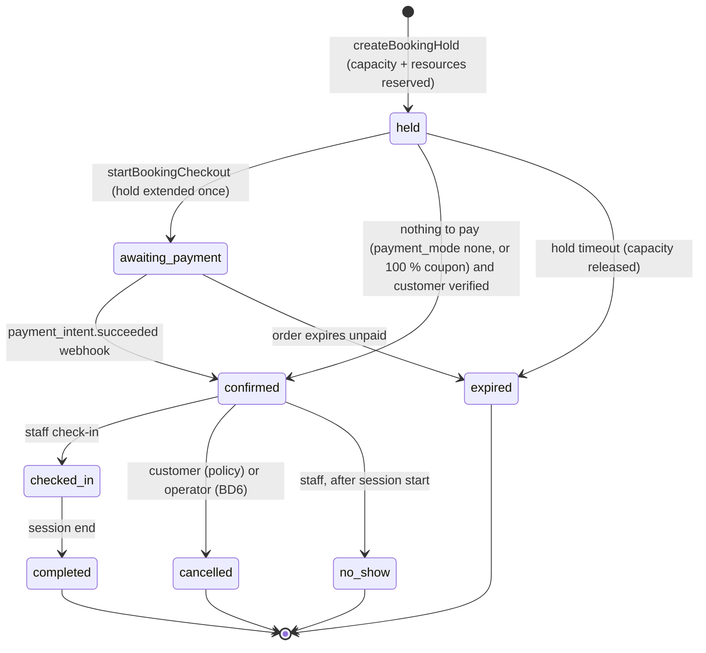
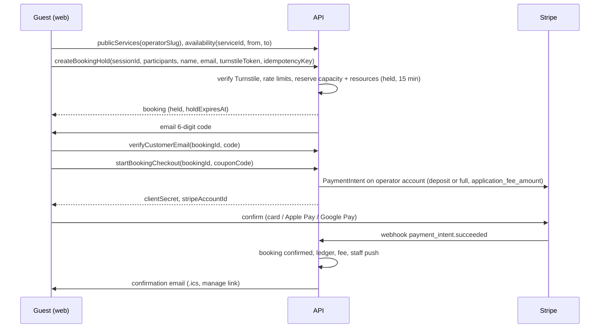

# Booking plan

Operators publish bookable **services** (tandem skydive, AFF first jump course, scenic flight, dive trip, tour), set up
when they run and how many people fit, and customers book and pay online, with or without an account, without ever
being double-booked. Index and executor rules: [README.md](README.md). Builds on
[COMMERCE_FOUNDATION.md](COMMERCE_FOUNDATION.md) (customers, sales orders, payments, coupons, ledger, platform fee).

Drafted 2026-10-11 against backend `0774b40` and client `dcc46d1`. Owner decisions recorded 2026-10-11 (§2).

## 1. Requirements coverage

| Owner requirement | Where |
|---|---|
| Operators add services customers can book | §3.1; B1.2, B2.3 |
| Book without logging in; captcha, OTP and/or deposit | §3.5, §3.6; B1.5, B1.6, B2.1 |
| Operators set up availability and booking slots | §3.2; B1.3, B2.3 |
| Reserve slots and prevent double-booking | §3.3, §3.4; B1.4 |
| Coupons usable for bookings | COMMERCE C2.7; applied in B1.6 |
| Transaction fee | Every online booking payment goes through COMMERCE checkout, so the platform fee applies automatically |

## 2. Decisions

All decided by the owner on 2026-10-11.

| ID | Decision | Decided | Notes | Tasks |
|---|---|---|---|---|
| BD1 | Where guests can book | **Public booking pages in the web app only** (shareable link, embeddable in the operator's website); the native app requires sign-in | Cloudflare Turnstile has no native SDK (a WebView is needed, and the common wrapper relays through a third-party domain); guests arrive from websites and ads anyway | B1.1, B1.5, B2.1, B2.5 |
| BD2 | Guest verification | **Turnstile when a hold is created + 6-digit email code before payment** | SMS codes rejected for now (per-message cost, phone required); can be added per operator later | B1.5, B2.1 |
| BD3 | Payment at booking | Per-service setting `none`, `deposit_fixed`, `deposit_percent`, `full`; **default `full`** | `none` only for verified customers | B1.6 |
| BD4 | Collecting the remaining balance | **At the desk on the day** (a desk payment: 1 % offline fee per CD3) **plus an optional "pay balance online" link** in the reminder email | Auto-charging saved cards rejected (off-session payments and 3-D Secure fallbacks) | B1.7, B1.8 |
| BD5 | Resource modelling | **Individual resource units, optional per service**, with database-enforced non-overlap across services | Capacity-only and full rostering rejected | B1.2–B1.4, B2.3 |
| BD6 | Default cancellation policy | **Customer cancels ≥ 72 h before: full refund; 24–72 h: deposit kept; < 24 h: no refund. Operator cancels (weather, aircraft): customer chooses reschedule or full refund** | The platform fee is refunded with the money (CD4) | B1.7, B2.2, B2.4 |
| BD7 | How bookings reach the manifest | **Check-in, then one action creates passengers and slots on a chosen load** (tandem: passenger + instructor slot) without charging wallets | Sessions that are trips (dive boats, tours) come after Phase 7 (D5/D6) | B3.2 |

## 3. Design

### 3.1 Concepts

| Concept | Table | Meaning |
|---|---|---|
| Service | `services` | What is sold: name, slug, `description_md`, media (reuses the webshop media table, or a banner until S1.2 lands), `duration_minutes`, `price_cents` per participant, `payment_mode` + deposit (BD3), `min_participants`/`max_participants` per booking, `booking_window` (opens N days ahead, closes M hours before), `cancellation_policy` jsonb (BD6), `participant_rules` jsonb (`min_age`, `max_body_mass_kg`), optional `participant_form_template_id` (existing `FormTemplate`), optional `ticket_type_id` (manifest link, BD7), `status` (`draft`, `published`, `archived`) |
| Resource | `resources` | One bookable unit: "Instructor: Sam", "Boat: Reef Runner", "Rig T-3". `kind` (free text per operator), optional link to a `DropzoneUser` or `Plane` |
| Requirement | `service_resource_requirements` | Per booking participant (or per booking) the service needs N units of a resource kind, e.g. 1 × "tandem instructor" per participant |
| Availability rule | `availability_rules` | Recurring weekly pattern per service: weekdays, first start, last start, interval, capacity per session, valid from/until |
| Exception | `availability_exceptions` | Dates closed, or extra/changed sessions on a date |
| Session | `booking_sessions` | A concrete occurrence generated from rules: `starts_at`, `ends_at` (timestamptz), `capacity`, `reserved_count`, `state` (`open`, `closed`, `cancelled`). The thing customers pick. Named "session", not "slot", because `slots` are manifest seats |
| Booking | `bookings` | One customer's reservation on one session: `customer_id`, `participants_count`, `state` (§3.4), `hold_expires_at`, `sales_order_line_id`, `manage_token` (Rails `generates_token_for`), `source` (`web`, `app`, `staff`) |
| Participant | `booking_participants` | Name, contact, `body_mass_kg`, date of birth, form answers, `checked_in_at`, link to the manifest slot/passenger after check-in |
| Allocation | `resource_allocations` | A resource unit held for `[starts_at, ends_at)` by a booking, or blocked (leave, maintenance) |

Times: sessions are generated in the operator's time zone (`dropzones.time_zone`) as local wall-clock times and stored
as UTC; daylight-saving transitions are covered by spec (a 09:00 rule stays 09:00 local across the change).

### 3.2 Availability and session generation

- Staff define rules and exceptions; `GenerateBookingSessionsJob` materialises sessions for a rolling horizon (default
  120 days, operator setting), nightly and whenever a rule or exception changes.
- Regeneration never deletes or moves a session with bookings. It may raise capacity, lower it only down to
  `reserved_count`, and close it. Sessions removed by a rule change that have bookings are flagged for staff
  ("orphaned sessions" list) instead of being cancelled silently.
- Staff can also add one-off sessions and edit a single session's capacity or close it.
- Public availability for a date range: open sessions inside the booking window with
  `capacity − reserved_count ≥ requested participants` **and** enough free resource units of each required kind for
  that interval. Computed in SQL; cached for 30 seconds per service and day, invalidated on any reservation.

### 3.3 Preventing double-booking

Three independent guarantees, each enforced by PostgreSQL rather than by application checks:

1. **Session capacity**: `reserved_count` counts active holds and confirmed bookings. Reservation is a single
   conditional update,
   `UPDATE booking_sessions SET reserved_count = reserved_count + :n WHERE id = :id AND state = 'open' AND reserved_count + :n <= capacity`;
   zero rows updated means sold out. A `CHECK (reserved_count BETWEEN 0 AND capacity)` constraint backs it up.
   Releases decrement in the same transaction as the booking's state change, so the counter never drifts; a nightly
   job compares it with `SUM(participants_count)` of active bookings and reports any difference.
2. **Resource units**: `resource_allocations` has an exclusion constraint
   `EXCLUDE USING gist (resource_id WITH =, tstzrange(starts_at, ends_at) WITH &&) WHERE (released_at IS NULL)`
   (extension `btree_gist`; Rails `add_exclusion_constraint`). Allocation picks free units of the required kind with
   `FOR UPDATE SKIP LOCKED` and inserts; a constraint violation means another booking won the race, so it tries the next
   unit, then reports sold out. Staff blocks (leave, maintenance) are allocations too, so they are covered by the same
   constraint.
3. **Duplicate submissions**: every booking mutation takes a client-generated idempotency key (unique per operator), and
   the sales order's own idempotency key covers checkout retries.

Holds keep abandoned checkouts from blocking capacity: a hold lasts `hold_minutes` (operator setting, default 15,
range 5–30) and is extended once by 10 minutes when payment starts. `ExpireBookingHoldsJob` runs every minute, and a
reservation attempt on a full session first expires stale holds on that session inside the same transaction, so a
missed job run never causes a false "sold out". Abuse limits for guests (§3.5) cap how many holds one person can create.

Race scenarios the B1.4 specs must cover:

| Scenario | Expected result |
|---|---|
| 20 concurrent requests for the last 2 places | Exactly 2 succeed (or 1 if a request asks for 2) |
| Two services sharing 4 instructors, 6 concurrent tandem holds at the same time | At most 4 hold instructors; the rest are sold out on both services |
| Hold expires while the customer is in 3-D Secure, payment succeeds afterwards | Re-reserve; if the session is now full, automatic full refund (fee included) and an apology email (COMMERCE §3.5 late-payment rule) |
| Staff lowers capacity during a checkout | Capacity cannot drop below `reserved_count`; the mutation errors with the current count |
| Same request submitted twice (double tap, retry) | One booking (idempotency key) |
| Duplicate webhook | One confirmation |
| Reschedule to a full session | Fails without releasing the original session |
| Session crosses a daylight-saving change | Correct UTC times, allocations compared in UTC |

### 3.4 Booking lifecycle

Capacity and allocations are released on `expired` and `cancelled`, never on `no_show` or `completed`. Rescheduling
reserves the new session first, then releases the old one, in one transaction.

### 3.5 Guests, verification and abuse limits

- Public GraphQL fields and mutations are marked `authenticate: false` (graphql_devise already supports this, see
  `login_with_apple` in `app/graphql/types/mutation_type.rb`) and only expose published services of operators with
  `booking_enabled`. Operators get a `slug` for URLs.
- `createBookingHold` (guest) requires a valid Turnstile token (verified server-side with Cloudflare's siteverify API,
  `TURNSTILE_SECRET_KEY`), name and email. It creates or finds the `customer` and the hold.
- Before payment (or confirmation when nothing is paid), the guest enters a 6-digit code emailed to them: stored as an
  HMAC, valid 10 minutes, 5 attempts, resend after 60 seconds. A verified email stays verified for that customer for
  12 months (no code on the next booking in the same browser session).
- Limits (GraphQL field extension `RateLimited`, counters in `Rails.cache`, Redis in production): holds per IP 10/hour,
  active holds per email 2, code sends per email 5/hour, participants per hold `max_participants`.
- The confirmation email carries a **manage link** (`Booking.generates_token_for(:manage, expires_in: …)`, valid until
  30 days after the session): view, add participant details, cancel or reschedule within policy. No account needed.
- Logged-in users skip Turnstile and the code (their account email is already confirmed).
- Personal data of guest customers is anonymised 24 months after their last booking (job), keeping amounts for the
  ledger. The retention period is an operator-visible constant, not a setting, until someone asks.

### 3.6 Checkout, deposits and accounting

- A booking is a `Sellable` (COMMERCE §3.5): `reserve!` is the hold, `on_paid!` confirms, `on_refunded!` cancels or
  reduces participants. Lines are priced per participant; the deposit or full amount is the amount charged now, and
  the balance due is stored on the booking.
- Coupons (`applies_to: services` or specific services) discount the booking; deposits are computed on the discounted
  total.
- Ledger (COMMERCE §3.2): online payment → `customer_deposits`; check-in or session end recognises `service_revenue`
  and tax; balance paid at the desk → `cash` to `service_revenue`; forfeited deposit on late cancellation →
  `cancellation_revenue`. Desk payments go through COMMERCE `recordDeskPayment` and accrue the 1 % offline fee (CD3).
- Cancellation refunds follow the service's policy at the time of booking (copied onto the booking), BD6 for operator
  cancellations.

### 3.7 Staff features

Calendar (day/week) of sessions with fill level, bookings list with filters, booking detail (participants, payments,
notes), manual booking for phone or walk-in customers (pay now by card, pay at desk, or no payment), move to another
session, cancel a booking or a whole session (weather: notifies every customer with reschedule and refund options),
check-in on the day, mark no-show. New paid bookings notify staff with `readBookings` by push.

### 3.8 Customer notifications

Emails (ActionMailer, SMTP already configured): verification code, confirmation with `.ics` attachment and manage link,
reminder 24 hours before (with the balance link if BD4 a), cancellation/reschedule confirmations, operator
cancellation notice. Logged-in customers also get in-app/push notifications through the existing `Notification` model.

### 3.9 Permissions

`manageServices` (services, resources, availability), `readBookings`, `manageBookings` (manual bookings, move, cancel,
check-in, no-show). Defaults: owner/admin all; `manifest` role `readBookings` + `manageBookings`. Refunds use
COMMERCE's `refundOrders`.

### 3.10 Guest booking flow

## 4. Tasks

Rules for every task: concurrency claims are proven by specs that run real parallel threads against PostgreSQL (the
P6.10 lock specs are the pattern); every public (`authenticate: false`) field has a spec that it exposes nothing from
unpublished services or other operators; times are tested in a non-UTC operator time zone with a DST change.

### B1.1 — Operator booking profile and the public API surface
Status: todo
Repo: backend
Depends on: C2.9
Branch: feature/b1-1-public-profile
Goal: Operators have a slug and booking settings; anonymous clients can read a published operator's public profile;
the rate-limit extension exists.
Context: §3.5. graphql_devise `authenticate: false`. `Dropzone` has no slug today.
Steps:
  1. Migration: `dropzones.slug` (unique, generated from the name, editable), settings `booking_enabled` (false),
     `booking_horizon_days` (120), `hold_minutes` (15), `booking_contact_email`, `booking_terms_md`.
  2. Query `publicOperator(slug)` (`authenticate: false`): name, slug, banner, colours, time zone, currency, terms,
     contact; null unless `booking_enabled`.
  3. `Extensions::RateLimited` field extension (limit, period, key by IP or argument) using `Rails.cache`.
  4. Specs: public field shape, disabled operator returns null, rate limit returns `RATE_LIMITED` error code.
Acceptance criteria (cloud VM):
  - Backend rspec green; schema dump diff additive.
Acceptance criteria (owner, real device):
  - none
Out of scope: services.
Risk / rollback: additive.
Size: M
Fixes: none

### B1.2 — Services, resources and permissions
Status: todo
Repo: backend
Depends on: B1.1
Branch: feature/b1-2-services
Goal: Staff create services and resources through the API; published services are publicly readable.
Context: §3.1, §3.9.
Steps:
  1. Tables `services`, `resources`, `service_resource_requirements`; models with validations (payment mode and deposit
     consistent, participant rules ranges, `description_md` ≤ 20 000 characters).
  2. Mutations `createService`, `updateService`, `archiveService`, `createResource`, `updateResource`,
     `archiveResource` (`manageServices`); queries `services(dropzoneId)` (staff), `publicServices(operatorSlug)`,
     `publicService(operatorSlug, slug)`.
  3. Permissions in `access.yml` with role backfill.
  4. Specs: authz, tenancy, public visibility of draft/archived, validation.
Acceptance criteria (cloud VM):
  - Backend rspec green.
Acceptance criteria (owner, real device):
  - none
Out of scope: availability (B1.3).
Risk / rollback: additive.
Size: M
Fixes: none

### B1.3 — Availability rules and session generation
Status: todo
Repo: backend
Depends on: B1.2
Branch: feature/b1-3-availability
Goal: Rules and exceptions produce sessions for the booking horizon; public availability answers "what can I book".
Context: §3.2.
Steps:
  1. Tables `availability_rules`, `availability_exceptions`, `booking_sessions` (with the capacity check constraint).
  2. `BookingSessions::Generate` (idempotent per service and date range, local-time generation, never touches booked
     sessions); `GenerateBookingSessionsJob` nightly in `config/recurring.yml` and after rule changes.
  3. Mutations for rules, exceptions, one-off sessions, session capacity and closing (`manageServices`).
  4. Query `availability(serviceId, from, to, participants)` (public for published services): sessions with remaining
     places, accounting for resource units (allocation table arrives in B1.4; until then capacity only).
  5. Specs: weekly pattern, exceptions, DST week in `Australia/Sydney` and `Europe/Oslo`, regeneration with bookings
     present (stub booked count), capacity floor.
Acceptance criteria (cloud VM):
  - Backend rspec green.
Acceptance criteria (owner, real device):
  - none
Out of scope: holds.
Risk / rollback: additive.
Size: L
Fixes: none

### B1.4 — Holds, capacity and resource allocation
Status: todo
Repo: backend
Depends on: B1.3
Branch: feature/b1-4-holds
Goal: Places and resource units are reserved atomically with database-enforced guarantees; holds expire.
Context: §3.3 (all three guarantees and the race table), §3.4.
Steps:
  1. Tables `bookings`, `booking_participants`, `resource_allocations` (`btree_gist`, exclusion constraint with
     `released_at IS NULL`).
  2. `Bookings::Reserve` (conditional update, allocation with `SKIP LOCKED` and retry on exclusion violation, inline
     expiry of stale holds on that session), `Bookings::Release`, `Bookings::Reschedule`.
  3. Mutation `createBookingHold` for logged-in users and staff (guests in B1.5); `ExpireBookingHoldsJob` every minute;
     nightly counter check.
  4. Resource blocks: `blockResource(resourceId, from, to, reason)`.
  5. Availability (B1.3 step 4) includes free resource units.
  6. Specs: every row of the race table in §3.3 with real threads.
Acceptance criteria (cloud VM):
  - Backend rspec green; the concurrency specs pass 20 consecutive runs (`for i in $(seq 20); do bundle exec rspec spec/concurrency/bookings; done`).
Acceptance criteria (owner, real device):
  - none
Out of scope: payment.
Risk / rollback: additive; constraint migrations are reversible.
Size: L
Fixes: none

### B1.5 — Guest customers: Turnstile, email codes, manage links
Status: todo
Repo: backend
Depends on: B1.4
Branch: feature/b1-5-guest-verification
Goal: Guests can hold a booking after a captcha, prove their email with a code, and manage the booking from a link.
Context: §3.5. Turnstile is not reachable from the VM (stub with fixtures).
Steps:
  1. `Captcha::Turnstile.verify(token, ip)` (5-second timeout; `TURNSTILE_SECRET_KEY`; always-pass test keys in
     development per Cloudflare's documented test site/secret keys).
  2. `customer_verifications` (code HMAC, expiry, attempts); mutations `createBookingHold` (guest variant),
     `resendVerificationCode`, `verifyCustomerEmail`; mailer.
  3. `Booking.generates_token_for(:manage)`; query `managedBooking(token)`.
  4. Rate limits from §3.5; `AnonymiseGuestCustomersJob` monthly.
  5. Specs: captcha failure, code expiry/attempts/resend timing, token expiry, limits, anonymisation keeps ledger rows.
Acceptance criteria (cloud VM):
  - Backend rspec green.
Acceptance criteria (owner, real device):
  - none
Out of scope: UI (B2.1).
Risk / rollback: additive.
Size: M
Fixes: none

### B1.6 — Booking checkout and confirmation
Status: todo
Repo: backend
Depends on: B1.5
Branch: feature/b1-6-booking-checkout
Goal: Bookings are paid (deposit or full) through COMMERCE checkout, with coupons, and confirmed by webhook; free
bookings confirm without payment.
Context: §3.6; COMMERCE §3.5 (Sellable, late payment), C2.7 (coupons).
Steps:
  1. `Booking` implements `Sellable`; `startBookingCheckout(bookingId | manageToken, couponCode, idempotencyKey)` for
     guests (verified) and users; hold extended once.
  2. On paid: `confirmed`, balance due stored, ledger to `customer_deposits`, staff push, confirmation email (B1.8 adds
     the template; here a plain one).
  3. Zero-amount path (payment mode `none` or 100 % coupon) requires a verified customer.
  4. Specs: deposit maths with coupons and tax, late payment both ways, unverified guest rejected, free path.
Acceptance criteria (cloud VM):
  - Backend rspec green.
Acceptance criteria (owner, real device):
  - none
Out of scope: cancellations.
Risk / rollback: additive.
Size: L
Fixes: none

### B1.7 — Cancellation, rescheduling, operator cancellations and desk payments
Status: todo
Repo: backend
Depends on: B1.6
Branch: feature/b1-7-cancellations
Goal: Customers and staff cancel or reschedule within policy; operators cancel whole sessions; balances paid at the
desk are recorded.
Context: §3.4, §3.6, §3.7; COMMERCE C2.6 refunds.
Steps:
  1. Policy snapshot on the booking; `cancelBooking` (manage token or user; staff variant overrides policy with a
     reason), `rescheduleBooking`, `cancelBookingSession(sessionId, reason)` (each booking: notice + reschedule/refund
     choice per BD6).
  2. Desk balances through COMMERCE `recordDeskPayment` (offline fee accrued); revenue recognition at check-in or
     session end (`RecogniseBookingRevenueJob` hourly).
  3. Optional "pay balance online" checkout for the remaining amount (BD4 a).
  4. Specs: each policy tier at the boundary hours (operator time zone), forfeited deposit posting, session
     cancellation with mixed paid/unpaid bookings, reschedule keeps payments.
Acceptance criteria (cloud VM):
  - Backend rspec green; ledger reconciliation passes after the spec scenarios.
Acceptance criteria (owner, real device):
  - none
Out of scope: automatic balance charges (BD4 b).
Risk / rollback: additive.
Size: L
Fixes: none

### B1.8 — Booking emails and reminders
Status: todo
Repo: backend
Depends on: B1.7
Branch: feature/b1-8-booking-emails
Goal: Customers receive clear confirmation, reminder and change emails with calendar files and the manage link.
Context: §3.8. Only `app/mailers/application_mailer.rb` exists (devise mails come from devise); there are no mailer
previews yet, so this task adds `spec/mailers/previews/` and sets `config.action_mailer.preview_paths` in development.
Steps:
  1. Mailers and templates (HTML + text, operator branding colours and logo): code, confirmation (with `.ics`),
     reminder 24 h before (`BookingRemindersJob` hourly), cancellation, reschedule, operator cancellation.
  2. Push/in-app notifications for logged-in customers (new `notification_type` values).
  3. Specs: content, `.ics` validity (start/end in UTC with `TZID`), reminder sent once.
Acceptance criteria (cloud VM):
  - Backend rspec green; mailer previews render.
Acceptance criteria (owner, real device):
  - Owner receives the confirmation and reminder emails on staging (SMTP) and adds the `.ics` to a phone calendar.
Out of scope: SMS.
Risk / rollback: additive.
Size: M
Fixes: none

### B2.1 — Public booking pages on the web
Status: todo
Repo: both
Depends on: B1.8
Branch: feature/b2-1-public-booking
Goal: A guest can go from the operator's booking link to a confirmed, paid booking on a phone browser.
Context: §3.10. Unauthenticated routes live in `client:app/screens/unauthenticated/`; linking config in
`client:app/screens/routes.tsx`; payment components from C2.5.
Steps:
  1. client: routes `/:operatorSlug/book`, `/:operatorSlug/book/:serviceSlug` available signed in or out; screens:
     service list, service detail (markdown description via the renderer chosen in WEBSHOP S1.1, or a minimal one if
     booking ships first), date picker with availability, session picker, participants form (rules), customer details,
     Turnstile widget (`.web.tsx` only), code entry, coupon, payment, confirmation.
  2. Hold countdown; clear "sold out, pick another time" recovery.
  3. backend: embed snippet documented in `docs/reference/README.md` (iframe of the booking URL).
  4. Tests: flow with mocked API; extend `docs/SMOKE_TEST.md` and the web smoke script with a guest booking using the
     fake payment provider and Turnstile test keys.
Acceptance criteria (cloud VM):
  - Client checks, `check:graphql`, web export and the smoke test (including the new booking step) pass.
Acceptance criteria (owner, real device):
  - Owner books as a guest on an iPhone (Safari, Apple Pay) and an Android phone (Chrome, Google Pay) on staging test
    mode; the layout passes the 360 dp checks from Phase 5.
Out of scope: native guest booking (BD1 b).
Risk / rollback: revert; operators enable booking explicitly.
Size: L
Fixes: none

### B2.2 — Manage-booking page
Status: todo
Repo: client
Depends on: B2.1
Branch: feature/b2-2-manage-booking
Goal: From the emailed link, a customer views, completes participant details for, cancels or reschedules a booking, and
pays a balance.
Context: §3.5 manage link; B1.7 mutations.
Steps:
  1. Route `/bookings/manage/:token`; booking summary, participant details form, cancel with the refund the policy
     gives (shown before confirming), reschedule picker, pay-balance button.
  2. Tests for each action and for an expired token.
Acceptance criteria (cloud VM):
  - Client checks, `check:graphql`, web export pass.
Acceptance criteria (owner, real device):
  - none
Out of scope: none.
Risk / rollback: revert.
Size: M
Fixes: none

### B2.3 — Staff configuration: services, resources and availability
Status: todo
Repo: client
Depends on: B2.2
Branch: feature/b2-3-booking-config
Goal: Staff with `manageServices` set up everything a booking needs from the app.
Context: configuration screens pattern (`app/screens/authenticated/configuration/*`, react-hook-form, Phase 5 layout
primitives).
Steps:
  1. Configuration → Booking: operator booking settings (enable, slug, hold minutes, terms), Services (form with
     payment mode, policy tiers, participant rules, resource requirements, markdown description with preview), Resources
     (units, blocks), Availability (weekly rules editor, exceptions, preview of generated sessions).
  2. Tests for each form's validation and the rule preview.
Acceptance criteria (cloud VM):
  - Client checks, `check:graphql`, web export pass.
Acceptance criteria (owner, real device):
  - Owner sets up a tandem service with weekend sessions on a small Android phone.
Out of scope: none.
Risk / rollback: revert.
Size: L
Fixes: none

### B2.4 — Staff bookings calendar, manual bookings and check-in
Status: todo
Repo: both
Depends on: B2.3
Branch: feature/b2-4-booking-desk
Goal: Staff see and run the day's bookings: calendar, list, booking detail, manual booking, move, cancel, check-in,
no-show, desk payment.
Context: §3.7.
Steps:
  1. backend: `bookings(dropzoneId, from, to, state, serviceId)` and `bookingSessions(...)` for staff
     (`readBookings`), subscription `bookingUpdated(dropzoneId)`; `checkInBooking`, `markNoShow`.
  2. client: Bookings tab (day/week calendar with fill bars, list, detail sheet with actions; manual booking reusing the
     B2.1 flow with "pay at desk" and "no payment").
  3. Tests: actions, live update via mocked subscription.
Acceptance criteria (cloud VM):
  - Backend rspec green; client checks, `check:graphql`, web export pass.
Acceptance criteria (owner, real device):
  - Owner checks in a booking and records a desk payment on a phone.
Out of scope: manifest link (B3.2).
Risk / rollback: revert.
Size: L
Fixes: none

### B2.5 — Booking in the app for signed-in users
Status: todo
Repo: client
Depends on: B2.4
Branch: feature/b2-5-app-booking
Goal: Signed-in users book from the native app and see their bookings.
Context: B2.1 screens are reused in the authenticated stack; native payments through C2.5 (PaymentSheet).
Steps:
  1. "Book" entry on the operator's home screen; reuse the booking screens without Turnstile and code steps.
  2. Profile → My bookings (upcoming, past, manage actions).
  3. Tests.
Acceptance criteria (cloud VM):
  - Client checks, web export pass.
Acceptance criteria (owner, real device):
  - Owner books with Apple Pay on an iPhone development build and with Google Pay on Android.
Out of scope: none.
Risk / rollback: revert.
Size: M
Fixes: none

### B3.1 — Participant details and waiver forms
Status: todo
Repo: both
Depends on: B2.5
Branch: feature/b3-1-participant-forms
Goal: Services can require per-participant answers (medical declaration, weight, emergency contact, waiver
acknowledgement) built with the existing form templates.
Context: `FormTemplate` (JSON definition, used for rig inspections), `services.participant_form_template_id`.
Steps:
  1. backend: answers stored on `booking_participants.form_answers` with the template version; validation against the
     template; "details incomplete" flag on the booking.
  2. client: form renderer reused from the rig-inspection screen in booking flow, manage page and staff detail;
     template editor reused from configuration.
  3. Tests.
Acceptance criteria (cloud VM):
  - Backend rspec green; client checks pass.
Acceptance criteria (owner, real device):
  - none
Out of scope: legally binding e-signatures (needs owner legal advice; record the acknowledgement and timestamp only).
Risk / rollback: revert.
Size: M
Fixes: none

### B3.2 — Check-in to manifest
Status: todo
Repo: both
Depends on: B3.1
Branch: feature/b3-2-checkin-manifest
Goal: On check-in, staff put the booking's participants on a load in one step, without charging their wallets again.
Context: BD7 (a). `Passenger`, `Manifest::CreateSlot` passenger path, `Transactions::Purchase#refund_if_tandem`
(tandem slots are not charged to wallets today, which is exactly what prepaid bookings need — confirm in the spec).
Steps:
  1. backend: `manifestBooking(bookingId, loadId, instructorIds?)` creates passengers from participants (name,
     `body_mass_kg`) and slots with the service's `ticket_type_id` through the existing manifest interactions;
     participant ↔ slot link; no wallet charge for prepaid participants.
  2. client: "Manifest" action on a checked-in booking with a load picker (today's open loads).
  3. Specs: tandem booking of 2 → 2 passengers + 2 instructor slots; nothing charged; the booking's revenue is
     recognised once.
Acceptance criteria (cloud VM):
  - Backend rspec green; client checks pass.
Acceptance criteria (owner, real device):
  - Owner manifests a booked tandem on a phone.
Out of scope: dive-boat/tour trips (after Phase 7, BD7 b).
Risk / rollback: revert.
Size: M
Fixes: none

### B3.3 — Booking statistics
Status: todo
Repo: both
Depends on: B3.2
Branch: feature/b3-3-booking-stats
Goal: Operators see utilisation, revenue and no-shows per service and period.
Context: the existing statistics screen (`client:app/screens/authenticated/overview/*`, `react-native-chart-kit`);
WEBSHOP S4.3 later consolidates reports.
Steps:
  1. backend: `bookingStatistics(dropzoneId, from, to)` (`readReports`): sessions, capacity, places sold, utilisation %,
     revenue recognised, deposits outstanding, cancellations and refunds, no-show rate, coupon usage, lead time.
  2. client: Booking section on the overview screen; CSV export.
  3. Specs: numbers on a fixed scenario, operator-time-zone day boundaries.
Acceptance criteria (cloud VM):
  - Backend rspec green; client checks pass.
Acceptance criteria (owner, real device):
  - none
Out of scope: none.
Risk / rollback: read-only.
Size: M
Fixes: none

### B3.4 — Verify booking
Status: todo
Repo: both
Depends on: B3.3
Branch: feature/b3-4-verify
Goal: Booking works end to end and is documented.
Context: all of this plan.
Steps:
  1. Run all checks; `docs/verification/booking.md` with results and the race-table spec output.
  2. Update `docs/reference/README.md` (feature inventory, domain model, jobs, public API) and `diagrams.md` (booking
     state and sequence diagrams from §3.4 and §3.10).
Acceptance criteria (cloud VM):
  - All checks exit 0.
Acceptance criteria (owner, real device):
  - Owner runs a full day on staging: guest bookings on two phones, a weather cancellation of one session, check-in
    and manifest of the rest; the ledger reconciliation reports no mismatch.
Out of scope: none.
Risk / rollback: none.
Size: S
Fixes: none
