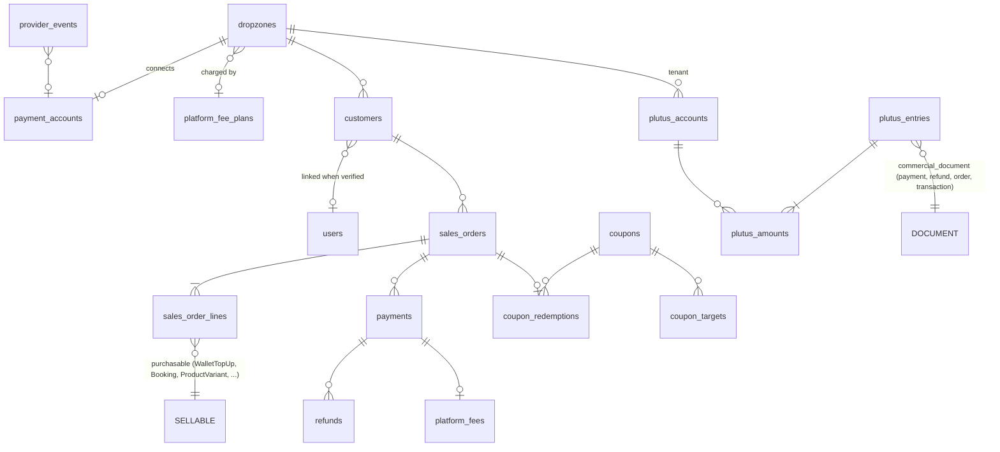

# Commerce foundation plan

Shared money, accounting and payment layer for the [booking](BOOKING_PLAN.md) and [webshop](WEBSHOP_PLAN.md) plans, and
the home of the platform's revenue: a transaction fee on purchases. Index and executor rules: [README.md](README.md).

Drafted 2026-10-11 against backend `0774b40` and client `dcc46d1`. **Status: draft.**

## 1. What this plan delivers

At the end of this plan an operator (dropzone) can connect its own Stripe account, and its members can top up their
credit wallet online by card, Apple Pay or Google Pay, on web and in the app. Every online payment carries the
OpenManifest platform fee, every money movement (online, wallet, desk) is posted to a per-operator double-entry ledger,
and the building blocks the other plans need exist: customers (including guests), sales orders with lines, checkout,
payments, refunds, disputes and coupons.

| Owner requirement | Where |
|---|---|
| Double-entry accounting, Money gem, Plutus | §3.1, §3.2; C1.1–C1.4 |
| Transaction fee on purchases (monetisation) | §3.4; C2.2, C2.9 |
| Purchases on web and mobile with Apple Pay / Google Pay | §3.3; C2.4, C2.5 |
| Coupon codes usable for shop and bookings | §3.7; C2.7, C2.8 |
| Virtual product: credit recharge | C2.3 (first slice: free-amount top-up); packages with bonuses in WEBSHOP S3.1 |

## 2. Open decisions

Same rules as the modernisation plan: the owner writes "Decision: …, date" into the row; blocked tasks are unblocked in
the next task's PR.

| ID | Decision | Options | Recommendation | Blocks |
|---|---|---|---|---|
| CD1 | Payment provider and charge model | (a) Stripe Connect, **direct charges** on operator accounts with full Stripe Dashboard (the "Standard" equivalent: `controller.stripe_dashboard.type = full`, `fees.payer = account`, `losses.payments = stripe`), platform fee via `application_fee_amount`; (b) Stripe Connect destination charges (platform is merchant of record); (c) another platform provider (Adyen for Platforms, etc.) | (a). The operator is the merchant of record and handles its own refunds and disputes; OpenManifest never holds customer money, which keeps it out of stored-value and money-transmission regulation and makes the operator's credit wallet the operator's liability, not the platform's. Disputes on direct charges are debited from the connected account, not the platform. Confirm Stripe's current Connect pricing for this setup before launch | C2.1–C2.10 |
| CD2 | Ledger library | (a) **Plutus 0.18** behind a `Ledger` wrapper, gated by the spike C1.1; (b) `double_entry` 2.0.2 (Envato; Money-gem native, integer cents, per-account balance locking, but two-line transfers only); (c) in-house three tables | (a) as requested, with (b) as the fallback if C1.1 fails. See §3.2 for Plutus' limits and how the wrapper contains them | C1.3, C1.4 |
| CD3 | Platform fee schedule and scope | Rate shape: percentage + fixed, with optional minimum and maximum per payment. Scope: (a) **online card payments only** (collected automatically by Stripe); (b) also offline sales recorded in OpenManifest (cash/EFTPOS top-ups at the desk, balances paid on arrival), accrued in the ledger and invoiced monthly. Who pays: (i) operator absorbs it; (ii) shown to the customer as a booking/service fee line | (a) + (i) at launch, with the ledger already accruing offline fees at 0 % so (b) is a configuration change later. Write the numbers (e.g. "2.0 % + A$0.30, min A$0.50") into this row. Note the leak in (a): credits bought at the desk and spent in the system carry no fee. Passing the fee to customers (ii) needs advice on local surcharging and drip-pricing rules | C2.2 |
| CD4 | Platform fee on refunds and disputes | (a) **the fee follows the money the operator keeps**: refund it in proportion to every refund and on lost disputes; (b) keep it on customer-initiated refunds, refund it on operator-initiated ones (weather); (c) never refund it | (a). Operators cancel tandems for weather often; keeping fees on money they had to give back would be the first complaint. With direct charges the platform carries no processing cost, so (a) only gives up revenue that was never earned | C2.6 |
| CD5 | Sales tax | (a) **per-operator single tax rate** (e.g. GST 10 %), prices tax-inclusive by default, tax lines posted to the ledger, stored value (credits, gift vouchers) taxed when redeemed rather than when sold; (b) Stripe Tax; (c) no tax handling | (a), confirmed by the owner's accountant (stored-value treatment in particular). OpenManifest's own fee is a supply to the operator; whether it carries GST is the owner's accounting question, and the fee statements (C2.9) show it either way | C1.2 |
| CD6 | Selling credits and gift vouchers inside the iOS/Android apps | (a) **sell with Apple Pay / Google Pay via Stripe**, relying on App Store guideline 3.1.3(e) (goods and services consumed outside the app: credits are only redeemable for real-world services at that operator), behind a remote flag that hides top-ups in the iOS app if review rejects it; (b) web-only top-ups (app links out); (c) Apple/Google in-app purchase | (a), and ask App Review before submission. Apple has not published a ruling on credits redeemable for physical services; this is the most likely rejection point. (c) is incompatible with the business model (store commission on every top-up) | C2.5, WEBSHOP S3.1, S3.2 |

## 3. Design

### 3.1 Money and currency

- Add the `money` gem (7.1.1, 2026-07-31). Do **not** add `money-rails`: P6.23 already provides `MoneyAttributes`
  (`app/models/concerns/money_attributes.rb`, integer `*_cents` columns, atomic `add_cents!`), which stays.
- The gem defines `::Money`, which collides with the app's own value object `app/models/money.rb` (P6.23). C1.2
  removes the app class and moves its two helpers: `Money.cents_of(units)` becomes `MoneyAttributes.cents_of` (same
  BigDecimal rounding), `Money#to_s` becomes `Money#format`. `Money.rounding_mode = BigDecimal::ROUND_HALF_UP` keeps
  today's rounding.
- **One currency per operator**: `dropzones.currency` (ISO 4217, default `AUD`), immutable once the operator has a
  ledger entry or a payment. Every amount on an operator's orders, payments, coupons and ledger is in that currency;
  `Ledger.post!` rejects anything else. Multi-currency operators are out of scope.
- Tax settings on the operator per CD5: `tax_rate_bps`, `prices_include_tax`, `tax_label`, `tax_registration_number`,
  `legal_name` (for receipts). Tax per line: inclusive `tax = round(total × r / (10000 + r))`, exclusive
  `tax = round(total × r / 10000)`; rounding half-up per line.

### 3.2 Ledger (Plutus)

**Shape.** One Plutus tenant per operator (`tenant_class = "Dropzone"`) plus platform accounts with no tenant. Accounts
get a stable `key` column (unique per tenant) so code never looks accounts up by display name. All code posts through
one module, `Ledger`, which is the only place that touches Plutus:

```ruby
Ledger.post!(dropzone:, description:, document:, date: dropzone_local_date, lines: [
  [:debit,  :stripe_receivable, Money.new(11_000, "AUD")],
  [:credit, :product_revenue,   Money.new(10_000, "AUD")],
  [:credit, :tax_payable,       Money.new(1_000,  "AUD")],
])
Ledger.reverse!(entry, description:)          # corrections are new entries, never edits
Ledger.balance(dropzone, :customer_wallets, as_of: Date)   # SQL SUM, not Plutus' per-account Ruby loop
Ledger.trial_balance(dropzone)                # must be zero
```

**Chart of accounts** (created lazily per operator by `Ledger::ChartOfAccounts`):

| Key | Type | Meaning |
|---|---|---|
| `stripe_receivable` | Asset | Money held for the operator at Stripe (connected-account balance) |
| `cash` | Asset | Desk takings: cash, EFTPOS terminal, bank transfer |
| `customer_wallets` | Liability | Control account for all member credit balances. The subsidiary ledger is the existing `transactions` table and `dropzone_users.credits_cents` |
| `customer_deposits` | Liability | Paid for but not yet delivered: booking payments before the session, wallet charges for slots on loads that have not landed |
| `gift_vouchers` | Liability | Outstanding voucher balances |
| `tax_payable` | Liability | Tax collected |
| `platform_fees_payable` | Liability | Fees accrued on offline sales, invoiced by OpenManifest (CD3 b; 0 % at launch) |
| `service_revenue`, `product_revenue`, `shipping_revenue`, `cancellation_revenue` | Revenue | Jumps/bookings, shop goods, shipping charged, forfeited deposits |
| `discounts` | Revenue (contra) | Coupon discounts, so reports show gross and net |
| `platform_fees`, `payment_processing_fees`, `chargebacks`, `promotional_expense` | Expense | OpenManifest fee, Stripe fees, lost disputes, bonus credits and complimentary top-ups |
| `opening_balance_equity` | Equity | Balances that existed before the ledger (C1.4) |
| platform: `platform_fee_revenue:<CUR>`, `platform_fee_receivable:<CUR>` | Revenue / Asset | OpenManifest's own fee income, one pair per currency, no tenant |

**Posting rules** (every flow in all three plans maps to one of these; amounts illustrative, A$, tax 10 % inclusive):

| Event | Debit | Credit |
|---|---|---|
| Card payment for goods, 110.00 | `stripe_receivable` 110.00 | `product_revenue` 100.00, `tax_payable` 10.00 |
| … platform fee on it, 2.50 | `platform_fees` 2.50 | `stripe_receivable` 2.50 (and on the platform: `platform_fee_receivable` / `platform_fee_revenue`) |
| … Stripe processing fee (from the balance transaction) | `payment_processing_fees` | `stripe_receivable` |
| Coupon of 10.00 on the goods | `discounts` 10.00 | (revenue stays gross; `stripe_receivable` is 10.00 less) |
| Online wallet top-up, 100.00 (+ 10.00 bonus) | `stripe_receivable` 100.00, `promotional_expense` 10.00 | `customer_wallets` 110.00 |
| Desk top-up in cash | `cash` | `customer_wallets` |
| Member manifested (credits reserved, existing `Transactions::Purchase`) | `customer_wallets` | `customer_deposits` |
| Load landed (existing `Transactions::Confirm`) | `customer_deposits` | `service_revenue`, `tax_payable` |
| Taken off load / load cancelled (existing `Transactions::Refund`) | reversal of the purchase entry | |
| Booking deposit paid online | `stripe_receivable` | `customer_deposits` |
| Booking delivered (check-in or session end) | `customer_deposits` | `service_revenue`, `tax_payable` |
| Late cancellation, deposit forfeited | `customer_deposits` | `cancellation_revenue`, `tax_payable` |
| Gift voucher sold / redeemed | `stripe_receivable` / `gift_vouchers` | `gift_vouchers` / revenue or `customer_deposits` |
| Refund (any) | reversal of the paid amounts, proportional fee refund per CD4 | |
| Dispute lost | `chargebacks` | `stripe_receivable` |

**Invariants**, checked daily by `LedgerReconciliationJob` (C1.4) and reported as error-level activity events plus an
AppSignal error: trial balance is zero per tenant; `customer_wallets` equals `SUM(dropzone_users.credits_cents)`;
`customer_deposits` equals reserved wallet transactions plus undelivered booking payments; per payment, ledger receipts
equal `payments.amount_cents − refunded_cents`.

**Plutus limits found in its source (0.18) and how the wrapper handles them:**

| Limit | Handling |
|---|---|
| Amounts are `decimal(20,10)` units, not cents | `Ledger` converts `Money` ↔ `BigDecimal`; reads convert back with `Money.from_amount` |
| `Account#balance` sums per account; `Account.balance` loops over every account in Ruby | Reports and checks use SQL aggregates over `plutus_amounts` grouped by account |
| `Amount#account_name=` looks accounts up by name **without** tenant scope | Never post by name; always pass account records resolved by `(tenant, key)` |
| Entries accept nested attributes with `allow_destroy`; nothing makes them immutable | Initializer makes `Plutus::Entry`/`Plutus::Amount` read-only once persisted and blocks destroy; spec proves it |
| `entries.date` is a date | Operator-local date; the exact time is `created_at` |
| Release cadence: 0.17 (2020-09), 0.18 (2025-03); depends on `kaminari`; gemspec `rails > 7.0`; Ruby 4.0 untested | Spike C1.1 runs its suite on Ruby 4.0.7 / Rails 8.1.4. If it fails, CD2 falls back to `double_entry` and only `Ledger`'s internals change |

The wallet itself stays where it is (`credits_cents` updated atomically, P6.10 locks). The ledger is the book of record
and the control total; it is not on the hot path of manifesting.

### 3.3 Payments

- **Provider adapter** `PaymentProviders::Stripe` and `PaymentProviders::Fake` behind one interface (create connected
  account and onboarding link, create/cancel PaymentIntent, refund with `refund_application_fee`, fetch balance
  transaction, register payment-method domain, verify webhook). `Fake` is the default in development and test, so the
  VM, CI and the client smoke test can complete a checkout without Stripe (a development-only `simulatePayment`
  mutation drives it).
- **Connected accounts** (CD1 a): `payment_accounts` (one per operator: provider account id, `charges_enabled`,
  `payouts_enabled`, `details_submitted`, `requirements` jsonb). Onboarding through Stripe-hosted account links;
  status kept current by `account.updated`.
- **Charges**: PaymentIntents created on the operator's account (`Stripe-Account` header) with
  `application_fee_amount` and metadata `sales_order_id`, `payment_id`, `dropzone_id`; Stripe idempotency key
  `payment-<id>`. Automatic payment methods, so cards, Apple Pay and Google Pay come from one integration.
- **Truth comes from webhooks**, never from the client: one Connect webhook endpoint `POST /webhooks/stripe`
  (signature verified), every event stored once in `provider_events` (unique provider + event id) and handled by a
  Solid Queue job. Handled: `payment_intent.succeeded|payment_failed|canceled`, `charge.refunded`,
  `charge.dispute.created|closed`, `account.updated`. A recurring job re-fetches PaymentIntents stuck in `processing`
  for more than 15 minutes, covering lost webhooks.
- **Client**: native uses `@stripe/stripe-react-native` (Expo config plugin with `merchantIdentifier` and
  `enableGooglePay`; install with `npx expo install` to get the SDK 57 version, 0.64.0 per Expo's docs) and PaymentSheet,
  which includes Apple Pay and Google Pay; the provider is initialised with the operator's `stripeAccountId`. Web uses
  `@stripe/stripe-js` + `@stripe/react-stripe-js` (Payment Element and Express Checkout Element) in `.web.tsx` files,
  loaded with `{ stripeAccount }`. Neither needs Expo Go support (EAS development builds are already the workflow).
- **Apple Pay on the web** with direct charges needs the web app's domain registered for each connected account
  (payment method domains), and the domain-association file served by the web host. C2.1 registers the domain when an
  operator finishes onboarding. Google Pay in the Android app needs production access in the Google Pay & Wallet
  Console; Apple Pay needs a merchant ID and the Stripe-issued certificate. All three are owner checks.
- **PCI**: card data never reaches the API (Stripe-hosted UI elements only), which keeps OpenManifest at the lightest
  self-assessment level.

### 3.4 Platform fee (monetisation)

- `platform_fee_plans` (`percent_bps`, `fixed_cents`, `min_cents`, `max_cents`, `currency`, `applies_to_offline_bps`
  (0 at launch, CD3 b)); one default plan per currency, optional per-operator plan (`dropzones.platform_fee_plan_id`),
  editable only by platform administrators (`users.moderation_role = administrator`).
- `fee = clamp(round_half_up(amount × percent_bps / 10000) + fixed_cents, min_cents, max_cents)`, never more than the
  amount, 0 for a 0 amount. Computed when the payment is created and snapshotted on the payment and in `platform_fees`
  (plan values copied, so a plan change never rewrites history).
- Collected by Stripe as `application_fee_amount`; recorded on both ledgers (§3.2); refunded per CD4 with
  `refund_application_fee` (proportional) and on lost disputes through the application-fee refund API.

Where the fee applies:

| Money path | Fee |
|---|---|
| Online payment (top-up, shop order, booking deposit or balance, gift voucher) | Yes, automatically |
| Spending wallet credits (manifesting, shop with credits) | No (fee was taken when the credits were bought online) |
| Desk sales recorded in OpenManifest (cash top-ups, balance paid on arrival) | Accrued at `applies_to_offline_bps` (0 % at launch); invoiced monthly if CD3 b |
| Refunds, disputes | Per CD4 |

Reporting (C2.9): operators see the fees they paid per month (statement, CSV); platform administrators see fees by
operator and month, gross payment volume, refunds and disputes.

### 3.5 Customers, sales orders and checkout

New tables are named `sales_orders` / `sales_order_lines` because `orders` is the existing wallet order table (kept,
unchanged, and posted to the ledger).

- `customers`: per operator, `email` (case-insensitive unique per operator), `name`, `phone`, optional `user_id`,
  `email_verified_at`. A logged-in user gets a customer row linked to their user; a guest (booking plan) gets one by
  verified email; when a guest later signs up with that verified email, the rows are linked.
- `sales_orders`: per-operator `number` (same locking as `Order#set_order_number`), `customer_id`, `currency`,
  `state` (`pending_payment` → `paid` | `expired` | `cancelled`), `payment_state` (`unpaid`, `paid`,
  `partially_refunded`, `refunded`, `disputed`), `fulfilment_state` (`unfulfilled`, `partially_fulfilled`, `fulfilled`,
  `not_required`), totals (`subtotal`, `discount`, `shipping`, `tax`, `total`, `platform_fee`, all `*_cents`),
  `idempotency_key` (unique per operator), `expires_at`, `channel` (`web`, `app`, `desk`), address snapshot.
- `sales_order_lines`: polymorphic `purchasable`, `description`, `quantity`, `unit_price_cents`, `discount_cents`,
  `tax_cents`, `total_cents`, `fulfilled_quantity`, `refunded_quantity`, `metadata`.
- `payments` (`provider`: `stripe`, `fake`, `wallet`, `cash`, `card_terminal`, `voucher`, `none`), `refunds`,
  `platform_fees`.
- **`Sellable` contract**: anything sold implements `price_for(customer, quantity)`, `reserve!(line)` (raises
  `Commerce::SoldOut`), `release!(line)`, `on_paid!(line)`, `on_refunded!(line, quantity)`, `ledger_account(line)`
  (revenue, deposit, wallet or voucher account), `coupon_category` and `stored_value?`. This plan implements
  `WalletTopUp`; booking adds `Booking`; the webshop adds `ProductVariant`, `CreditPackage`, `GiftVoucherProduct`.
- **Checkout** (`Commerce::Checkout`): one transaction creates the order, reserves every line, applies the coupon,
  computes totals and creates the payment; outside the transaction the PaymentIntent is created and its client secret
  returned. Orders that stay unpaid past `expires_at` (30 minutes; holds in the booking plan may be shorter) are expired
  by a recurring job, which cancels the PaymentIntent and releases lines and coupon. A `payment_intent.succeeded` that
  arrives for an expired order re-reserves; if that fails, the payment is refunded in full (fee included) and the
  customer is emailed. A zero total (100 % coupon) skips the provider (`provider: none`).

### 3.6 Refunds and disputes

Full or partial refunds by line and quantity (`refundOrder`, permission `refundOrders`), with optional restock and
reason. Wallet payments refund to the wallet, card payments through Stripe, desk payments are recorded as paid out in
cash. Each refund calls `on_refunded!` on the affected lines, reverses the ledger proportionally and refunds the platform
fee per CD4. Disputes set `payment_state = disputed`, notify staff with `refundOrders`, and on `charge.dispute.closed`
post a chargeback if lost.

### 3.7 Coupons

- `coupons`: per operator, `code` (stored upper-case, unique per operator), `kind` (`percent`, `fixed_amount`,
  `free_shipping`), `value`, `min_subtotal_cents`, `starts_at`/`ends_at`, `max_redemptions`, `max_per_customer`,
  `first_order_only`, `applies_to` (`everything`, `products`, `services`, specific targets through `coupon_targets`),
  `active`.
- **Stored value is never discounted**: coupons do not apply to wallet top-ups, credit packages or gift vouchers
  (otherwise a 20 % coupon on credits is a cash machine). Bonus credits are a property of credit packages instead.
- Redemptions are reserved at checkout with a conditional update (`redemptions_count < max_redemptions`) and a row in
  `coupon_redemptions`, released when the order expires or is cancelled, kept when the order is refunded.
- The discount is allocated across eligible lines in proportion to line totals (remainder cents to the largest line)
  so tax, refunds and per-product reports stay exact. One coupon per order.

### 3.8 Permissions

Added to `config/seed/access.yml`, granted to `owner` and `admin` by default (data migration for existing roles), and
listed in the permissions screen: `managePayments` (Stripe onboarding, fee statements), `readOrders`, `refundOrders`,
`manageCoupons`, `readReports`. Platform fee plans: platform administrators only.

### 3.9 Data model



## 4. Tasks

Rules for every task in this plan: money is integer cents in the database and API (`*Cents: Int!` fields plus the
operator `currency`); every interaction that moves money posts through `Ledger` in the same database transaction;
every new mutation has a tenant-isolation spec (P1.7 style) and an authorization spec; webhook handlers are idempotent
and have a duplicate-delivery spec.

### C1.1 — Spike: Plutus and the money gem on the current stack
Status: blocked (awaiting decision CD2)
Repo: backend
Depends on: P6.27
Branch: feature/c1-1-ledger-spike
Goal: Know, before building on it, whether Plutus 0.18 and money 7.1 work on Ruby 4.0.7 / Rails 8.1.4 with tenancy.
Context: §3.2 (limits table). Plutus gemspec `rails > 7.0`, README "Rails ~> 7.0, ~> 8.0", depends on `kaminari ~> 1.2`.
Steps:
  1. On a scratch branch add `plutus` and `money`; run `bin/rails g plutus` and `bin/rails g plutus:tenancy`;
     `db:migrate` against the test database.
  2. Clone the Plutus repo at tag 0.18 into the scratchpad and run its spec suite on Ruby 4.0.7; record the result.
  3. Script (kept as `spec/spikes/plutus_spike_spec.rb` on the spike branch only): two tenants, balanced and
     unbalanced entries, account uniqueness per tenant, platform accounts with a null tenant, `BigDecimal` round-trip of
     `Money#to_d`, read-only patch for persisted entries, 10 000 entries then SQL-aggregate balance timing.
  4. Write `docs/features/spikes/c1-1-ledger.md`: what passed, what failed, timings, recommendation (keep Plutus or
     fall back to `double_entry` per CD2). Commit only that document.
Acceptance criteria (cloud VM):
  - The spike document exists with the Plutus suite result and the script output.
Acceptance criteria (owner, real device):
  - none
Out of scope: production code.
Risk / rollback: documentation only.
Size: S
Fixes: none

### C1.2 — Adopt the money gem; operator currency and tax settings
Status: blocked (awaiting decisions CD2, CD5)
Repo: both
Depends on: C1.1
Branch: feature/c1-2-money-currency
Goal: `::Money` is the money gem everywhere; each operator has an immutable-once-used currency and tax settings, shown
and formatted correctly in the client.
Context: §3.1. `app/models/money.rb` (app value object, collides with the gem), `MoneyAttributes`, call sites
(`grep -rn "Money\." app lib spec`), `Transaction#notification_message`. Client P6.23 formats with a default `AUD`.
Steps:
  1. backend: add `gem "money", "~> 7.1"`; `config/initializers/money.rb` (`rounding_mode` half-up, `locale_backend
     :currency`, no default currency); delete `app/models/money.rb`; move `cents_of` to `MoneyAttributes.cents_of`;
     add `<name>_money` readers to `MoneyAttributes` that return `Money.new(cents, currency_for_money)`.
  2. Migration: `dropzones.currency` string not null default `"AUD"` (backfill from the operator's most common valid
     `ticket_types.currency`), `tax_rate_bps` integer not null default 0, `prices_include_tax` boolean default true,
     `tax_label`, `tax_registration_number`, `legal_name`. Validation: ISO currency; currency cannot change once the
     operator has payments or ledger entries (guard written now, checked against tables added later).
  3. GraphQL: `Dropzone.currency`, `taxSettings`; `updateDropzone` accepts them (permission `updateDropzone`).
  4. client: `formatMoney(cents, currency)` uses the dropzone currency everywhere; tax fields in dropzone settings.
  5. Specs: formatting parity with the old class for AUD (`"$12.50"`, `"-$3.00"`), currency immutability, tax maths
     table (inclusive/exclusive, rounding).
Acceptance criteria (cloud VM):
  - Backend `bundle exec rspec` green, rubocop clean; client checks, `check:graphql`, web export pass.
Acceptance criteria (owner, real device):
  - none
Out of scope: ledger.
Risk / rollback: revert; the migration is additive.
Size: M
Fixes: none

### C1.3 — Ledger wrapper and chart of accounts
Status: blocked (awaiting decision CD2)
Repo: backend
Depends on: C1.2
Branch: feature/c1-3-ledger
Goal: `Ledger.post!`, `reverse!`, `balance`, `trial_balance` work per operator and for the platform, on top of the
library chosen in CD2, with immutable entries.
Context: §3.2; spike results in `docs/features/spikes/c1-1-ledger.md`.
Steps:
  1. Install the library with tenancy; migration adds `plutus_accounts.key` with a unique index on `(tenant_id, key)`
     and a partial unique index on `key` where `tenant_id IS NULL`.
  2. `app/models/ledger.rb` (module), `Ledger::ChartOfAccounts` (the table in §3.2), lazy account creation per
     operator and per platform currency; validation: one currency, debits = credits, no zero lines, accounts belong to
     the operator.
  3. Initializer: persisted entries and amounts are read-only, destroy is blocked.
  4. Specs: posting, unbalanced rejected, foreign-currency rejected, cross-tenant account rejected, reversal,
     immutability, trial balance zero, SQL balance equals library balance.
Acceptance criteria (cloud VM):
  - Backend rspec green; rubocop clean.
Acceptance criteria (owner, real device):
  - none
Out of scope: posting existing flows (C1.4).
Risk / rollback: new tables only.
Size: M
Fixes: none

### C1.4 — Post the wallet flows to the ledger and reconcile daily
Status: blocked (awaiting decision CD2)
Repo: both
Depends on: C1.3
Branch: feature/c1-4-wallet-ledger
Goal: Every existing credit movement posts a balanced entry; existing balances get opening entries; a daily job proves
the ledger and the wallets agree.
Context: §3.2 posting rules (wallet rows). `app/interactions/transactions/{purchase,confirm,refund,create_order}.rb`;
staff top-ups go through `createOrder` (client `app/forms/credits`).
Steps:
  1. Post in `Purchase` (reserve), `Confirm` (recognise revenue and tax), `Refund` (reverse), staff top-up and
     withdrawal. Staff top-ups gain `paymentMethod` (`cash` default, `card_terminal`, `bank_transfer`, `complimentary`);
     complimentary posts to `promotional_expense`. client: payment-method select in the credits form.
  2. Rake task `ledger:opening_balances` (idempotent, prints counts): per operator, wallets and reserved transactions
     against `opening_balance_equity`. Run it in a data migration too, so every environment is consistent.
  3. `LedgerReconciliationJob` daily in `config/recurring.yml`; mismatches create error-level activity events and
     report to AppSignal.
  4. Specs: each flow posts the expected lines; opening balances on the P0.5 seed make reconciliation pass; a forced
     mismatch is reported.
Acceptance criteria (cloud VM):
  - Backend rspec green; on the dev seed, `bin/rails ledger:opening_balances` then the reconciliation job report no
    mismatch; client checks pass.
Acceptance criteria (owner, real device):
  - none
Out of scope: online payments.
Risk / rollback: posting is additive; reverting leaves orphan entries that the next run's opening balance does not
duplicate (the task is idempotent by `commercial_document`).
Size: L
Fixes: none

### C2.1 — Stripe Connect onboarding and webhooks
Status: blocked (awaiting decision CD1)
Repo: both
Depends on: C1.4
Branch: feature/c2-1-stripe-connect
Goal: An operator with `managePayments` connects a Stripe account from the app; account status stays current from
webhooks; the fake provider covers development and tests.
Context: §3.3. Stripe API is not reachable from the VM (README "External services").
Steps:
  1. backend: `gem "stripe"` (latest stable 20.x); `PaymentProviders::Base`, `::Stripe`, `::Fake`; provider chosen by
     `PAYMENT_PROVIDER` (default `fake` outside production).
  2. `payment_accounts`, `provider_events` tables; mutation `startPaymentOnboarding(dropzoneId)` returns an account-link
     URL; `Dropzone.paymentAccount { chargesEnabled payoutsEnabled requirementsDue }`.
  3. `Webhooks::StripeController#create` (`POST /webhooks/stripe`, CSRF-free, signature verified with
     `STRIPE_WEBHOOK_SECRET`), stores the event, enqueues `ProcessProviderEventJob`; handler registry; `account.updated`.
     On first `charges_enabled`, register the web app's domain for Apple Pay on the connected account.
  4. Permission `managePayments` (§3.8) with the role backfill.
  5. client: Settings → Payments screen (status, "Connect Stripe" opening the link with `expo-web-browser`, refresh on
     return).
  6. Specs with WebMock and fixtures: onboarding authz and tenancy, bad signature → 400, duplicate event handled once,
     `account.updated` updates flags.
Acceptance criteria (cloud VM):
  - Backend rspec green; client checks and web export pass.
Acceptance criteria (owner, real device):
  - Owner, on staging with test-mode keys: connect a test operator account and see "charges enabled".
Out of scope: charges (C2.4).
Risk / rollback: new tables and endpoint. Revert both.
Size: L
Fixes: none

### C2.2 — Platform fee plans and calculation
Status: blocked (awaiting decision CD3)
Repo: backend
Depends on: C2.1
Branch: feature/c2-2-platform-fee
Goal: Fees are computed from versioned plans, snapshotted per payment and posted to both ledgers.
Context: §3.4; CD3 numbers.
Steps:
  1. `platform_fee_plans`, `dropzones.platform_fee_plan_id`, `platform_fees`; seed the default plan from CD3.
  2. `PlatformFees::Calculator` (formula in §3.4); administrator-only mutations to create plans and assign them.
  3. Ledger postings for fee charged and fee refunded (both ledgers).
  4. Specs: rounding table (amounts 0, 1, 99, 100, 12 345, at min, at max), plan change does not alter existing fees,
     non-administrators rejected.
Acceptance criteria (cloud VM):
  - Backend rspec green.
Acceptance criteria (owner, real device):
  - none
Out of scope: statements (C2.9).
Risk / rollback: additive.
Size: M
Fixes: none

### C2.3 — Customers, sales orders and the wallet top-up sellable
Status: blocked (awaiting decision CD1)
Repo: backend
Depends on: C2.2
Branch: feature/c2-3-sales-orders
Goal: The order model, totals, the `Sellable` contract and `WalletTopUp` exist; `createCheckout` creates an order with a
pending payment through the fake provider.
Context: §3.5.
Steps:
  1. Tables `customers`, `sales_orders`, `sales_order_lines`, `payments`; models, state machines (`state_machines`
     already in the Gemfile), `Sellable` concern, `Commerce::Totals` (tax per §3.1).
  2. `WalletTopUp` sellable: amount chosen by the member within operator limits (`settings.top_up_min_cents`,
     `top_up_max_cents`); `on_paid!` credits the wallet through the existing wallet code and posts per §3.2.
  3. `Commerce::Checkout` and mutation `createCheckout(input: {dropzoneId, lines, idempotencyKey})` (logged-in
     members); query `salesOrder(id)` (buyer or `readOrders`); subscription `salesOrderUpdated(salesOrderId)`.
  4. `ExpireSalesOrdersJob` every minute (`config/recurring.yml`).
  5. Specs: totals, idempotency (same key twice → same order; parallel requests → one order), expiry releases lines,
     tenant isolation.
Acceptance criteria (cloud VM):
  - Backend rspec green; schema dump diff additive.
Acceptance criteria (owner, real device):
  - none
Out of scope: Stripe charges (C2.4), coupons (C2.7).
Risk / rollback: additive.
Size: L
Fixes: none

### C2.4 — Charge through Stripe and confirm from webhooks
Status: blocked (awaiting decision CD1)
Repo: backend
Depends on: C2.3
Branch: feature/c2-4-payment-intents
Goal: Checkout creates a PaymentIntent on the operator's account with the platform fee; orders become paid only from
webhooks; late and lost webhooks are handled.
Context: §3.3, §3.5 (late payment rule).
Steps:
  1. `Payments::CreateIntent` (outside the checkout DB transaction, idempotency key `payment-<id>`); `createCheckout`
     returns `clientSecret`, `stripeAccountId`, `publishableKey`; checkout fails clearly when the operator's account
     cannot take charges.
  2. Handlers: `payment_intent.succeeded` (mark paid, `on_paid!`, ledger, fee record, staff/customer notification),
     `payment_failed` (record message), `canceled`; late success on an expired order → re-reserve or full refund.
  3. `Payments::RecordProcessingFeeJob` reads the balance transaction and posts the Stripe fee.
  4. `ReconcileStuckPaymentsJob` (every 15 minutes) re-fetches intents in `processing`.
  5. Development-only `simulatePayment(paymentId, outcome)` for the fake provider.
  6. Specs with fixtures: happy path, duplicate webhook, failure then retry, late success both ways, processing-fee
     posting, stuck-payment recovery.
Acceptance criteria (cloud VM):
  - Backend rspec green.
Acceptance criteria (owner, real device):
  - none (end-to-end in C2.10)
Out of scope: client UI.
Risk / rollback: revert; no data migration.
Size: L
Fixes: none

### C2.5 — Client payments and online credit top-up
Status: blocked (awaiting decisions CD1, CD6)
Repo: both
Depends on: C2.4
Branch: feature/c2-5-client-payments
Goal: Members top up credits from the app and the web with card, Apple Pay or Google Pay; the payment components are
reusable by the other plans.
Context: §3.3 (client). Client platform-file convention (`*.web.tsx`), Apollo hooks via codegen.
Steps:
  1. client: `npx expo install @stripe/stripe-react-native`; config plugin in `app.config.ts` (`merchantIdentifier`
     per environment, `enableGooglePay: true`); `@stripe/stripe-js` and `@stripe/react-stripe-js` for web.
  2. `app/components/payments/`: `PaymentProvider(.web).tsx` (keyed by `stripeAccountId`), `PayButton(.web).tsx`
     (PaymentSheet natively; Express Checkout Element + Payment Element on web), `OrderStatus` (waits for
     `salesOrderUpdated`, falls back to polling).
  3. "Top up credits" screen from the drawer balance and the profile; remote flag `topUpsInIosApp` (CD6).
  4. With the fake provider, a development "Simulate payment" button replaces the Stripe UI so the web smoke test can
     complete a top-up.
  5. Tests: top-up form validation, status transitions with mocked subscription; extend `docs/SMOKE_TEST.md` with
     "top up credits".
Acceptance criteria (cloud VM):
  - Client checks, `check:graphql`, web export, smoke test with the fake provider pass.
Acceptance criteria (owner, real device):
  - Owner, staging test mode: top up with a test card on web, with Apple Pay on an iPhone (development build), with
    Google Pay on Android; balances and the ledger agree.
Out of scope: credit packages with bonuses (WEBSHOP S3.1).
Risk / rollback: revert; feature hidden when the operator has no connected account.
Size: L
Fixes: none

### C2.6 — Refunds and disputes
Status: blocked (awaiting decision CD4)
Repo: both
Depends on: C2.5
Branch: feature/c2-6-refunds
Goal: Staff refund orders fully or partly; fees, ledger and wallet follow; disputes are tracked and posted.
Context: §3.6, CD4.
Steps:
  1. `refunds` table; `refundSalesOrder(input: {salesOrderId, lines: [{lineId, quantity}], amountCents?, reason,
     restock})` with `refundOrders`; provider refund with `refund_application_fee` per CD4; wallet refunds; ledger
     reversal; `on_refunded!`.
  2. Handlers `charge.refunded` (refunds made in the Stripe Dashboard are mirrored), `charge.dispute.created|closed`.
  3. client: refund action on the transactions screen for top-ups (shop and booking screens reuse it later).
  4. Specs: partial and full refund maths, fee refund proportional, Dashboard-initiated refund mirrored once, lost
     dispute posts a chargeback.
Acceptance criteria (cloud VM):
  - Backend rspec green; client checks pass.
Acceptance criteria (owner, real device):
  - Owner, staging test mode: refund a test top-up half, then fully; check the Stripe Dashboard shows the fee refunds.
Out of scope: return shipping (WEBSHOP S4.1).
Risk / rollback: revert.
Size: M
Fixes: none

### C2.7 — Coupons (backend)
Status: blocked (awaiting decision CD1)
Repo: backend
Depends on: C2.6
Branch: feature/c2-7-coupons
Goal: Coupons can be created, validated and redeemed in checkout with exact allocation and safe limits.
Context: §3.7.
Steps:
  1. Tables `coupons`, `coupon_targets`, `coupon_redemptions`; CRUD mutations (`manageCoupons`); `previewCoupon(code,
     lines)` for the client; `createCheckout` accepts `couponCode`.
  2. Conditional-update redemption reservation; release on expiry/cancel.
  3. Stored-value sellables (`stored_value? == true`) never discounted.
  4. Specs: each kind, date window, per-customer and total limits under 20 parallel checkouts (no over-redemption),
     allocation remainder, zero-total order paid without provider, ledger `discounts` line.
Acceptance criteria (cloud VM):
  - Backend rspec green.
Acceptance criteria (owner, real device):
  - none
Out of scope: UI (C2.8).
Risk / rollback: additive.
Size: M
Fixes: none

### C2.8 — Coupons (client)
Status: blocked (awaiting decision CD1)
Repo: client
Depends on: C2.7
Branch: feature/c2-8-coupons-client
Goal: Staff manage coupons; checkout accepts a code and shows the discount.
Context: configuration screens pattern (`app/screens/authenticated/configuration/*`, react-hook-form from P4.5).
Steps:
  1. Configuration → Coupons list and form (kind, value, window, limits, targets).
  2. Coupon field in the shared checkout summary component (`previewCoupon`).
  3. Tests: form validation; discount display.
Acceptance criteria (cloud VM):
  - Client checks, `check:graphql`, web export pass.
Acceptance criteria (owner, real device):
  - none
Out of scope: none.
Risk / rollback: revert.
Size: M
Fixes: none

### C2.9 — Platform fee statements and platform reporting
Status: blocked (awaiting decision CD3)
Repo: both
Depends on: C2.8
Branch: feature/c2-9-fee-statements
Goal: Operators see what they paid OpenManifest; platform administrators see fee revenue and payment volume.
Context: §3.4 reporting.
Steps:
  1. Queries: `dropzone.platformFeeStatement(month)` (`managePayments`): payments, fees, fee refunds, net, tax label per
     CD5; CSV download. `platformRevenue(from, to)` (administrators): per operator and currency: payment volume, fees,
     refunds, disputes, offline accruals.
  2. client: statement screen under Settings → Payments; administrator screen beside the existing admin overview
     (`app/screens/authenticated/overview/AdminOverview.tsx`).
  3. Specs: statement totals equal the platform ledger for the month (operator time zone boundaries).
Acceptance criteria (cloud VM):
  - Backend rspec green; client checks pass.
Acceptance criteria (owner, real device):
  - none
Out of scope: invoicing offline fees (only if CD3 b; add a task then).
Risk / rollback: read-only.
Size: M
Fixes: none

### C2.10 — Verify the commerce foundation
Status: blocked (awaiting decision CD1)
Repo: both
Depends on: C2.9
Branch: feature/c2-10-verify
Goal: The foundation works end to end and is documented.
Context: all of this plan.
Steps:
  1. Run every check in both repos; record results in `docs/verification/commerce-foundation.md`.
  2. Update `docs/reference/README.md` (payments row, domain model, env vars, jobs) and `diagrams.md` (ER for §3.9,
     sequence for checkout → webhook → ledger).
Acceptance criteria (cloud VM):
  - All checks exit 0.
Acceptance criteria (owner, real device):
  - Owner on staging (needs P8.4 or an equivalent public URL for webhooks): test-mode top-ups on web, iPhone and
    Android; a refund; a fee statement matching the Stripe Dashboard; App Review answer for CD6 recorded.
Out of scope: none.
Risk / rollback: none.
Size: S
Fixes: none
