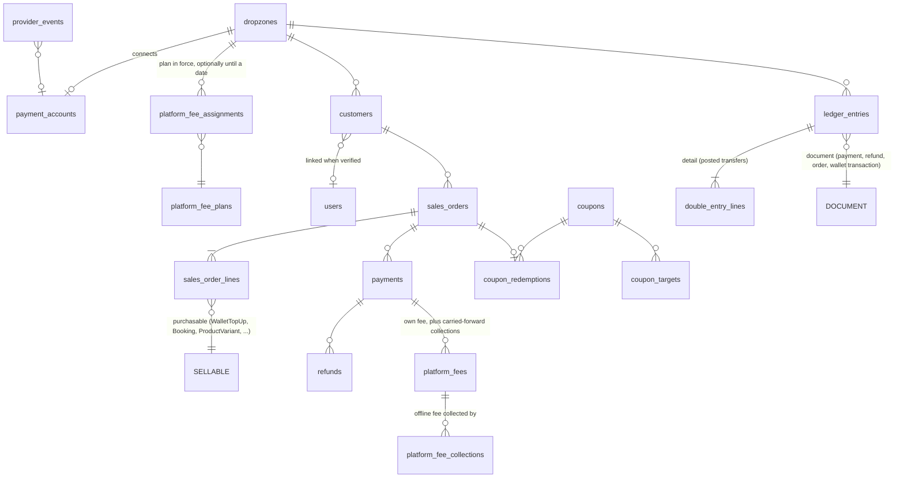

# Commerce foundation plan

Shared money, accounting and payment layer for the [booking](BOOKING_PLAN.md) and [webshop](WEBSHOP_PLAN.md) plans, and
the home of the platform's revenue: a transaction fee on purchases. Index: [README.md](README.md). Tasks and executor rules: [`../MODERNISATION_PLAN.md`](../MODERNISATION_PLAN.md).

Drafted 2026-10-11 against backend `0774b40` and client `dcc46d1`. Owner decisions recorded 2026-10-11 (§2).

## 1. What this plan delivers

At the end of this plan an operator (dropzone) can connect its own Stripe account, and its members can top up their
credit wallet online by card, Apple Pay or Google Pay, on web and in the app. Every online payment carries the
OpenManifest platform fee, offline sales recorded at the desk accrue a smaller fee that is collected automatically or
invoiced, every money movement (online, wallet, desk) is posted to a per-operator double-entry ledger, and the
building blocks the other plans need exist: customers (including guests), sales orders with lines, checkout, payments,
refunds, disputes and coupons.

| Owner requirement | Where |
|---|---|
| Double-entry accounting with the Money gem | §3.1, §3.2 (`double_entry` gem, see CD2); C1.1–C1.3 |
| Replace the app's own `Money` class with the Money gem | §3.1; C1.1 |
| Transaction fee on purchases, including offline sales (monetisation) | §3.4; C2.2, C2.9, C2.10 |
| Purchases on web and mobile with Apple Pay / Google Pay | §3.3; C2.4, C2.5 |
| Coupon codes usable for shop and bookings | §3.7; C2.7, C2.8 |
| Virtual product: credit recharge | C2.3 (first slice: free-amount top-up); packages with bonuses in WEBSHOP S3.1 |

## 2. Decisions

All decided by the owner on 2026-10-11. The options that were weighed are kept short for the record.

| ID | Decision | Decided | Notes | Tasks |
|---|---|---|---|---|
| CD1 | Payment provider and charge model | **Stripe Connect, direct charges** on operator accounts with the full Stripe Dashboard (the "Standard" equivalent: `controller.stripe_dashboard.type = full`, `fees.payer = account`, `losses.payments = stripe`); platform fee via `application_fee_amount` | The operator is the merchant of record and handles its own refunds and disputes; OpenManifest never holds customer money, so the credit wallet is the operator's liability. Rejected: destination charges (platform becomes merchant of record), other providers. **ActiveMerchant is not used**: it abstracts server-side card gateways, while this design needs Stripe-hosted payment UI confirmed on the client, Connect onboarding, application fees, webhooks and Apple Pay domain registration, none of which it covers (last release 1.137.0, 2024-08-02). A thin adapter over the official `stripe` gem (§3.3) keeps provider code in one place instead | C2.1–C2.11 |
| CD2 | Ledger library | **`double_entry` 2.0.2** (Envato), behind a `Ledger` wrapper | The owner asked for Plutus or something better. `double_entry` is tested against Ruby 4.0 and Rails 8.1 (this stack), stores integer cents through the Money gem, keeps running balances with per-account locking and only allows transfers declared in configuration. Plutus 0.18 was the alternative: no release between 2020-09 and 2025-03, untested on Ruby 4.0, decimal amounts, no locking, an unscoped account lookup by name and editable entries. There is no default Rails ledger gem. `double_entry`'s limits and how §3.2 handles them are listed there | C1.2, C1.3 |
| CD3 | Platform fee schedule and scope | **Fees are configuration, not code.** Platform administrators manage fee plans and assign them per operator, optionally until a date; **zero-fee operation is fully supported** (a free plan, or no plan at all). Starting configuration: default AUD plan online 1.5 % + A$0.30 (minimum A$0.50), offline 1 %, no fixed part; plus a "Free" plan for operators the owner chooses. **The operator absorbs the fee** (customers see the operator's price only) | Offline means cash/EFTPOS/bank-transfer top-ups at the desk, booking balances paid on arrival, desk shop sales. Complimentary credits and wallet spends carry no fee; complimentary top-ups are listed on the fee statement. A deployment or currency with no plan charges no fee (a self-hosted OpenManifest needs no fee setup), and the platform revenue report lists operators without a plan so it is never an accident | C2.2, C2.9, C2.10 |
| CD4 | Platform fee on refunds and disputes | **Refunded in proportion to every refund and on lost disputes**: the fee follows the money the operator keeps | Applies to offline fees too (a desk refund reduces the accrued fee) | C2.6 |
| CD5 | Sales tax | **One tax rate per operator, prices tax-inclusive by default**, tax lines in the ledger and on receipts; credits and gift vouchers taxed when redeemed, not when sold | The owner's accountant confirms the stored-value treatment and whether OpenManifest's own fee carries GST; fee statements (C2.9) show a tax line either way | C1.1, C2.9 |
| CD6 | Selling credits and gift vouchers in the iOS/Android apps | **Sell in-app with Apple Pay / Google Pay via Stripe**, under App Store guideline 3.1.3(e) (credits only spendable on real-world services at that operator), with a remote switch that hides top-ups in the iOS app if review rejects it | Ask App Review before the first submission that includes top-ups (owner check in C2.11) | C2.5, WEBSHOP S3.1, S3.2 |
| CD7 | Collecting offline fees (Standard accounts cannot be debited by the platform) | **Carry forward, invoice the rest**: owed offline fees are added to the application fee of the operator's next online payments (capped per payment, §3.4); whatever is still owed at month end is invoiced through Stripe Billing on the platform account | Rejected: invoice only (more invoices, slower cash); carry forward only (operators with few online payments never pay) | C2.10 |

## 3. Design

### 3.1 Money and currency

- Add the `money` gem (7.1.1, 2026-07-31) and **delete the app's own value object** `app/models/money.rb` (P6.23); the
  gem's `::Money` replaces it everywhere. Do not add `money-rails`: P6.23's `MoneyAttributes`
  (`app/models/concerns/money_attributes.rb`, integer `*_cents` columns, atomic `add_cents!`) already maps columns and
  stays.
- The two helpers the app class had move: `Money.cents_of(units)` becomes `MoneyAttributes.cents_of` (same BigDecimal
  rounding) and `Money#to_s` call sites use `Money#format`. `Money.rounding_mode = BigDecimal::ROUND_HALF_UP` keeps
  today's rounding.
- **One currency per operator**: `dropzones.currency` (ISO 4217, default `AUD`), immutable once the operator has a
  ledger entry or a payment. Every amount on an operator's orders, payments, coupons and ledger is in that currency;
  `Ledger` rejects anything else. Multi-currency operators are out of scope.
- Tax settings on the operator (CD5): `tax_rate_bps`, `prices_include_tax`, `tax_label`, `tax_registration_number`,
  `legal_name` (for receipts). Tax per line: inclusive `tax = round(total × r / (10000 + r))`, exclusive
  `tax = round(total × r / 10000)`; rounding half-up per line.

### 3.2 Ledger (`double_entry`)

**How `double_entry` works.** Accounts are declared in an initializer by identifier, with a scope (here: the operator)
and a currency. Money moves only by `DoubleEntry.transfer(amount, from:, to:, code:, detail:, metadata:)`, and only for
`(from, to, code)` combinations declared in the same initializer. Each transfer writes two lines with running
balances (integer cents) and updates a cached balance per account; `DoubleEntry.lock_accounts(...)` locks the accounts
for multi-transfer operations. `DoubleEntry::Validation::LineCheck` re-verifies running balances.

**Sign convention.** A transfer from A to B decreases A and increases B. The ledger treats an increase as a debit and a
decrease as a credit, so "debit X, credit Y" is a transfer from Y to X. Asset and expense accounts carry positive
balances, liability, equity and revenue accounts negative ones (reports negate them for display), and the sum of all
balances is zero by construction.

**Journal entries and the outbox.** `lock_accounts` must be the **outermost** database transaction, but the wallet code
already runs inside transactions (manifesting composes `Transactions::Purchase` inside `Manifest::CreateSlot`, with the
P6.10 locks). So business code never calls `double_entry` directly:

1. Inside the business transaction, `Ledger.record!(dropzone:, description:, document:, lines:)` validates the lines
   (one currency, debits = credits, accounts known, no zero lines) and inserts one `ledger_entries` row
   (`dropzone_id`, `description`, polymorphic `document`, `occurred_on` in the operator's time zone, `lines` jsonb,
   `posted_at` null). Either the business change and its entry both commit, or neither does.
2. After commit, `PostLedgerEntryJob` (enqueued by `after_commit`, plus a sweep every minute for anything missed) posts
   the entry: inside `DoubleEntry.lock_accounts` for all its accounts it re-checks `posted_at`, splits the lines into
   transfers (largest debit against largest credit, deterministic) with `detail: ledger_entry`, and sets `posted_at`.
   Posting is idempotent.
3. Corrections are new entries (`Ledger.reverse!(entry)`); `ledger_entries` and `double_entry_lines` are never updated
   or deleted (a DB trigger rejects `UPDATE`/`DELETE` on both, except the single `posted_at` write).

Balances (`Ledger.balance(dropzone, :customer_wallets, as_of:)`) read `double_entry`; reports first assert there are no
unposted entries older than five minutes.

**Chart of accounts** (`Ledger::ChartOfAccounts`; the initializer declares every key once per supported currency, e.g.
`customer_wallets_aud`, scoped by operator):

| Key | Type | Meaning |
|---|---|---|
| `stripe_receivable` | Asset | Money held for the operator at Stripe (connected-account balance) |
| `cash` | Asset | Desk takings: cash, EFTPOS terminal, bank transfer |
| `customer_wallets` | Liability | Control account for all member credit balances. The subsidiary ledger is the existing `transactions` table and `dropzone_users.credits_cents` |
| `customer_deposits` | Liability | Paid for but not yet delivered: booking payments before the session, wallet charges for slots on loads that have not landed |
| `gift_vouchers` | Liability | Outstanding voucher balances |
| `tax_payable` | Liability | Tax collected |
| `platform_fees_payable` | Liability | Offline fees owed to OpenManifest, not yet collected (CD7) |
| `service_revenue`, `product_revenue`, `shipping_revenue`, `cancellation_revenue` | Revenue | Jumps/bookings, shop goods, shipping charged, forfeited deposits |
| `discounts` | Revenue (contra) | Coupon discounts, so reports show gross and net |
| `platform_fees`, `payment_processing_fees`, `chargebacks`, `promotional_expense` | Expense | OpenManifest fee, Stripe fees, lost disputes, bonus credits and complimentary top-ups |
| `opening_balance_equity` | Equity | Balances that existed before the ledger (C1.3) |
| `platform_fee_revenue`, `platform_fee_receivable` | Revenue / Asset | OpenManifest's own books: fee income and offline fees owed to it. Also scoped by operator (an unscoped account would make every payment on the platform wait for one lock); platform reports sum across scopes |

**Posting rules** (every flow in all three plans maps to one of these; each row is also a declared transfer code;
amounts illustrative, A$, tax 10 % inclusive, fee 1.5 % + 0.30):

| Event | Debit | Credit |
|---|---|---|
| Card payment for goods, 110.00 | `stripe_receivable` 110.00 | `product_revenue` 100.00, `tax_payable` 10.00 |
| … platform fee on it, 1.95 | `platform_fees` 1.95 | `stripe_receivable` 1.95 (platform side: `platform_fee_receivable` / `platform_fee_revenue`, settled at once because Stripe collected it) |
| … Stripe processing fee (from the balance transaction) | `payment_processing_fees` | `stripe_receivable` |
| Coupon of 10.00 on goods | `discounts` 10.00 | (revenue is credited gross, the receivable is 10.00 lower) |
| Online wallet top-up, 100.00 (+ 10.00 bonus) | `stripe_receivable` 100.00, `promotional_expense` 10.00 | `customer_wallets` 110.00 |
| Desk top-up in cash, 100.00 | `cash` 100.00 | `customer_wallets` 100.00 |
| … offline fee on it (1 %), 1.00 | `platform_fees` 1.00 | `platform_fees_payable` 1.00 (platform side: `platform_fee_receivable` / `platform_fee_revenue`) |
| Offline fee collected through a later application fee or invoice | `platform_fees_payable` | `stripe_receivable` (application fee) or `cash` (invoice paid) |
| Member manifested (credits reserved, existing `Transactions::Purchase`) | `customer_wallets` | `customer_deposits` |
| Load landed (existing `Transactions::Confirm`) | `customer_deposits` | `service_revenue`, `tax_payable` |
| Taken off load / load cancelled (existing `Transactions::Refund`) | reversal of the purchase entry | |
| Booking payment online | `stripe_receivable` | `customer_deposits` |
| Booking delivered (check-in or session end) | `customer_deposits` | `service_revenue`, `tax_payable` |
| Late cancellation, deposit forfeited | `customer_deposits` | `cancellation_revenue`, `tax_payable` |
| Gift voucher sold / redeemed | `stripe_receivable` / `gift_vouchers` | `gift_vouchers` / revenue or `customer_deposits` |
| Refund (any) | reversal of the refunded share, including the proportional fee (CD4) | |
| Dispute lost | `chargebacks` | `stripe_receivable` |

**Invariants**, checked daily by `LedgerReconciliationJob` (C1.3) and reported as error-level activity events plus an
AppSignal error: `DoubleEntry::Validation::LineCheck` finds no errors; no entry has stayed unposted for more than an
hour; `customer_wallets` equals `SUM(dropzone_users.credits_cents)` per operator; `customer_deposits` equals reserved
wallet transactions plus undelivered booking payments; per payment, ledger receipts equal
`payments.amount_cents − refunded_cents`; `platform_fees_payable` equals uncollected offline fees.

**`double_entry` limits and how the wrapper handles them:**

| Limit | Handling |
|---|---|
| `lock_accounts` must be the outermost transaction | Outbox (`ledger_entries` + `PostLedgerEntryJob`) above. Specs set `DoubleEntry::Locking.configuration.running_inside_transactional_fixtures = true` |
| Transfers have exactly two sides | `ledger_entries` is the multi-line journal entry; its transfers share `detail` |
| Currency is fixed per account identifier, not per scope | One identifier per key and supported currency (`SUPPORTED_CURRENCIES`, `AUD` at launch); the wrapper maps `(key, dropzone.currency)` to it |
| No account types | `Ledger::ChartOfAccounts` holds type and normal side for reports (trial balance, profit and loss) |
| Unscoped accounts contend for one lock | Every account, platform ones included, is scoped by operator |
| Only declared transfers are allowed | Transfer codes are generated from the posting-rule table, which doubles as a safety net: an undeclared money movement raises |

The wallet stays where it is (`credits_cents` updated atomically, P6.10 locks). The ledger is the book of record and
the control total; it is not on the hot path of manifesting.

### 3.3 Payments

- **Provider adapter** `PaymentProviders::Stripe` and `PaymentProviders::Fake` behind one interface (create connected
  account and onboarding link, create/cancel PaymentIntent, refund with `refund_application_fee`, refund an
  application fee, fetch balance transaction, register payment-method domain, create platform invoice, verify webhook),
  built on the official `stripe` gem. `Fake` is the default in development and test, so the VM, CI and the client
  smoke test can complete a checkout without Stripe (a development-only `simulatePayment` mutation drives it).
- **Connected accounts** (CD1): `payment_accounts` (one per operator: provider account id, `charges_enabled`,
  `payouts_enabled`, `details_submitted`, `requirements` jsonb, `billing_customer_id` for platform invoices (CD7)).
  Onboarding through Stripe-hosted account links; status kept current by `account.updated`.
- **Charges**: PaymentIntents created on the operator's account (`Stripe-Account` header) with
  `application_fee_amount` and metadata `sales_order_id`, `payment_id`, `dropzone_id`; Stripe idempotency key
  `payment-<id>`. Automatic payment methods, so cards, Apple Pay and Google Pay come from one integration.
- **Truth comes from webhooks**, never from the client: one Connect webhook endpoint `POST /webhooks/stripe`
  (signature verified), every event stored once in `provider_events` (unique provider + event id) and handled by a
  Solid Queue job. Handled: `payment_intent.succeeded|payment_failed|canceled`, `charge.refunded`,
  `charge.dispute.created|closed`, `account.updated`, and for platform invoices `invoice.paid|payment_failed`. A
  recurring job re-fetches PaymentIntents stuck in `processing` for more than 15 minutes, covering lost webhooks.
- **Client**: native uses `@stripe/stripe-react-native` (Expo config plugin with `merchantIdentifier` and
  `enableGooglePay`; install with `npx expo install` to get the SDK 57 version, 0.64.0 per Expo's docs) and PaymentSheet,
  which includes Apple Pay and Google Pay; the provider is initialised with the operator's `stripeAccountId`. Web uses
  `@stripe/stripe-js` + `@stripe/react-stripe-js` (Payment Element and Express Checkout Element) in `.web.tsx` files,
  loaded with `{ stripeAccount }`. Neither needs Expo Go support (EAS development builds are already the workflow).
- **Apple Pay on the web** with direct charges needs the web app's domain registered for each connected account
  (payment method domains), and the domain-association file served by the web host. C2.1 registers the domain when an
  operator finishes onboarding. Google Pay in the Android app needs production access in the Google Pay & Wallet
  Console; Apple Pay needs a merchant ID and the Stripe-issued certificate. All three are owner checks.
- **PCI**: card data never reaches the API (Stripe-hosted UI elements only), which keeps OpenManifest at the lightest
  self-assessment level.

### 3.4 Platform fee (monetisation)

- **Plans are data.** `platform_fee_plans` (`name`, `currency`, online `percent_bps`, `fixed_cents`, `min_cents`,
  optional `max_cents`, offline `offline_percent_bps`, `carry_forward_cap_bps`, `is_default`, `archived_at`). Every
  field may be 0. Managed only by platform administrators (`users.moderation_role = administrator`) from an admin
  screen; plans in use are never edited in place: an edit creates a new plan version and moves the assignments, so
  history keeps the terms that applied.
- **Assignment per operator**: `platform_fee_assignments` (`dropzone_id`, `platform_fee_plan_id`, `starts_at`,
  optional `ends_at`, `reason`, `created_by`). The plan in force for a payment is the operator's assignment covering
  the payment time, else the default plan for the operator's currency, else **none, which means no fee**. That gives:
  - **free operators**: assign the "Free" plan (all zeros), permanently or until a date ("free for the first 6 months"
    reverts to the default automatically when `ends_at` passes);
  - **special rates**: any other plan per operator;
  - **a fee-free deployment**: no default plan at all (self-hosting, or the platform choosing to charge nothing).
  Every assignment change writes an activity event and notifies the operator's `managePayments` holders.
- Seeded: "Standard AUD" (default; 150 bps + 30 cents, minimum 50 cents, no maximum, offline 100 bps, carry-forward
  cap 500 bps) and "Free" (all zeros), per CD3.
- **A zero fee does nothing**: no `application_fee_amount` is sent to Stripe, no `platform_fees` row, no ledger
  entry, nothing accrues offline, so carry-forward and invoices (below) have nothing to collect. The operator's
  Payments screen shows the plan in force (e.g. "Free until 2027-04-30").
- Online: `fee = max(min_cents, round_half_up(amount × percent_bps / 10000) + fixed_cents)`, capped at `max_cents` when
  set, never more than the amount, 0 for a 0 amount. Offline: `round_half_up(amount × offline_percent_bps / 10000)`.
  Computed when the payment is recorded and snapshotted on the payment and in `platform_fees` (`kind`: `online`,
  `offline`; plan id and values copied, so a plan or assignment change never rewrites history).
- **Online fees** are collected by Stripe as `application_fee_amount`. **Offline fees** accrue in
  `platform_fees_payable` (CD7) and are collected two ways:
  1. **Carry forward**: each new online payment's application fee is its own fee plus as much owed offline fee as fits
     under `carry_forward_cap_bps` of that payment (5 %: a A$400 booking can collect at most A$20 of backlog). The
     collected part is recorded in `platform_fee_collections` against the oldest owed fees first.
  2. **Monthly invoice**: after each month ends (operator time zone), for each operator still owing for it or earlier
     months, a Stripe Billing invoice on
     the platform account (the operator is a billing customer, `billing_customer_id`), itemised by month, with the tax
     line per CD5. `invoice.paid` settles the owed fees; unpaid invoices show on the operator's Payments screen and in
     platform reporting.
- Refunds (CD4): online fees through `refund_application_fee` (proportional) and the application-fee refund API on lost
  disputes; offline fees by reducing the accrual (or crediting the next invoice if already collected). Carried-forward
  amounts are never refunded with the payment that carried them, only with the offline sale they belong to.

Where the fee applies:

| Money path | Fee |
|---|---|
| Online payment (top-up, shop order, booking deposit or balance, gift voucher) | 1.5 % + A$0.30 (min A$0.50), collected by Stripe |
| Offline sale recorded in OpenManifest (desk top-up, balance paid on arrival, desk shop sale) | 1 %, accrued, collected by carry-forward or monthly invoice |
| Complimentary credits | None; listed on the statement |
| Spending wallet credits (manifesting, shop with credits) | None (the fee was taken when the credits were bought) |
| Refunds, lost disputes | Fee refunded proportionally (CD4) |

Reporting (C2.9): operators see a monthly statement (online fees, offline fees accrued, collected by carry-forward,
invoiced, refunded, complimentary credits given, net); platform administrators see fees by operator and month, payment
volume, offline volume, outstanding offline fees, refunds and disputes.

### 3.5 Customers, sales orders and checkout

New tables are named `sales_orders` / `sales_order_lines` because `orders` is the existing wallet order table (kept,
unchanged, and posted to the ledger).

- `customers`: per operator, `email` (case-insensitive unique per operator), `name`, `phone`, optional `user_id`,
  `email_verified_at`. A logged-in user gets a customer row linked to their user; a guest (booking plan) gets one by
  verified email; when a guest later signs up with that verified email, the rows are linked.
- `sales_orders`: per-operator `number` (same locking as `Order#set_order_number`), `customer_id`, `currency`,
  `state` (`pending_payment` → `paid` | `expired` | `cancelled`), `payment_state` (`unpaid`, `paid`,
  `partially_refunded`, `refunded`, `disputed`), `fulfilment_state` (`unfulfilled`, `partially_fulfilled`, `fulfilled`,
  `not_required`), totals (`subtotal`, `discount`, `shipping`, `tax`, `total`, `platform_fee`, all `*_cents`),
  `idempotency_key` (unique per operator), `expires_at`, `channel` (`web`, `app`, `desk`), address snapshot.
- `sales_order_lines`: polymorphic `purchasable`, `description`, `quantity`, `unit_price_cents`, `discount_cents`,
  `tax_cents`, `total_cents`, `fulfilled_quantity`, `refunded_quantity`, `metadata`.
- `payments` (`provider`: `stripe`, `fake`, `wallet`, `cash`, `card_terminal`, `bank_transfer`, `voucher`, `none`;
  the desk providers are the offline ones), `refunds`, `platform_fees`, `platform_fee_collections`.
- **`Sellable` contract**: anything sold implements `price_for(customer, quantity)`, `reserve!(line)` (raises
  `Commerce::SoldOut`), `release!(line)`, `on_paid!(line)`, `on_refunded!(line, quantity)`, `ledger_account(line)`
  (revenue, deposit, wallet or voucher account), `coupon_category` and `stored_value?`. This plan implements
  `WalletTopUp`; booking adds `Booking`; the webshop adds `ProductVariant`, `CreditPackage`, `GiftVoucherProduct`.
- **Checkout** (`Commerce::Checkout`): one transaction creates the order, reserves every line, applies the coupon,
  computes totals and creates the payment; outside the transaction the PaymentIntent is created and its client secret
  returned. Orders that stay unpaid past `expires_at` (30 minutes; holds in the booking plan may be shorter) are expired
  by a recurring job, which cancels the PaymentIntent and releases lines and coupon. A `payment_intent.succeeded` that
  arrives for an expired order re-reserves; if that fails, the payment is refunded in full (fee included) and the
  customer is emailed. A zero total (100 % coupon) skips the provider (`provider: none`).
- **Desk payments** (`recordDeskPayment`, staff): settle an order or a booking balance with `cash`, `card_terminal` or
  `bank_transfer`; post to `cash` and accrue the offline fee.

### 3.6 Refunds and disputes

Full or partial refunds by line and quantity (`refundSalesOrder`, permission `refundOrders`), with optional restock and
reason. Wallet payments refund to the wallet, card payments through Stripe, desk payments are recorded as paid out in
cash. Each refund calls `on_refunded!` on the affected lines, reverses the ledger proportionally and refunds the platform
fee proportionally (CD4). Disputes set `payment_state = disputed`, notify staff with `refundOrders`, and on
`charge.dispute.closed` post a chargeback and refund the fee if lost.

### 3.7 Coupons

- `coupons`: per operator, `code` (stored upper-case, unique per operator), `kind` (`percent`, `fixed_amount`,
  `free_shipping`), `value`, `min_subtotal_cents`, `starts_at`/`ends_at`, `max_redemptions`, `max_per_customer`,
  `first_order_only`, `applies_to` (`everything`, `products`, `services`, specific targets through `coupon_targets`),
  `active`.
- **Stored value is never discounted**: coupons do not apply to wallet top-ups, credit packages or gift vouchers
  (otherwise a 20 % coupon on credits is a cash machine). Bonus credits are a property of credit packages instead.
- Redemptions are reserved at checkout with a conditional update (`redemptions_count < max_redemptions`) and a row in
  `coupon_redemptions`, released when the order expires or is cancelled, kept when the order is refunded.
- The discount is allocated across eligible lines in proportion to line totals (remainder cents to the largest line)
  so tax, refunds and per-product reports stay exact. One coupon per order.

### 3.8 Permissions

Added to `config/seed/access.yml`, granted to `owner` and `admin` by default (data migration for existing roles), and
listed in the permissions screen: `managePayments` (Stripe onboarding, fee statements, platform invoices),
`readOrders`, `refundOrders`, `recordDeskPayments`, `manageCoupons`, `readReports`. `manifest` role defaults:
`readOrders`, `recordDeskPayments`. Platform fee plans: platform administrators only.

### 3.9 Data model

## 4. Tasks

The tasks (C1.1–C2.11) are Phase C of the plan, [`../MODERNISATION_PLAN.md`](../MODERNISATION_PLAN.md), where their status
is tracked and the Execution order places them. They use the renamed code (GENERALISATION §3: `Operator`,
`Membership`, `Vehicle`, `Guest`); this design's prose predates the rename and reads through that map.
