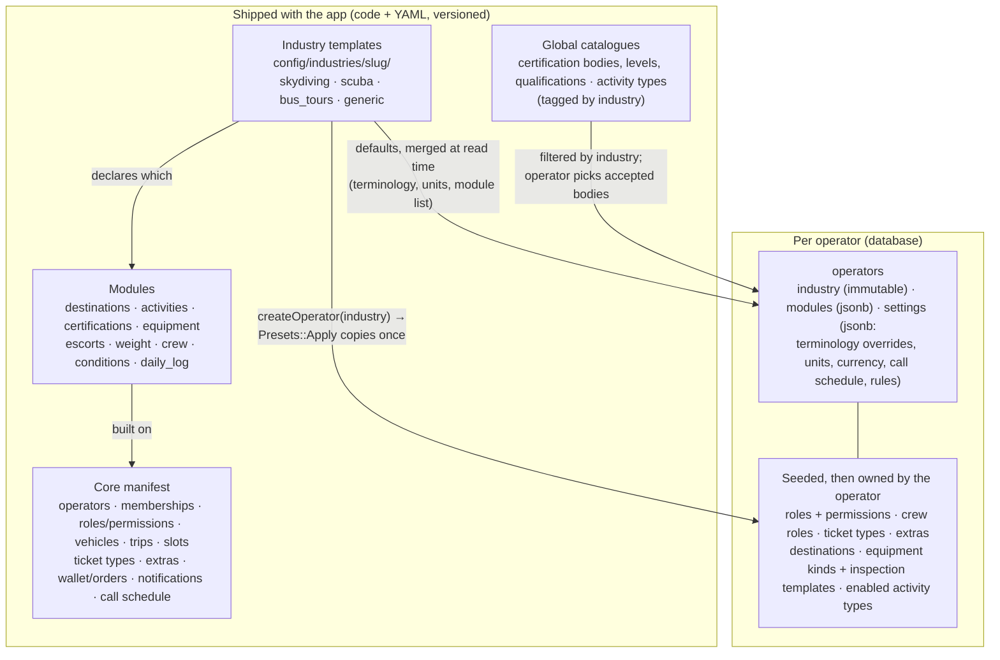
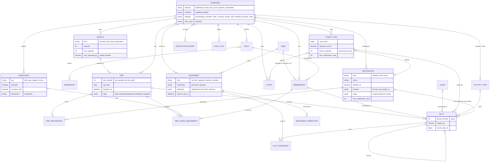
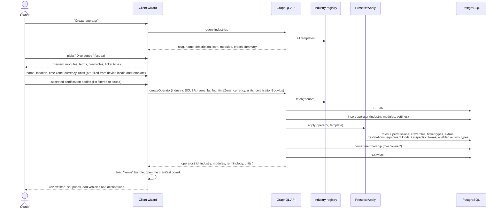
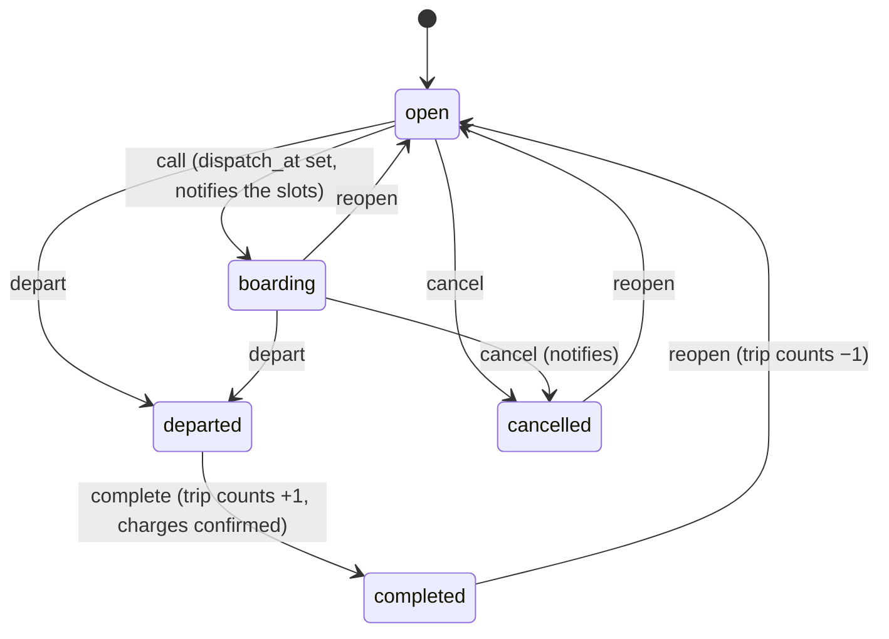
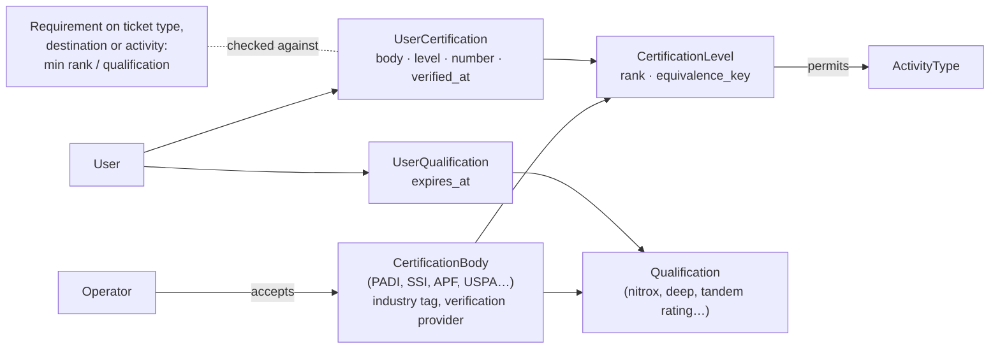
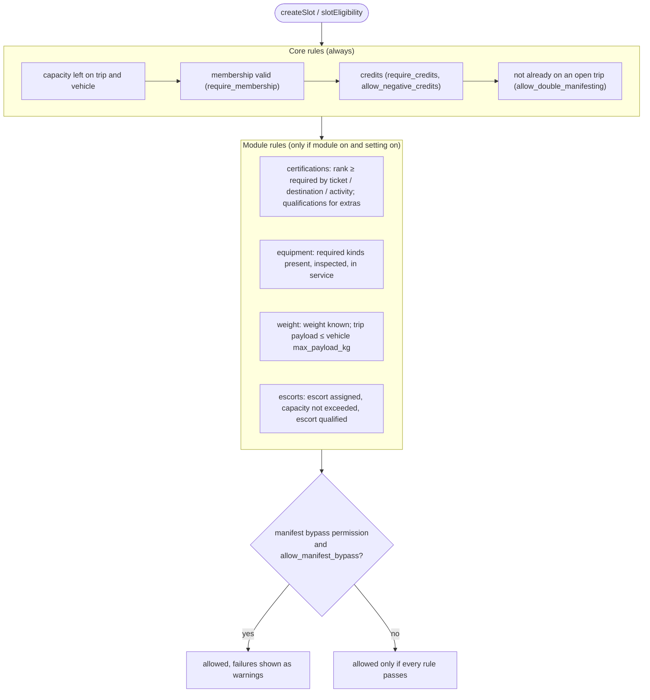
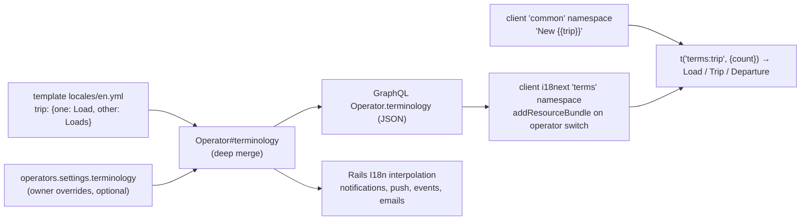
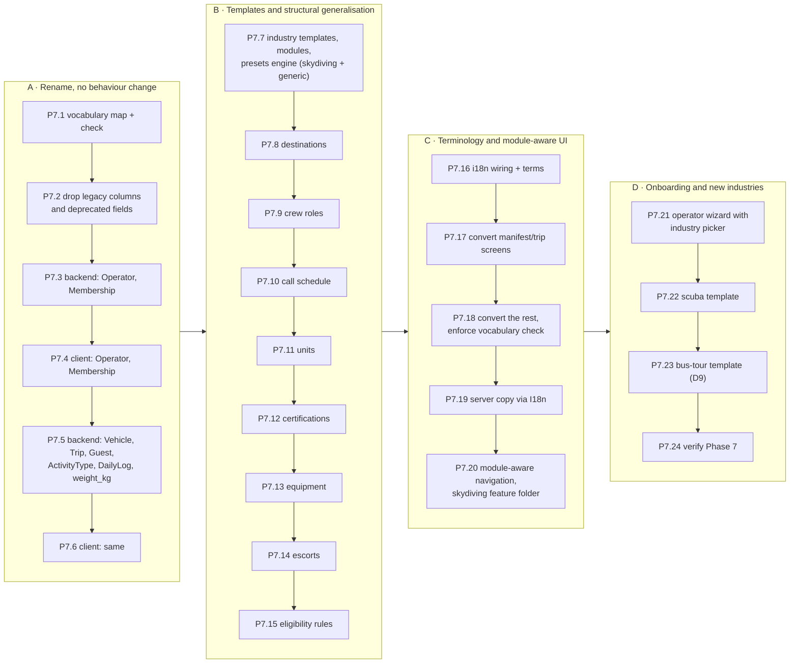

# Generalisation design: from "skydiving dropzone" to "manifesting people onto vehicles"

OpenManifest was built for skydiving dropzones. It will serve any business that **manifests people onto a vehicle that
departs at a set time for a destination, with crew on board and rules about who may go**: skydiving dropzones, dive
centres sending boats to dive sites, tour companies sending buses on routes, and the related industries listed in §1.

This document is the design. The executable tasks are Phase 7 of [`../MODERNISATION_PLAN.md`](../MODERNISATION_PLAN.md).
Appendix A keeps the inventory of every skydiving-specific concept in both repos (pass 1, backend `b8dc33a`, client
`3112795`); the rest was rewritten on 2026-10-11 against backend `6314faa` and client `dcc46d1` (Phases 0–6 merged).

Contents: [0 Summary](#0-summary) · [1 Target industries](#1-target-industries) ·
[2 Architecture](#2-architecture-core-modules-industry-templates-presets) · [3 Vocabulary](#3-vocabulary-the-rename-map) ·
[4 Domain model](#4-generic-domain-model) · [5 Industry templates](#5-industry-templates) ·
[6 Creating an operator](#6-creating-an-operator) · [7 Trips](#7-trips-lifecycle-calls-crew-destinations) ·
[8 Certifications](#8-certifications) · [9 Equipment](#9-equipment) · [10 Escorts](#10-escorts-tandem-try-dive-guided-guests) ·
[11 Eligibility](#11-eligibility) · [12 Units](#12-units) · [13 Terminology](#13-terminology) ·
[14 Client](#14-client-module-aware-ui) · [15 Roadmap](#15-roadmap) · [16 Not in this phase](#16-not-in-this-phase) ·
[Appendix A](#appendix-a-inventory-of-skydiving-specific-concepts-pass-1)

## 0. Summary

| Question | Answer |
|---|---|
| Rename or alias? | **Rename now** (decision D5 = A). There is no production data and no released client, so there is nothing to stay compatible with. Renaming before the first release (Phase 8) is the cheapest it will ever be. No deprecated mirrors, no backfills, no dual columns. |
| How is an operator configured for its use case? | The operator picks an **industry template** at creation (`skydiving`, `scuba`, `bus_tours`, `generic`). The template (a) switches on **modules** (certifications, equipment, crew, destinations, …) and (b) supplies **presets** that are copied into the operator's own tables (roles, crew roles, ticket types, destinations, equipment kinds, …), which the operator then edits freely. |
| Where do industry differences live? | In YAML templates under `config/industries/<slug>/` and in modules. Code never branches on the industry slug; it asks `operator.module?(:equipment)` or reads operator settings. A CI check enforces this. |
| What ships first? | Skydiving (today's behaviour, now expressed as a template), scuba diving (closest second; proves the abstraction) and a generic template. Bus tours follow once decision D9 settles its scope (routes, booking ahead, pickups). |
| Order of work | (A) mechanical rename with no behaviour change → (B) template/module engine and the structural generalisations → (C) terminology and module-aware UI → (D) onboarding wizard and the scuba and bus-tour templates. |

## 1. Target industries

The common shape: a **vehicle** with a **capacity** departs at a **time** for a **destination**; **participants** are
manifested into slots; **crew** are assigned per trip; some participants need **certifications** or **equipment** or must
be **escorted**; the operator charges **tickets** and **extras**; departure **calls** go out before the trip.

| Industry | Vehicle | Destination | Crew | Certifications | Equipment | Escort | Weight matters | Fit |
|---|---|---|---|---|---|---|---|---|
| Skydiving | aircraft | altitude (per participant) | pilot, ground control (GCA), load master | APF, USPA, BPA, … licences | rig (personal or rental), inspection, reserve repack | tandem (1:1, seat) | yes (weight & balance, wing loading) | native |
| Scuba diving | boat | dive site(s), ordered (two-tank trip) | skipper, dive supervisor, divemaster | PADI, SSI, NAUI, CMAS, RAID, SDI/TDI, BSAC levels and specialties (e.g. nitrox) | rental BCD, regulator, wetsuit, cylinder; service dates | try-dive / student with instructor (1:n) | optional | very high |
| Snorkel and reef day trips | boat | reef / site | skipper, guide | none | rental mask/fins/stinger suit | children with adult | no | high (scuba template with modules off) |
| Bus and coach tours | bus | route with stops | driver, guide | none | none | children with adult | no | medium: needs booking ahead and pickups (D9) |
| Helicopter scenic flights | helicopter | route / landing site | pilot, ground crew | none | none | none | **yes** (seat assignment by weight) | very high |
| Hot-air balloon flights | balloon | launch site → landing (unknown) | pilot, chase crew | none | none | children with adult | **yes** (basket load) | high |
| Tandem paragliding / hang gliding | wing (one per pilot) + shuttle | launch site | tandem pilot, driver | pilot ratings (staff only) | harness, wing inspection | tandem 1:1 | yes | high (skydiving-like) |
| Gliding clubs | glider + tug/winch | airfield / task | tug pilot, instructor, launch point controller | national gliding licences | glider maintenance | instructional flight 1:1 | yes | high (club model like skydiving) |
| Heli-skiing / cat-skiing | helicopter / snowcat | run / zone | pilot, lead guide, tail guide | avalanche courses (AST, AIARE) | transceiver, airbag pack check | guide ratio per group | yes | high |
| Whitewater rafting | raft (+ shuttle bus) | river section (grade) | raft guide, safety kayaker, driver | river grade experience | PFD, helmet, wetsuit | guide per raft | yes (raft load) | high |
| Whale watching / fishing charters / water taxis | boat | route / grounds / island | skipper, deckhand | fishing licence (charters) | rods (charters) | children with adult | no | high |
| Parasailing | boat + parasail | — | captain, winch operator | none | harness check | tandem/triple flights | **yes** | high |
| Safari game drives | 4×4 | drive sector | ranger, tracker | none | none | children with adult | no | medium |
| Zipline / canopy tours | — (course) | course | guides | none | harness check | guide ratio | yes (limits) | medium (no vehicle; capacity is a group) |

Three archetypes cover the list, and the modules in §2 follow them: **aviation-like** (weight, pilot, regulated crew:
skydiving, helicopter, balloon, gliding, parasailing), **marine** (boat, skipper, passenger lists, sea conditions: scuba,
snorkel, charters, water taxis), **ground** (bus/4×4, driver, guide, route stops: tours, safari, rafting shuttles).
Guided-adventure businesses (heli-skiing, rafting) mix them and mostly need **escort ratios** and **certifications**.

## 2. Architecture: core, modules, industry templates, presets



Rules:

1. **Template = defaults + presets, never live behaviour.** Things an operator must be able to edit (roles, ticket types,
   crew roles, destinations, equipment kinds, inspection forms) are **copied** into the operator's tables when it is created.
   Changing a template later does not change existing operators. Things that are pure presentation or defaults
   (terminology, units, module list) are **merged at read time**: template value, then the operator's override in
   `operators.settings`.
2. **Modules, not industries, drive behaviour.** `operator.module?(:certifications)` decides whether licence checks run and
   licence screens show. A template is just a list of enabled modules plus data. An operator can switch optional modules on
   or off later (e.g. a skydiving club without rental gear switches `equipment` rentals off; a snorkel operator uses
   `scuba` with `certifications` off).
3. **The industry is fixed at creation.** It selects presets and global catalogues. Switching industry later is not
   supported; create a new operator instead (no data to migrate in a fresh business, and mixing presets is ambiguous).
4. **Skydiving-only features stay, inside a namespace.** Wing loading, jump run, winds aloft and packing jobs move to
   `app/**/skydiving/` (backend) and `app/features/skydiving/` (client) and are only reachable when the matching module is on.
5. **`generic`** is a template with only the core and `destinations` on and neutral terms ("Trip", "Vehicle"), for
   industries without a template.

## 3. Vocabulary (the rename map)

Code names become industry-neutral. What users see comes from terminology (§13), so a skydiving operator still sees
"Load", "Aircraft" and "Jumper". `config/vocabulary.yml` holds this table in machine-readable form; `bin/check-vocabulary`
(both repos) fails CI when an old term appears outside the allow-listed skydiving paths, templates, migrations and docs.

| Old code name | New code name | Skydiving term | Scuba term | Bus-tour term |
|---|---|---|---|---|
| `Dropzone`, `dropzones`, `dropzoneId` | `Operator`, `operators`, `operatorId` | Dropzone | Dive centre | Tour operator |
| `DropzoneUser`, `dropzone_users` | `Membership`, `memberships` | Jumper / member | Diver / customer | Passenger / customer |
| `Plane` (GraphQL `Plane`, `Aircraft` types, `createPlane`) | `Vehicle` (`kind`: aircraft, boat, bus, …) | Aircraft | Boat | Bus |
| `planes.max_slots` / `min_slots` | `vehicles.capacity` / `min_capacity`; new `max_payload_kg` | Slots | Places | Seats |
| `Load`, `load_number`, `load_date` | `Trip`, `trip_number`, `trip_date` | Load | Trip / dive | Departure / tour |
| Load states `open, boarding_call, in_flight, landed, cancelled` | `open, boarding, departed, completed, cancelled` | Boarding call, In flight, Landed | Boat call, Departed, Back | Boarding, Departed, Completed |
| `Slot` | `Slot` (unchanged; generic already) | Slot | Place | Seat |
| `TicketType`, `Extra` | unchanged | Ticket, Extra | Package, Add-on | Ticket, Add-on |
| `ticket_types.altitude` (feet) | `Destination` (`kind` altitude/site/route) + `default_destination_id` | Altitude | Dive site | Route |
| `JumpType`, `jump_types` | `ActivityType`, `activity_types` | Jump type | Dive type | — |
| `Passenger`, `passenger_slot_id`, `is_tandem` | `Guest`, `escort_slot_id` (on the guest's slot), `requires_escort` + `escort_capacity` | Tandem passenger / instructor | Try-dive guest / instructor | Child / adult |
| `exit_weight` (users, slots, passengers) | `weight_kg` | Exit weight | Weight | — |
| `pilot_id`, `gca_id`, `load_master_id` | `crew_roles` + `trip_crew_assignments` | Pilot, GCA, Load master | Skipper, Dive supervisor, Divemaster | Driver, Guide |
| `MasterLog`, `dzso_id` | `DailyLog`, `duty_officer_id` | Master log, DZSO | Daily log, Dive supervisor | Daily manifest, Duty manager |
| `Federation`, `License`, `LicensedJumpType` | `CertificationBody`, `CertificationLevel`, `PermittedActivity` | Federation, Licence | Agency, Certification | — |
| `UserFederation`, `UserFederationQualification` | `UserCertification`, `UserQualification` | | | |
| `users.apf_number`, `dropzones.federation_id` | removed: `user_certifications.number`; `operator_certification_bodies` (many) | | | |
| `Rig`, `RigInspection`, `rig_type`, `canopy_size`, `repack_expires_at` | `Equipment` (`kind`, `ownership`, `attributes` jsonb, `service_due_at`), `EquipmentInspection` | Rig, Rig inspection, Reserve repack | Rental gear, Gear check, Service | — |
| `jump_count`, `dropzone_count`, `plane_count` | `trip_count`, `operator_count`, removed | Jumps | Dives | Tours |
| `WeatherCondition` (winds aloft, jump run) | unchanged, owned by the `conditions: winds_aloft` module | Weather board | — | — |
| `Pack` (packing jobs) | unchanged, skydiving namespace | Pack jobs | — | — |
| Settings `require_license`, `require_rig_inspection`, `require_reserve_in_date` | `require_certification`, `require_equipment_inspection`, `require_equipment_in_service` | | | |
| Permissions `createLoad`, `createPlane`, `createRig`, `actAsDZSO`, `actAsRigInspector` | `createTrip`, `createVehicle`, `createEquipment`, `actAsDutyOfficer`, `actAsEquipmentInspector`; crew `actAs<CrewRoleKey>` | | | |
| Client routes `/dropzone/manifest`, `/dropzone/load/:loadId` | `/manifest`, `/trips/:tripId` | | | |
| Default time zone `Australia/Brisbane` | none; required at creation, pre-filled from the device | | | |

## 4. Generic domain model

Wallet, orders, receipts, transactions, notifications, events and auth tables keep their shape (they only get the
`operator_id` / `membership_id` renames) and are left out for readability. Certification entities are drawn in §8.



Destination scope is per template: **per slot** for skydiving (two jumpers on one load exit at different altitudes:
`slots.destination_id`, defaulted from the ticket), **per trip** for scuba and tours (the boat visits site 1 then site 2;
the bus runs a route: `trip_destinations` ordered by `position`).

## 5. Industry templates

### File layout

```
config/industries/
  skydiving/
    template.yml          # name, description, icon, modules, destination scope, units, call schedule, settings defaults
    presets.yml           # copied into each new operator: roles+permissions, crew roles, ticket types, extras,
                          # destinations, equipment kinds (+ attribute schema, inspection form), enabled activity types
    catalogue.yml         # global, seeded once: certification bodies/levels/qualifications, activity types
    locales/en.yml        # terminology (one/other forms) and industry copy
  scuba/ …
  bus_tours/ …
  generic/ …
```

`Industry` (PORO, `app/models/industry.rb`) loads and validates all templates at boot; a spec validates every template
against `config/industries/schema.json` (required keys, known module names, presets referencing known permissions).
`config/seed/global.yml` and the role section of `config/seed/access.yml` move into the skydiving template; `access.yml`
keeps only the permission list.

### Example (abridged)

```yaml
# config/industries/scuba/template.yml
slug: scuba
name: Dive centre
description: Boats to dive sites, certified divers, rental gear
icon: diving-scuba-tank          # MaterialCommunityIcons
vehicle_kinds: [boat]
modules:
  destinations: { kinds: [site], scope: per_trip, max_per_trip: 3 }
  activities: {}
  certifications: { required_by_default: true }
  equipment: { rentals: true, personal: true }
  escorts: {}
  crew: {}
  weight: false
  conditions: false              # marine conditions are a later module
  daily_log: { template: passenger_manifest }
units: { depth: m, distance: km, mass: kg, temperature: c, speed: kn }
call_schedule_minutes: [60, 30, 15]
settings:
  require_certification: true
  require_equipment: false
  require_credits: false
```

```yaml
# config/industries/scuba/presets.yml (excerpt)
roles:
  customer:     { default: true, permissions: [readTrip, createSlot] }
  divemaster:   { permissions: [readTrip, createSlot, updateSlot, readUser, actAsDivemaster] }
  instructor:   { permissions: [readTrip, createSlot, updateSlot, deleteSlot, readUser, actAsDivemaster, actAsEquipmentInspector] }
  skipper:      { permissions: [readTrip, actAsSkipper] }
  front_desk:   { permissions: [...] }        # today's "manifest" role
  admin:        { permissions: [...] }
  owner:        { permissions: all }
crew_roles:
  - { key: skipper,         required: true,  occupies_slot: false }
  - { key: dive_supervisor, required: true,  occupies_slot: true }
  - { key: divemaster,      required: false, occupies_slot: true }
ticket_types:
  - { name: Double-tank boat dive, cost_cents: 0, activity: fun_dive, min_certification: open_water }
  - { name: Try dive, cost_cents: 0, requires_escort: true, escort_capacity: 4 }
  - { name: Snorkeller, cost_cents: 0, requires_certification: false }
extras:
  - { name: Nitrox, cost_cents: 0, requires_qualification: nitrox }
  - { name: Full gear rental, cost_cents: 0 }
equipment_kinds:
  - { key: bcd, attributes: { size: { type: enum, values: [XS, S, M, L, XL] } }, service_interval_days: 365 }
  - { key: regulator, service_interval_days: 365 }
  - { key: wetsuit, attributes: { size: { type: string }, thickness_mm: { type: integer } } }
  - { key: cylinder, attributes: { volume_l: { type: integer }, gas: { type: enum, values: [air, nitrox] } } }
```

Prices are `0` in presets (the operator sets them in the wizard's review step); escort capacities, service intervals and
role permissions are starting points the owner should review per market, not regulatory values.

### Module matrix for the first three templates

| Module | `skydiving` | `scuba` | `bus_tours` (D9) |
|---|---|---|---|
| destinations | `altitude`, per slot (Hop n Pop 1 219 m, Full altitude 4 267 m) | `site`, per trip, up to 3 | `route` with stops, per trip |
| activities | jump types (global catalogue) | dive types: fun, night, deep, wreck, drift, training | off |
| certifications | APF, USPA, BPA, … licences A–E; APF verification | PADI, SSI, NAUI, CMAS, RAID, SDI/TDI, BSAC; ranks and equivalence keys | off |
| equipment | rig (personal + rental), inspection required, reserve-repack date | rental BCD, regulator, wetsuit, cylinder; service dates | off |
| escorts | tandem, 1 guest per instructor, instructor occupies a slot | try dive, n guests per instructor | children with an adult (optional) |
| weight | required; vehicle payload; wing loading (skydiving feature) | off | off |
| crew | pilot (req), GCA (req), load master | skipper (req), dive supervisor (req), divemaster | driver (req), guide |
| call schedule | 20 / 15 / 10 min | 60 / 30 / 15 min | 30 / 15 / 5 min |
| conditions | winds aloft, jump run | off (marine module later) | off |
| daily log | APF master log | passenger manifest | passenger manifest |
| units | altitude ft, mass kg, speed kn | depth m, mass kg | distance km |
| roles | student, fun jumper, coach, AFF instructor, tandem instructor, chief instructor, pilot, manifest, admin, owner | customer, student, divemaster, instructor, skipper, front desk, admin, owner | passenger, driver, guide, front desk, admin, owner |

## 6. Creating an operator

The industry is the first question in the wizard; everything after it is pre-filled from the template.



Wizard steps (client `screens/wizards/operator_wizard/`): **Industry** (cards, one per template, plus "Other" →
`generic`) → **Name** → **Location and time zone** → **Currency and units** → **Certification bodies** (only when the
module is on) → **Branding** (logo, colours) → **Review presets** (prices, vehicles) → **Done**. The existing
`dropzone_wizard` steps are reused where they fit.

## 7. Trips: lifecycle, calls, crew, destinations



Same machine as today's load (`StateMachines::LoadState`), renamed. Calls: the operator's `call_schedule_minutes`
(template default, editable) generates the call buttons and countdowns that the client hard-codes as 20/15/10 today.
Crew: a trip is valid only when every `required` crew role of the operator has an assignment held by a member with that
role's permission (replaces `validates :gca, :pilot`); crew with `occupies_slot` count against `vehicle.capacity`.

## 8. Certifications



Diving needs **cross-recognition**: a dive centre accepts PADI and SSI and treats "PADI Advanced Open Water" and "SSI
Advanced Adventurer" as the same tier. Each level therefore has a numeric `rank` and an `equivalence_key` that are
comparable across bodies within an industry; requirements are expressed as a minimum rank (ticket type, destination,
e.g. a 30 m wreck site) or a required qualification (nitrox extra), never as a specific body's level. Skydiving keeps
the per-level permitted activities (today's `licensed_jump_types`). APF verification becomes the `apf` verification
provider of the APF body; other bodies have none (manual verification by staff).

An operator accepts many bodies (`operator_certification_bodies`); today's single `dropzones.federation_id` goes.

## 9. Equipment

`Equipment` replaces `Rig`: `kind` (from the operator's equipment kinds, seeded from the template), `ownership`
(`personal` with `user_id`, or `operator` rental), `attributes` jsonb validated against the kind's attribute schema
(skydiving `rig`: canopy size ft², container, reserve, AAD; scuba `wetsuit`: size, thickness), `service_due_at` (reserve
repack, regulator service). Each kind may have an inspection form (`FormTemplate`, already generic JSON) and
`EquipmentInspection` replaces `RigInspection`. A slot can use several items (`slot_equipment`) because a diver rents a
BCD, a regulator and a wetsuit. Packing jobs and wing loading stay in the skydiving namespace and read the `rig` kind's
attributes.

## 10. Escorts (tandem, try dive, guided guests)

Today a tandem is two slots: the instructor's slot points at the passenger's slot (`passenger_slot_id`) and the
passenger is a `Passenger` record without an account. Generalised: a ticket type with `requires_escort` and
`escort_capacity` (guests per escort, 1 for tandem); each guest slot points at its escort's slot (`escort_slot_id`);
guests without an account are `Guest` records (name, weight, contact, emergency contact). The escort must hold the crew
or qualification the ticket names (tandem rating, instructor).

## 11. Eligibility

The server is the single source of truth. Today the rules are duplicated in the client (`app/hooks/useManifestValidator.ts`)
and the server (`Manifest::CreateSlot` + `Dropzones::Configuration`). After Phase 7 each module contributes rule objects;
the API exposes `slotEligibility(membershipId, tripId, ticketTypeId, …)` returning each rule's result so the client
renders warnings without re-implementing them.



## 12. Units

Store SI, convert at the edge. Because there is no data, columns are changed in place (no dual columns).

| Quantity | Stored as | Display options | Notes |
|---|---|---|---|
| Altitude / depth / height | `*_m` decimal(10,2) | ft, m | `ticket_types.altitude` (int feet) disappears into `destinations.altitude_m` |
| Distance | `*_m` decimal | km, nmi, mi, m | weather `exit_spot_miles`, `offset_miles` → `exit_spot_m`, `offset_m` |
| Mass | `*_kg` decimal(6,2) | kg, lb | `weight_kg` everywhere |
| Area | `*_m2` decimal, inside equipment attributes | ft², m² | canopy size shown in ft² by the skydiving template |
| Speed | `*_mps` decimal | kn, km/h, mph | winds JSON |
| Temperature | `*_c` decimal | °C, °F | |
| Money | `*_cents` bigint + operator `currency` (ISO 4217) | locale format | float columns from before P6.23 are dropped |
| Time | `timestamptz` UTC + operator `time_zone` | operator local time | |

Backend `Units` module (`to_si`, `from_si`); the API accepts and returns SI only. Client `app/i18n/units.ts`
(`formatQuantity`, `parseQuantity`, `compactAltitude` for the "14k" convention) using `Intl.NumberFormat` unit style.
Unit system = template `units` merged with `operators.settings.units`.

## 13. Terminology



Term keys: `operator, member, vehicle, trip, slot, ticket, extra, destination, activity, crew.<key>, escort, guest,
certification_body, certification, equipment, inspection, daily_log, call, trip_count`. Client: i18next +
react-i18next with `common` and `terms` namespaces, `eslint-plugin-i18next` (`no-literal-string`) once converted.
Server copy (e.g. `"Load #12 take off at 10:30"`) becomes `I18n.t("notifications.boarding", trip: operator.term(:trip), …)`.
Only English ships; other languages are out of scope but the keys make them possible.

## 14. Client: module-aware UI

- Navigation and settings menu entries declare the module they need; the drawer, tab bar and settings menu filter on
  `operator.modules` (e.g. no Equipment, Licences, Weather or Master log for a bus-tour operator).
- Skydiving-only components (`WingLoading`, `JumpRunSelect`, winds board, `AltitudeSelect`, pilot/GCA chips) move to
  `app/features/skydiving/`; generic replacements: `DestinationSelect`, `CrewChip` (per crew role), `VehicleIcon`
  (`kind` → icon: airplane, ferry, bus, helicopter).
- The user wizard (profile set-up) asks only for what the operator's modules need: weight (weight module),
  certifications (certifications module, bodies the operator accepts), personal equipment (equipment module).
- Branding: the product name "OpenManifest" is already neutral. Airplane icons and skydiving Lottie animations become
  per-template assets (D10).

## 15. Roadmap

Stages and tasks (IDs are Phase 7 tasks in the plan). Each stage ends with both repos green and the web smoke test
passing; the dev seed is regenerated per stage because there is no data to migrate.



| Stage | Goal | Exit criteria |
|---|---|---|
| A · Rename | Code speaks the generic vocabulary; behaviour identical | All Phase 1 characterisation specs and client tests pass under new names; `bin/check-vocabulary` count drops to the allow-listed paths (report mode) |
| B · Templates and structure | Skydiving runs as a template; destinations, crew, calls, units, certifications, equipment, escorts and eligibility are generic | Backend specs prove skydiving behaviour unchanged; `generic` operator can create trips with no skydiving concepts; no `industry ==` branches (`bin/check-industry-branches`) |
| C · Terminology and UI | No hard-coded industry words in the UI; screens follow modules | Lint `no-literal-string` on `app/**`; vocabulary check enforcing in both repos; web smoke run with the `generic` template shows no skydiving words |
| D · Onboarding and industries | A dive centre can be created from the wizard and run a trip end to end | Web smoke test: create a scuba operator in the wizard, add a boat and two sites, manifest a certified diver and a try-dive guest with an instructor, call, depart, complete |

Why this order: renaming first, as a pure refactor with the Phase 1 safety net, keeps later structural diffs small and
reviewable; templates must exist before terminology (terms come from templates); the wizard and new templates come last
because they exercise everything before them.

## 16. Not in this phase

Each is a candidate for a later phase; none blocks Phase 7, and the model above leaves room for each.

| Feature | Needed by | Note |
|---|---|---|
| Booking ahead by customers (date picker, reservations, holds) | tours, scuba, helicopter, balloon | Trips already have a date; the gap is a customer-facing booking flow and capacity holds |
| Timetables / recurring trips (daily 09:00 tour) | tours, water taxis | A `trip_schedules` table generating trips; D9 |
| Boarding and alighting at intermediate stops, hotel pickups | tours | Route stops are modelled but slots board at the start only; D9 |
| Online payments (Stripe etc.) | tours, scuba | Wallet and orders stay internal; D11 |
| Waivers and medical declarations with expiry | all (scuba medical questionnaire, skydiving waiver) | Reuse `FormTemplate`; a per-member declaration with `expires_at` and an eligibility rule |
| Recency / currency rules ("no dive in 12 months → refresher") | scuba, skydiving | Eligibility rule on `last_trip_at` per activity |
| Marine conditions (swell, visibility, water temperature, tides) | scuba, charters | A second `conditions` module next to winds aloft |
| Dive logging (depth, bottom time, buddy) | scuba | Per-slot log entries after completion |
| Cargo (mass/volume as bookable items) | water taxis, freight | Out of scope; people only (D6) |
| Other languages | all | Keys exist after P7.18; translations are content work |

---

## Appendix A. Inventory of skydiving-specific concepts (pass 1)

Written against backend `b8dc33a` and client `3112795`. File and line references may have moved since; the concepts have not. Section 3 says where each one goes.

| # | Concept (code name) | What it is in skydiving | Where it lives |
|---|---|---|---|
| 1 | **Dropzone** (`Dropzone`, `dropzones`, `dropzoneId` everywhere) | The business/site: the tenant | backend `app/models/dropzone.rb`, ~every resolver/mutation argument (`dropzone`, `dropzoneId`); client `app/providers/dropzone/*`, `screens/limbo/dropzone_select/*`, route paths `/dropzone/...` (`app/screens/routes.tsx:28-66`), copy "Create dropzone", "No dropzones?" |
| 2 | **Plane / Aircraft** (`Plane`, `planes`, GraphQL `Aircraft`, `createPlane`) | Vehicle | backend `app/models/plane.rb`, `app/graphql/types/dropzone/aircraft.rb`, `mutations/setup/aircrafts/*`; client `screens/authenticated/configuration/aircrafts/*`, `forms/aircraft/*` (FIXME "Should be AVGAS/Jetfuel", `app/forms/aircraft/useForm.tsx:22`), `components/chips/PlaneChip.tsx`, icon `airplane` on the Manifest tab (`screens/authenticated/routes.tsx:263`) |
| 3 | **Load** (`Load`, `load_number`, "Load #n") | One trip of the vehicle | backend `app/models/load.rb`, `mutations/manifest/*`; client `screens/authenticated/dropzone/load/*`, `manifest/LoadCard/*`, notification copy "Load ##{n} take off at …" (`app/models/load.rb:83`, `load_state.rb:16,29`) |
| 4 | **Altitude** (`ticket_types.altitude` integer, implied feet; UI `/1000 + "k"`) | The destination: exit height | backend `db/schema.rb` `ticket_types.altitude`, master log `altitude` (`concerns/master_log_entry/slot.rb:12`); client `components/slots_table/UserRow.tsx:159,191` (`(altitude \|\| 14000) / 1000}k`), `components/input/dropdown_select/AltitudeSelect.tsx` (hard-coded 4000 "Hop n Pop" / 14000 "Height"), `configuration/ticket_types/TicketTypesScreen.tsx:70,91`, `configuration/master_log/MasterLogScreen.tsx:136,143` |
| 5 | **Slot** (`Slot`) | A seat on the load | backend `app/models/slot.rb`; client "Available" rows (`components/slots_table/AvailableRow.tsx`), `SlotCard*` |
| 6 | **Jumper / DropzoneUser** ("jumper", "fun jumper", `exit_weight`) | Participant | backend `DropzoneUser`, `users.exit_weight`, role `fun_jumper`; client copy "Jumper", profile wizard steps |
| 7 | **Exit weight** (`users.exit_weight`, `slots.exit_weight`, kg) | Participant body weight + gear, for wing loading and aircraft weight & balance | backend `app/models/slot.rb:95-104`, `app/graphql/types/manifest/load.rb:19-23` (`weight`); client `forms/user_wizard/steps/Wingloading.tsx`, load header "kg" (`dropzone/load/LoadScreen.tsx:249`) |
| 8 | **Wing loading** (lbs/sq ft) | Safety metric: exit weight ÷ canopy size | backend `Slot#wing_loading` (kg→lb ×2.20462); client `app/utils/calculateWingLoading.ts`, `slots_table/UserRow.tsx`, `SlotCardUser.tsx`, `forms/manifest_group/UserRigCard.tsx` |
| 9 | **Rig** (`Rig`, `rig_type` student/sport/tandem, `canopy_size`, `repack_expires_at`, packing card) | Personal/rental equipment needed to participate | backend `app/models/rig.rb`, `mutations/setup/equipment/*`; client `screens/authenticated/user/equipment/*`, `configuration/rigs/*`, `forms/user_wizard/steps/Rig.tsx`, `ReserveRepack.tsx`, `AskForRig.tsx` |
| 10 | **Rig inspection** (`RigInspection`, `FormTemplate`, `actAsRigInspector`) | Equipment check before participation | backend `app/models/rig_inspection.rb` (default form is all parachute questions, lines 38-106); client `screens/authenticated/user/rig_inspection/*`, `configuration/rig_inspection_template/*` |
| 11 | **Federation, licence, licensed jump types, qualifications, APF number** | National body certification gating what a participant may do | backend `Federation`, `License`, `LicensedJumpType`, `Qualification`, `UserFederation*`, `users.apf_number`, `Federations::ApfSync` (APF API), `config/seed/global.yml`; client `forms/user_wizard/steps/Federation*.tsx`, `License.tsx`, `components/input/card_select/FederationCardSelect.tsx`, `LicenseCardSelect.tsx` |
| 12 | **Jump type** (`JumpType`: Angle, Freefly, Camera, Hop 'n Pop, High Pull, Flat, Wingsuit, …) | Activity performed at the destination; restricted by licence | backend `app/models/jump_type.rb`, `config/seed/global.yml:1-16`; client `components/input/chip_select/JumpTypeChipSelect.tsx`, `dropdown_select/JumpTypeSelect.tsx` |
| 13 | **Ticket type** (`TicketType`: cost, altitude, `is_tandem`, `allow_manifesting_self`) | Fare/product for a seat; doubles as destination | backend `app/models/ticket_type.rb`; client `configuration/ticket_types/*`, `forms/ticket_type/*` |
| 14 | **Extras / add-ons** (`Extra`) | Video, photos | backend `app/models/extra.rb`; client `configuration/extras/*`, `forms/ticket_type_addon/*` |
| 15 | **Tandem / passenger** (`is_tandem`, `Passenger`, `passenger_slot_id`, role `tandem_passenger`, `tandem_instructor`, `rig_type: tandem`) | A participant who is accompanied by a staff member occupying a linked seat | backend `app/models/slot.rb:39,99,106-118`, `app/interactions/manifest/create_slot.rb:91-114`, `app/models/passenger.rb`; client manifest form passenger fields, "Tandem Passenger:" row (`slots_table/UserRow.tsx:185`) |
| 16 | **Student / AFF / coach / instructor roles** | Participant categories and staff roles | backend `config/seed/access.yml` (`student`, `fun_jumper`, `coach`, `aff_instructor`, `tandem_instructor`, `chief_instructor`), `UserRole::DEFAULT`, `DEFAULT_LICENSED` (`app/models/user_role.rb:15-16`), `DropzoneUser.staff` scope (`app/models/dropzone_user.rb:48`) |
| 17 | **Staff duties: pilot, GCA, load master, DZSO** (`loads.pilot_id`, `gca_id`, `load_master_id`, `master_logs.dzso_id`, `actAsPilot/GCA/LoadMaster/DZSO`) | Per-trip crew roles required by regulation | backend `app/models/load.rb:30-35` (`validates :gca`, `:pilot`), `config/seed/access.yml` acting permissions; client `components/chips/PilotChip.tsx`, `GcaChip.tsx`, `LoadMasterChip.tsx`, load form |
| 18 | **Calls: 10/15/20-minute call, boarding call, "take off"** (`dispatch_at`, state `boarding_call`, `in_flight`, `landed`) | Departure call schedule and trip status | client `screens/authenticated/dropzone/load/ActionButton.tsx:48-69` (hard-coded 20/15/10), `LoadCard/Countdown.tsx`; backend `load_state.rb`, notification copy |
| 19 | **Landed / finalise** | Trip completed; charges confirmed; jump counts | backend `Manifest::FinalizeLoad`, `jump_count` columns |
| 20 | **Weather: winds aloft, jump run, exit spot, offset (miles), temperature** | Destination-specific operating conditions | backend `app/models/weather_condition.rb` (altitudes 0–14000 ft, knots, miles), client `screens/authenticated/dropzone/weather_conditions/*`, `manifest/Weather/*`, `components/input/jump_run_select/*` |
| 21 | **Master log** (APF Operational Regulations 12.3.3) | Regulatory daily log | backend `app/models/master_log.rb:24-35`, `concerns/master_log_entry/*`; client `configuration/master_log/*` |
| 22 | **Membership expiry** (`dropzone_users.expires_at`, `require_membership`) | Club membership | backend `app/models/slot.rb:125-131`, `dropzones/configuration.rb` |
| 23 | **Credits / wallet** | Prepaid balance | backend `transactions/*`; client `forms/credits/*`, "$" literals (`AppBar.tsx:50`, `Drawer.tsx:111`, `OrderCard.tsx:43`, `TicketTypeChipSelect.tsx:44`) |
| 24 | **Dropzone settings** (`require_rig_inspection`, `require_license`, `require_reserve_in_date`, `require_equipment`, `allow_double_manifesting`, …) | Eligibility rules | backend `app/models/concerns/dropzones/configuration.rb`; client `configuration/dropzone_settings/*`, `components/forms/dropzone/*`, `app/hooks/useManifestValidator.ts` |
| 25 | **Time zone default `Australia/Brisbane`, AUD-style `$`** | Original market | `db/schema.rb` defaults on `dropzones.time_zone`, `users.time_zone`; client `$` literals |
| 26 | **Location: lat/lng of the dropzone** | Base location | `dropzones.lat/lng`, maps in client |
| 27 | **Group manifest / group number** | Participants who travel and act together | `slots.group_number`, `CreateMultipleSlots` |

