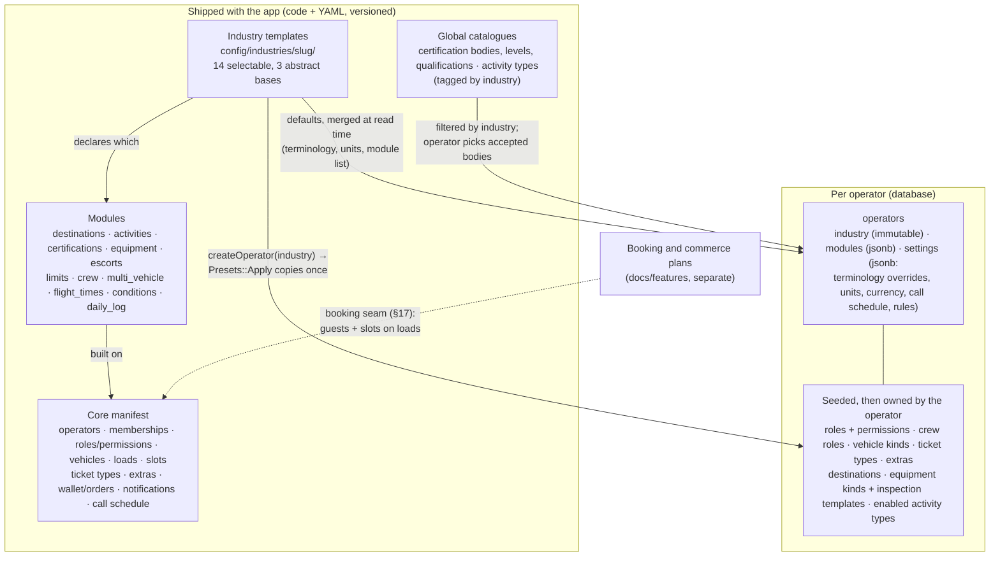
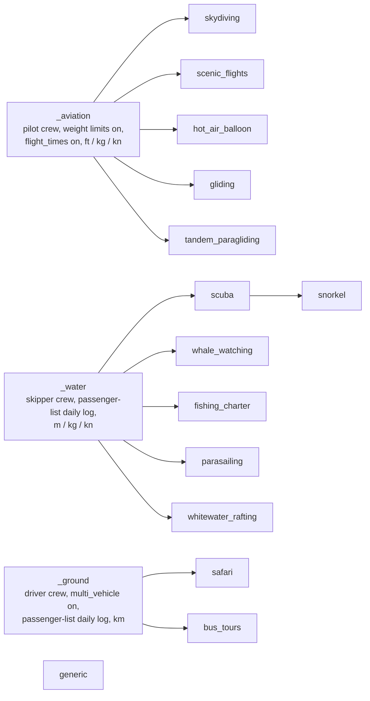
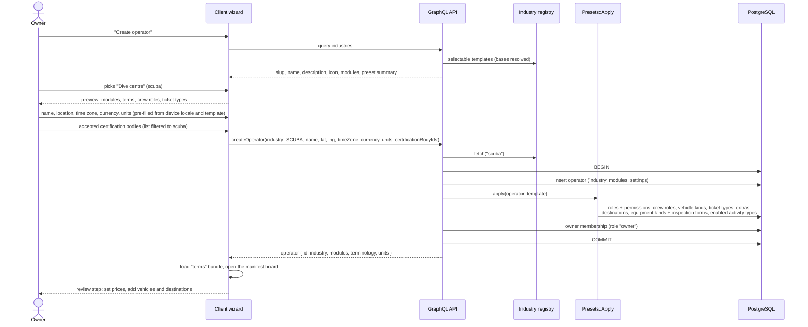
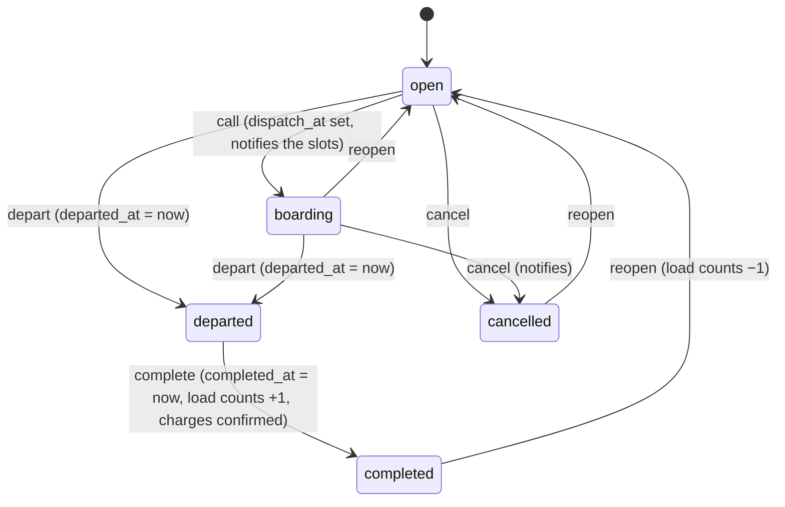
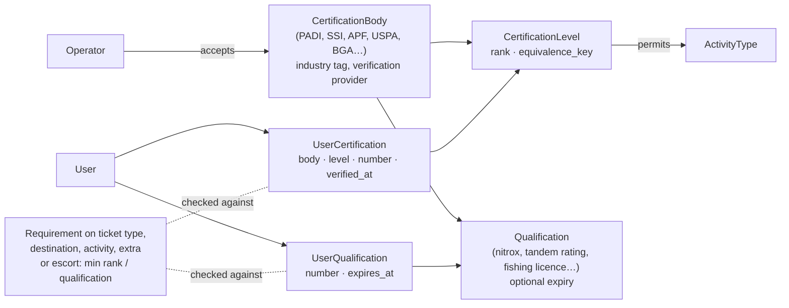
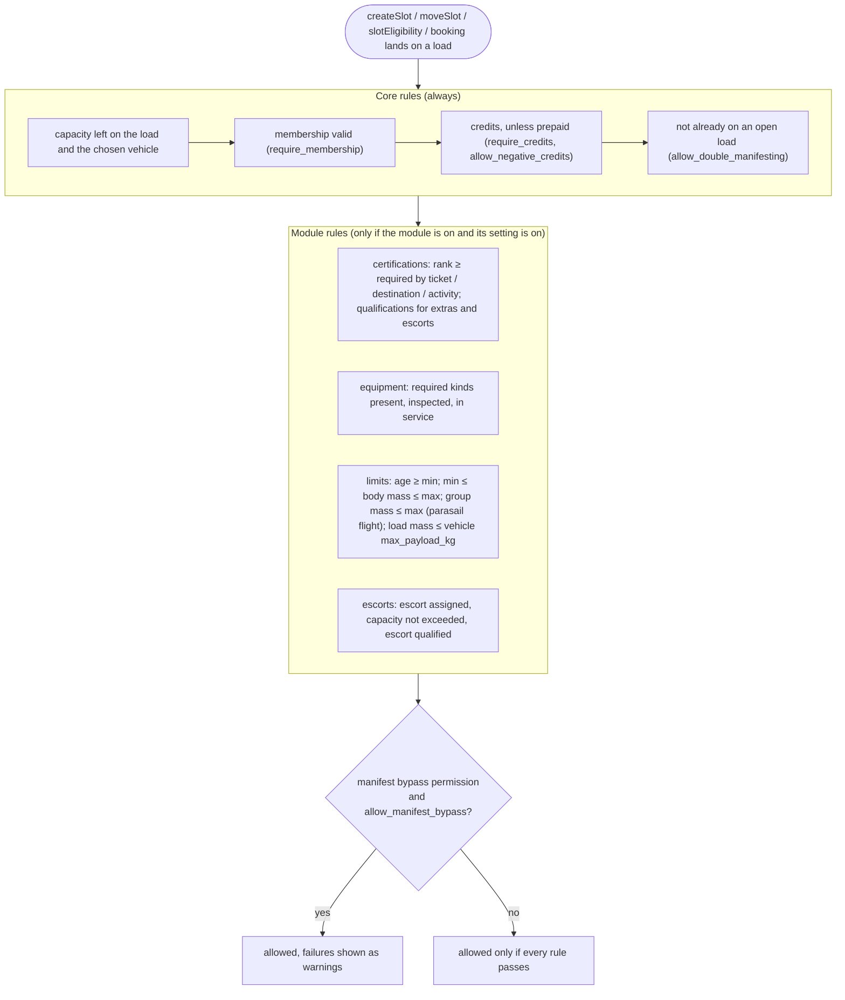
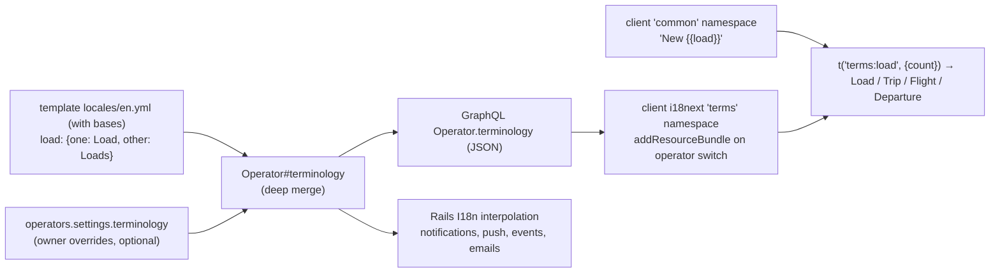
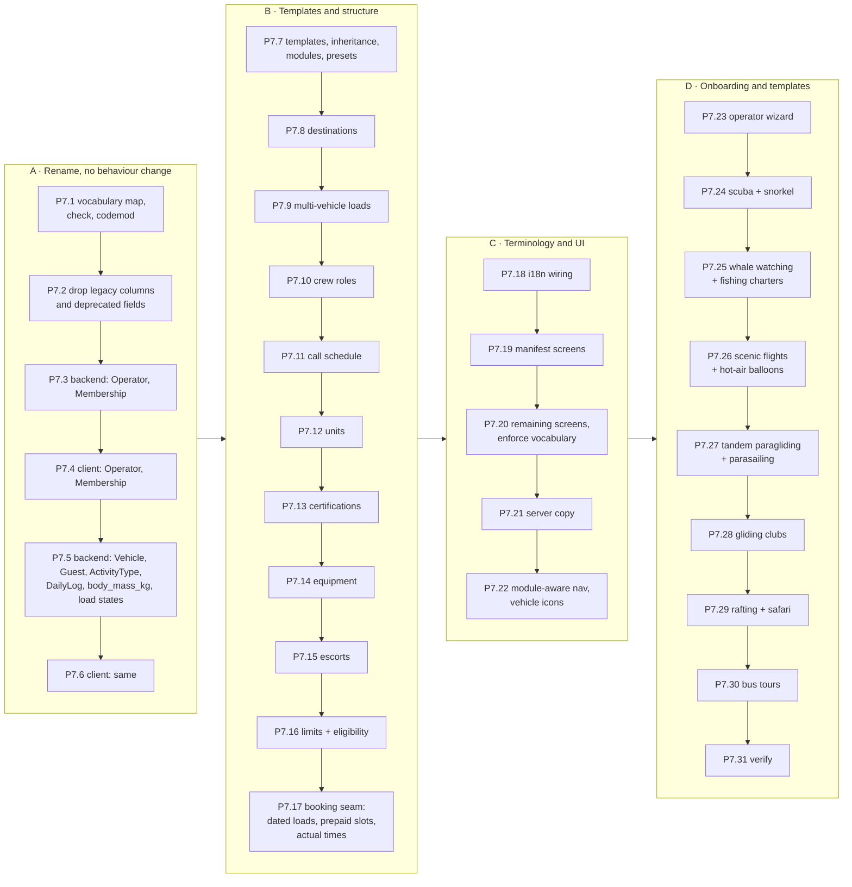
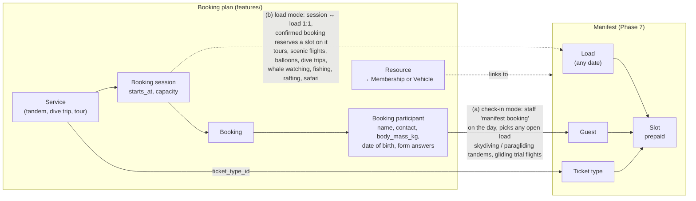

# Generalisation design: from "skydiving dropzone" to "manifesting people onto vehicles"

OpenManifest was built for skydiving dropzones. It will serve any business that **manifests people onto loads: a
vehicle (or several) departs at a set time for a destination, with crew on board and rules about who may go**:
skydiving dropzones, dive centres, tour companies, scenic flight and balloon operators, paragliding and parasailing
operators, gliding clubs, safari, rafting, whale-watching and fishing-charter operators.

This document is the design. The executable tasks are Phase 7 of [`../MODERNISATION_PLAN.md`](../MODERNISATION_PLAN.md).
Customer self-booking and online payments are a separate set of plans (booking, commerce foundation, webshop in
[`../features/`](../features/README.md), drafted on branch `claude/zealous-gates-lgavf4`); §17 defines the seam between
them and the manifest. Appendix A keeps the pass-1 inventory of every skydiving-specific concept (backend `b8dc33a`,
client `3112795`); the rest was written on 2026-10-11 against backend `6314faa` and client `dcc46d1` (Phases 0–6
merged) and revised the same day with the owner's answers to D5, D6, D9, D10 and D11.

Contents: [0 Summary](#0-summary) · [1 Industries](#1-industries) ·
[2 Architecture](#2-architecture-core-modules-industry-templates-presets) · [3 Vocabulary](#3-vocabulary-the-rename-map) ·
[4 Domain model](#4-generic-domain-model) · [5 Industry templates](#5-industry-templates) ·
[6 Creating an operator](#6-creating-an-operator) · [7 Loads](#7-loads-lifecycle-calls-vehicles-crew-destinations) ·
[8 Certifications](#8-certifications) · [9 Equipment](#9-equipment) · [10 Escorts](#10-escorts-tandem-try-dive-instructional-flight-children) ·
[11 Eligibility](#11-eligibility-and-participant-limits) · [12 Units](#12-units) · [13 Terminology](#13-terminology) ·
[14 Client](#14-client-module-aware-ui) · [15 Roadmap](#15-roadmap) · [16 Not in this phase](#16-not-in-this-phase) ·
[17 Booking integration](#17-booking-integration) ·
[Appendix A](#appendix-a-inventory-of-skydiving-specific-concepts-pass-1)

## 0. Summary

| Question | Answer |
|---|---|
| Rename or alias? | **Rename now** (D5). There is no production data and no released client, so there is nothing to stay compatible with. Renaming before the first release (Phase 8) is the cheapest it will ever be. No deprecated mirrors, no backfills, no dual columns. **`Load` stays `Load`** (owner): it is the manifest's own word and reads fine for any vehicle. |
| How is an operator configured for its use case? | The operator picks an **industry template** at creation (14 selectable, §5). The template (a) switches on **modules** (certifications, equipment, crew, destinations, …) and (b) supplies **presets** that are copied into the operator's own tables (roles, crew roles, ticket types, destinations, equipment kinds, …), which the operator then edits freely. Templates inherit from three abstract bases (aviation, water, ground) so the 14 stay small. |
| Where do industry differences live? | In YAML templates under `config/industries/<slug>/` and in modules. Code never branches on the industry slug; it asks `operator.module?(:equipment)` or reads operator settings. A CI check enforces this. |
| What ships in Phase 7? | Templates for every industry in D6: skydiving, scuba, snorkel, whale watching, fishing charters, scenic flights, hot-air balloons, tandem paragliding, parasailing, gliding clubs, whitewater rafting, safari drives, bus tours, plus `generic`. All are staff-manifested in Phase 7. |
| Customer booking and payments? | Not in Phase 7 (D9, D11): the booking and commerce plans own them. Phase 7 provides the manifest-side seam (P7.17, §17) so a booking can land on a load either at check-in (tandems) or directly on a pre-scheduled load (tours, scenic flights, balloons). Bus tours become a full fit when that lands. |
| Order of work | (A) mechanical rename with no behaviour change → (B) template/module engine and the structural generalisations, including multi-vehicle loads, participant limits and the booking seam → (C) terminology and module-aware UI → (D) onboarding wizard and the industry templates. |

## 1. Industries

The common shape: one or more **vehicles** with a **capacity** depart at a **time** for a **destination**; **participants**
are manifested into slots on the **load**; **crew** are assigned per load or per vehicle; some participants need
**certifications** or **equipment**, must be **escorted**, or must meet **age and weight limits**; the operator charges
**tickets** and **extras**; departure **calls** go out before the load leaves.

All rows are in scope (D6). "Base" is the abstract template the industry template extends (§5).

| Industry (template) | Base | Vehicles (carrying / support) | Destination | Crew | Certifications | Equipment | Escort | Limits that matter |
|---|---|---|---|---|---|---|---|---|
| Skydiving (`skydiving`) | aviation | aircraft | altitude, per slot | pilot, GCA, load master | APF, USPA, BPA, … licences A–E | rig (personal + rental), inspection, reserve repack | tandem 1:1, occupies a slot | weight (payload, wing loading), age |
| Scenic flights (`scenic_flights`) | aviation | helicopter, aeroplane | route | pilot | — | — | children with an adult | per-person and total weight, seat count |
| Hot-air balloons (`hot_air_balloon`) | aviation | balloon / chase vehicle | launch site | pilot / chase crew | — | — | children with an adult | weight, age, height |
| Gliding clubs (`gliding`) | aviation | glider / tug or winch | release height (aerotow) or circuit | instructor, tug pilot, launch point controller | national gliding licences and ratings | glider (club or private), daily inspection | instructional flight 1:1 | weight (cockpit limits) |
| Tandem paragliding (`tandem_paragliding`) | aviation | shuttle van | launch site | tandem pilots (as escorts), driver | pilot ratings (staff) | wing and harness inspection | 1:1, pilot occupies a slot | min/max weight per passenger, age |
| Scuba diving (`scuba`) | water | boat | dive sites, ordered (two-tank trip) | skipper, dive supervisor, divemaster | PADI, SSI, NAUI, CMAS, RAID, SDI/TDI, BSAC levels and specialties | rental BCD, regulator, wetsuit, cylinder; service dates | try dive, n guests per instructor | certification rank per site depth |
| Snorkel trips (`snorkel`, extends `scuba`) | water | boat | reef / site | skipper, guide | — | mask, fins, stinger suit | children with an adult | age |
| Whale watching (`whale_watching`) | water | boat | route / grounds | skipper, deckhand, naturalist | — | — | children with an adult | passenger list |
| Fishing charters (`fishing_charter`) | water | boat | fishing grounds | skipper, deckhand | fishing licence (qualification with expiry) | rods and tackle | children with an adult | passenger list |
| Parasailing (`parasailing`) | water | boat | — (flights from the boat) | captain, winch operator | — | harness check | solo / tandem / triple flights as groups | min/max weight per person and per flight group, age |
| Whitewater rafting (`whitewater_rafting`) | water | rafts / shuttle bus, safety kayak | river section (grade) | raft guide per raft, safety kayaker, driver | river guide ratings (staff) | PFD, helmet, wetsuit | children with an adult | age, weight |
| Safari drives (`safari`) | ground | 4×4s | drive sector / route | ranger and tracker per vehicle | — | — | children with an adult | age |
| Bus and coach tours (`bus_tours`) | ground | buses | route with stops | driver per bus, guide | — | — | children with an adult | — |
| Anything else (`generic`) | — | any | any | configurable | off | off | off | — |

Industries outside D6 that the same model covers with the `generic` template or a later template: water taxis and
island ferries, heli-skiing and cat-skiing, zipline and canopy tours, surf charters, sea kayaking, canyoning.

What the extra industries add to the original three (each becomes a Phase 7 capability rather than an industry
special case):

- **Several vehicles on one load, some only supporting** — rafting (several rafts plus a shuttle), safari (several
  4×4s), bus tours (two coaches), gliding (glider plus tug), balloons (balloon plus chase vehicle). §7.
- **Crew per vehicle** — a guide per raft, a ranger per 4×4, a tug pilot for the tug. §7.
- **Participant limits** — minimum age, minimum and maximum body mass per person (paragliding, parasailing, balloons,
  rafting), combined mass per flight group (parasailing) and per vehicle (scenic flights, balloons, skydiving). §11.
- **Actual times and duration charges** — gliding clubs charge glider hire by the minute and log take-off and landing
  times; scenic flights and balloons log flight times. §7.
- **Qualifications without levels** — a fishing licence is a qualification with an expiry, not a rank. §8.

## 2. Architecture: core, modules, industry templates, presets



Rules:

1. **Template = defaults + presets, never live behaviour.** Things an operator must be able to edit (roles, ticket types,
   crew roles, destinations, equipment kinds, inspection forms) are **copied** into the operator's tables when it is created.
   Changing a template later does not change existing operators. Things that are pure presentation or defaults
   (terminology, units, module list) are **merged at read time**: template value, then the operator's override in
   `operators.settings`.
2. **Modules, not industries, drive behaviour.** `operator.module?(:certifications)` decides whether licence checks run and
   licence screens show. A template is a list of enabled modules plus data. An operator can switch optional modules on
   or off later (a skydiving club without rental gear switches equipment rentals off; a dive centre that also runs
   whale-watching trips keeps the `scuba` template and adds a "Whale watching" ticket type).
3. **The industry is fixed at creation.** It selects presets and global catalogues. Switching industry later is not
   supported; create a second operator instead.
4. **Industry-only features stay, inside a namespace.** Wing loading, jump run, winds aloft and packing jobs move to
   `app/**/skydiving/` (backend) and `app/features/skydiving/` (client); gliding's flying log and duration charges are a
   `flight_times` module, not gliding code, because scenic flights and balloons use it too.
5. **Templates inherit.** A template may `extends:` one other template; maps deep-merge and lists are replaced. Abstract
   bases (`_aviation`, `_water`, `_ground`, not selectable) hold what a family shares: crew role names, units,
   daily-log template, default call schedule.
6. **`generic`** has only the core and `destinations` on and neutral terms, for industries without a template.

## 3. Vocabulary (the rename map)

Code names become industry-neutral. What users see comes from terminology (§13), so a skydiving operator still sees
"Dropzone", "Aircraft" and "Jumper". `config/vocabulary.yml` holds this table in machine-readable form;
`bin/check-vocabulary` (both repos) fails CI when an old term appears outside the allow-listed skydiving paths,
templates, migrations and docs.

| Old code name | New code name | Skydiving term | Scuba term | Bus-tour term |
|---|---|---|---|---|
| `Dropzone`, `dropzones`, `dropzoneId` | `Operator`, `operators`, `operatorId` | Dropzone | Dive centre | Tour operator |
| `DropzoneUser`, `dropzone_users` | `Membership`, `memberships` | Jumper / member | Diver / customer | Passenger / customer |
| `Plane` (GraphQL `Plane`, `Aircraft` classes, `createPlane`) | `Vehicle` (`kind`: aircraft, helicopter, balloon, glider, tug, boat, raft, bus, 4x4, van, …) | Aircraft | Boat | Bus |
| `planes.max_slots` / `min_slots` | `vehicles.capacity` / `min_capacity`; new `max_payload_kg` | Slots | Places | Seats |
| `loads.plane_id` | `load_vehicles` (`vehicle_id`, `role` carrying/support) | | | |
| `Load`, `load_number`, `load_date` | **unchanged** | Load | Trip | Departure |
| Load states `open, boarding_call, in_flight, landed, cancelled` | `open, boarding, departed, completed, cancelled` (aviation-only words go; the template's terms still say "In flight", "Landed") | Boarding call, In flight, Landed | Boat call, Departed, Back | Boarding, Departed, Completed |
| `Slot`, `TicketType`, `Extra` | unchanged | Slot, Ticket, Extra | Place, Package, Add-on | Seat, Ticket, Add-on |
| `ticket_types.altitude` (feet) | `Destination` (`kind` altitude/site/route/section) + `default_destination_id` | Altitude | Dive site | Route |
| `JumpType`, `jump_types` | `ActivityType`, `activity_types` | Jump type | Dive type | — |
| `Passenger`, `passenger_slot_id`, `is_tandem` | `Guest`, `escort_slot_id` (on the guest's slot), `requires_escort` + `escort_capacity` | Tandem passenger / instructor | Try-dive guest / instructor | Child / adult |
| `exit_weight` (users, slots, passengers) | `body_mass_kg` (same name as the booking plan's participants) | Exit weight | Weight | — |
| `pilot_id`, `gca_id`, `load_master_id` | `crew_roles` + `load_crew_assignments` | Pilot, GCA, Load master | Skipper, Dive supervisor, Divemaster | Driver, Guide |
| `MasterLog`, `dzso_id` | `DailyLog`, `duty_officer_id` | Master log, DZSO | Daily log, Dive supervisor | Daily manifest, Duty manager |
| `Federation`, `License`, `LicensedJumpType` | `CertificationBody`, `CertificationLevel`, `PermittedActivity` | Federation, Licence | Agency, Certification | — |
| `UserFederation`, `UserFederationQualification` | `UserCertification`, `UserQualification` | | | |
| `users.apf_number`, `dropzones.federation_id` | removed: `user_certifications.number`; `operator_certification_bodies` (many) | | | |
| `Rig`, `RigInspection`, `rig_type`, `canopy_size`, `repack_expires_at` | `Equipment` (`kind`, `ownership`, `attributes` jsonb, `service_due_at`), `EquipmentInspection` | Rig, Rig inspection, Reserve repack | Rental gear, Gear check, Service | — |
| `jump_count`, `dropzone_count`, `plane_count` | `load_count`, `operator_count`, removed | Jumps | Dives | Tours |
| `WeatherCondition` (winds aloft, jump run) | unchanged, owned by the `conditions: winds_aloft` module | Weather board | — | — |
| `Pack` (packing jobs) | unchanged, skydiving namespace | Pack jobs | — | — |
| Settings `require_license`, `require_rig_inspection`, `require_reserve_in_date` | `require_certification`, `require_equipment_inspection`, `require_equipment_in_service` | | | |
| Permissions `createPlane`, `createRig`, `actAsDZSO`, `actAsRigInspector` (`createLoad` etc. unchanged) | `createVehicle`, `createEquipment`, `actAsDutyOfficer`, `actAsEquipmentInspector`; crew `actAs<CrewRoleKey>` | | | |
| Client routes `/dropzone/manifest`, `/dropzone/load/:loadId` | `/manifest`, `/loads/:loadId` | | | |
| Default time zone `Australia/Brisbane` | none; required at creation, pre-filled from the device | | | |

## 4. Generic domain model

Wallet, orders, receipts, transactions, notifications, events and auth tables keep their shape (they only get the
`operator_id` / `membership_id` renames) and are left out for readability. Certification entities are drawn in §8,
booking entities in §17.

```mermaid
erDiagram
  USER ||--o{ MEMBERSHIP : "belongs to operators via"
  OPERATOR ||--o{ MEMBERSHIP : has
  OPERATOR ||--o{ ROLE : defines
  ROLE ||--o{ MEMBERSHIP : "assigned to"
  ROLE }o--o{ PERMISSION : grants
  OPERATOR ||--o{ VEHICLE : owns
  OPERATOR ||--o{ DESTINATION : catalogues
  OPERATOR ||--o{ CREW_ROLE : defines
  OPERATOR ||--o{ TICKET_TYPE : sells
  OPERATOR ||--o{ EXTRA : sells
  OPERATOR }o--o{ CERTIFICATION_BODY : accepts
  OPERATOR ||--o{ ACTIVITY_TYPE : "enables / adds"
  OPERATOR ||--o{ LOAD : runs
  LOAD ||--|{ LOAD_VEHICLE : uses
  VEHICLE ||--o{ LOAD_VEHICLE : "assigned to"
  LOAD ||--o{ LOAD_DESTINATION : visits
  DESTINATION ||--o{ LOAD_DESTINATION : "planned in"
  LOAD ||--o{ LOAD_CREW_ASSIGNMENT : crewed
  LOAD_VEHICLE |o--o{ LOAD_CREW_ASSIGNMENT : "crew of this vehicle"
  CREW_ROLE ||--o{ LOAD_CREW_ASSIGNMENT : fills
  MEMBERSHIP ||--o{ LOAD_CREW_ASSIGNMENT : "works as"
  LOAD ||--o{ SLOT : contains
  LOAD_VEHICLE |o--o{ SLOT : "rides in"
  MEMBERSHIP |o--o{ SLOT : "manifested as"
  GUEST |o--o{ SLOT : "manifested as"
  TICKET_TYPE ||--o{ SLOT : "priced by"
  ACTIVITY_TYPE |o--o{ SLOT : "does"
  DESTINATION |o--o{ SLOT : "own target (per-slot scope)"
  SLOT |o--o{ SLOT : "escorts"
  SLOT ||--o{ SLOT_EQUIPMENT : uses
  EQUIPMENT ||--o{ SLOT_EQUIPMENT : "used in"
  TICKET_TYPE }o--o| DESTINATION : "default"
  TICKET_TYPE }o--o{ EXTRA : offers
  OPERATOR ||--o{ EQUIPMENT : "rents out"
  USER ||--o{ EQUIPMENT : "owns"
  EQUIPMENT ||--o{ EQUIPMENT_INSPECTION : "checked by"
  OPERATOR ||--o{ DAILY_LOG : keeps

  OPERATOR {
    string industry "template slug, immutable"
    jsonb modules "enabled modules"
    jsonb settings "terminology overrides, units, currency, locale, call_schedule_minutes, rules"
    string time_zone "required"
  }
  VEHICLE {
    string kind "aircraft, balloon, glider, tug, boat, raft, bus, 4x4, ..."
    int capacity
    int min_capacity
    decimal max_payload_kg "limits module"
  }
  LOAD {
    int load_number "per operator per load_date"
    date load_date "any date, not only today"
    datetime dispatch_at
    datetime departed_at "actual, flight_times module"
    datetime completed_at "actual"
    enum state "open boarding departed completed cancelled"
  }
  LOAD_VEHICLE {
    string role "carrying | support"
    int position
  }
  DESTINATION {
    string kind "altitude | site | route | section"
    string name
    decimal altitude_m
    jsonb location "lat, lng, max_depth_m, grade, ..."
    jsonb stops "ordered stops for routes"
    int min_certification_rank
  }
  CREW_ROLE {
    string key "pilot, gca, skipper, guide, ranger, ..."
    string scope "load | vehicle"
    boolean required
    boolean occupies_slot
    string permission "actAsPilot, ..."
  }
  SLOT {
    int group_number "party, or parasail flight"
    decimal body_mass_kg
    bigint escort_slot_id
    boolean prepaid "paid outside the wallet (booking)"
  }
  GUEST {
    string name
    string email
    string phone
    date date_of_birth
    decimal body_mass_kg
    string emergency_contact
  }
  TICKET_TYPE {
    bigint cost_cents
    int price_per_minute_cents "flight_times module"
    boolean requires_escort
    int escort_capacity "guests per escort"
    int min_certification_rank
    jsonb participant_limits "min_age, min/max body_mass_kg"
  }
  EQUIPMENT {
    string kind "rig, bcd, wetsuit, pfd, rod, glider, ..."
    string ownership "personal | operator"
    jsonb attributes "validated by the kind's schema"
    datetime service_due_at
  }
```



Destination scope is per template: **per slot** for skydiving (two jumpers on one load exit at different altitudes:
`slots.destination_id`, defaulted from the ticket) and gliding aerotows (release height), **per load** for everyone else
(the boat visits site 1 then site 2; the bus runs a route: `load_destinations` ordered by `position`).

## 5. Industry templates

### File layout

```
config/industries/
  schema.json             # validates every template
  _aviation/  _water/  _ground/        # abstract bases (not selectable)
  skydiving/
    template.yml          # extends, name, description, icon, modules, destination scope, units, call schedule, settings
    presets.yml           # copied into each new operator: roles+permissions, crew roles, vehicle kinds, ticket types,
                          # extras, destinations, equipment kinds (+ attribute schema, inspection form), activity types,
                          # booking defaults (§17)
    catalogue.yml         # global, seeded once: certification bodies/levels/qualifications, activity types
    locales/en.yml        # terminology (one/other forms) and industry copy
  scuba/  snorkel/  whale_watching/  fishing_charter/  parasailing/  whitewater_rafting/
  scenic_flights/  hot_air_balloon/  gliding/  tandem_paragliding/
  safari/  bus_tours/  generic/
```



`Industry` (PORO, `app/models/industry.rb`) loads, resolves `extends` and validates all templates at boot; a spec
validates every resolved template against `config/industries/schema.json` (required keys, known module names, presets
referencing known permissions and crew roles). `config/seed/global.yml` and the role section of `config/seed/access.yml`
move into the skydiving template; `access.yml` keeps only the permission list.

### Example (abridged)

```yaml
# config/industries/scuba/template.yml
slug: scuba
extends: _water
name: Dive centre
description: Boats to dive sites, certified divers, rental gear
icon: diving-scuba-tank          # MaterialCommunityIcons
vehicle_kinds: [boat]
modules:
  destinations: { kinds: [site], scope: per_load, max_per_load: 3 }
  activities: {}
  certifications: { required_by_default: true }
  equipment: { rentals: true, personal: true }
  escorts: {}
  crew: {}
  limits: { age: true }
  conditions: false              # marine conditions are a later module
units: { depth: m, distance: km, mass: kg, temperature: c, speed: kn }
call_schedule_minutes: [60, 30, 15]
settings:
  require_certification: true
  require_equipment: false
  require_credits: false
```

```yaml
# config/industries/scuba/presets.yml (excerpt)
roles:
  customer:     { default: true, permissions: [readLoad, createSlot] }
  divemaster:   { permissions: [readLoad, createSlot, updateSlot, readUser, actAsDivemaster] }
  instructor:   { permissions: [readLoad, createSlot, updateSlot, deleteSlot, readUser, actAsDivemaster, actAsEquipmentInspector] }
  skipper:      { permissions: [readLoad, actAsSkipper] }
  front_desk:   { permissions: [...] }        # today's "manifest" role
  admin:        { permissions: [...] }
  owner:        { permissions: all }
crew_roles:
  - { key: skipper,         scope: load, required: true,  occupies_slot: false }
  - { key: dive_supervisor, scope: load, required: true,  occupies_slot: true }
  - { key: divemaster,      scope: load, required: false, occupies_slot: true }
ticket_types:
  - { name: Double-tank boat dive, cost_cents: 0, activity: fun_dive, min_certification: open_water }
  - { name: Try dive, cost_cents: 0, requires_escort: true, escort_capacity: 4, participant_limits: { min_age: 10 } }
  - { name: Snorkeller, cost_cents: 0, requires_certification: false }
extras:
  - { name: Nitrox, cost_cents: 0, requires_qualification: nitrox }
  - { name: Full gear rental, cost_cents: 0 }
equipment_kinds:
  - { key: bcd, attributes: { size: { type: enum, values: [XS, S, M, L, XL] } }, service_interval_days: 365 }
  - { key: regulator, service_interval_days: 365 }
  - { key: wetsuit, attributes: { size: { type: string }, thickness_mm: { type: integer } } }
  - { key: cylinder, attributes: { volume_l: { type: integer }, gas: { type: enum, values: [air, nitrox] } } }
booking:
  manifest_link: load            # bookings land on a pre-scheduled load (§17)
```

Prices are `0` in presets (the operator sets them in the wizard's review step). Ages, weight limits, escort capacities,
service intervals and role permissions in presets are starting points the owner reviews with an operator from each
industry, not regulatory values; each template task cites its sources in the PR.

### Module matrix

| Template | destinations (scope) | multi_vehicle | crew (scope) | certifications | equipment | escorts | limits | flight_times | daily log | call schedule |
|---|---|---|---|---|---|---|---|---|---|---|
| skydiving | altitude (slot) | — | pilot*, GCA*, load master (load) | levels + permitted jump types | rig, inspection, repack | tandem 1:1 | mass, payload, age | — | APF master log | 20 / 15 / 10 |
| scenic_flights | route (load) | — | pilot* (vehicle) | — | — | children | mass, payload | yes | flight log | 30 / 15 |
| hot_air_balloon | site (load) | balloon + chase | pilot* (vehicle), chase crew | — | — | children | mass, payload, age | yes | flight log | 60 / 30 |
| gliding | altitude (slot) or circuit | glider + tug/winch | instructor (vehicle), tug pilot* (vehicle), launch point controller (load) | gliding licences | glider, daily inspection | instructional 1:1 | cockpit mass | yes, per-minute charges | flying log | none |
| tandem_paragliding | site (load) | van | driver* (vehicle) | pilot ratings (escort qualification) | wing, harness | tandem 1:1, pilot occupies a slot | mass min/max, age | — | flight log | 30 / 15 |
| scuba | site (load, ≤ 3) | — | skipper*, dive supervisor*, divemaster (load) | ranked levels, specialties | BCD, regulator, wetsuit, cylinder | try dive 1:n | age | — | passenger list | 60 / 30 / 15 |
| snorkel | site (load) | — | skipper*, guide (load) | — | mask, fins, stinger suit | children | age | — | passenger list | 60 / 30 |
| whale_watching | route (load) | — | skipper*, deckhand, naturalist (load) | — | — | children | — | — | passenger list | 30 / 15 |
| fishing_charter | site (load) | — | skipper*, deckhand (load) | fishing licence (qualification) | rods | children | — | — | passenger list | 30 / 15 |
| parasailing | — | — | captain*, winch operator* (load) | — | harness | flight groups | mass per person and per group, age | — | passenger list | 30 / 15 |
| whitewater_rafting | section (load) | rafts + shuttle, kayak | raft guide* (vehicle), safety kayaker, driver (load) | guide ratings (staff) | PFD, helmet, wetsuit | children | age, mass | — | passenger list | 30 / 15 |
| safari | route (load) | 4×4s | ranger* (vehicle), tracker (vehicle) | — | — | children | age | — | passenger list | 15 / 5 |
| bus_tours | route (load) | buses | driver* (vehicle), guide (load) | — | — | children | — | — | passenger list | 30 / 15 / 5 |
| generic | any (load) | on | configurable | off | off | off | off | off | off | 15 |

`*` = required crew role.

## 6. Creating an operator

The industry is the first question in the wizard; everything after it is pre-filled from the template.



Wizard steps (client `screens/wizards/operator_wizard/`): **Industry** (cards grouped by base: air, water, land, plus
"Other" → `generic`) → **Name** → **Location and time zone** → **Currency and units** → **Certification bodies** (only
when the module is on) → **Branding** (logo, colours) → **Review presets** (prices, first vehicle) → **Done**. The
existing `dropzone_wizard` steps are reused where they fit.

## 7. Loads: lifecycle, calls, vehicles, crew, destinations



- **Lifecycle.** Same machine as today's `StateMachines::LoadState`; only the aviation-specific state names change
  (`boarding_call` → `boarding`, `in_flight` → `departed`, `landed` → `completed`). Templates name the states for users
  ("In flight", "Landed" for aviation). `departed_at` and `completed_at` record the actual times.
- **Calls.** The operator's `call_schedule_minutes` (template default, editable) generates the call buttons and
  countdowns that the client hard-codes as 20/15/10 today. Gliding has none.
- **Vehicles.** A load has one or more `load_vehicles`. `carrying` vehicles add their capacity to the load's capacity;
  `support` vehicles (tug, winch, chase vehicle, safety kayak, shuttle) carry nobody on the manifest but can have crew.
  With `multi_vehicle` off (skydiving, scuba, …) the UI shows a single vehicle picker exactly as today. With it on, slots
  can be assigned to a carrying vehicle (which raft, which bus) and the load card groups them.
- **Crew.** Each crew role has a scope: `load` (GCA, dive supervisor, guide) or `vehicle` (pilot of each aircraft, guide
  of each raft, ranger of each 4×4, tug pilot). A load is valid when every required role is assigned for its scope, to
  a member holding the role's permission (replaces `validates :gca, :pilot`). Crew with `occupies_slot` count against
  capacity.
- **Destinations.** Per slot (skydiving altitude, aerotow release height) or per load, ordered (§4).
- **Dates.** Loads can be created for any date, not only today, so staff can schedule tomorrow's departures and the
  booking plan can attach sessions to them (§17). The manifest board gets a date picker.
- **Duration charges** (`flight_times` module, gliding). A ticket type may have `price_per_minute_cents`; on completion
  the slot is charged `cost_cents + minutes(departed_at → completed_at) × price_per_minute_cents` through the existing
  finalise step. Aerotow height is the slot's destination and priced by its ticket type.

## 8. Certifications



Diving needs **cross-recognition**: a dive centre accepts PADI and SSI and treats "PADI Advanced Open Water" and "SSI
Advanced Adventurer" as the same tier. Each level therefore has a numeric `rank` and an `equivalence_key` that are
comparable across bodies within an industry; requirements are expressed as a minimum rank (ticket type, destination,
e.g. a 30 m wreck site) or a required qualification (nitrox extra, fishing licence, tandem rating for an escort), never
as a specific body's level. A body may issue qualifications only (fishing licences, guide ratings). Skydiving keeps the
per-level permitted activities (today's `licensed_jump_types`). APF verification becomes the `apf` verification provider
of the APF body; other bodies have none (manual verification by staff).

An operator accepts many bodies (`operator_certification_bodies`); today's single `dropzones.federation_id` goes.

## 9. Equipment

`Equipment` replaces `Rig`: `kind` (from the operator's equipment kinds, seeded from the template), `ownership`
(`personal` with `user_id`, or `operator` rental), `attributes` jsonb validated against the kind's attribute schema
(skydiving `rig`: canopy size, container, reserve, AAD; scuba `wetsuit`: size, thickness; rafting `pfd`: size),
`service_due_at` (reserve repack, regulator service, glider annual inspection). Each kind may have an inspection form
(`FormTemplate`, already generic JSON) and `EquipmentInspection` replaces `RigInspection`; gliding's daily inspection is
an inspection with a one-day validity. A slot can use several items (`slot_equipment`) because a diver rents a BCD, a
regulator and a wetsuit. Packing jobs and wing loading stay in the skydiving namespace and read the `rig` kind's
attributes.

## 10. Escorts (tandem, try dive, instructional flight, children)

Today a tandem is two slots: the instructor's slot points at the passenger's slot (`passenger_slot_id`) and the
passenger is a `Passenger` record without an account. Generalised: a ticket type with `requires_escort` and
`escort_capacity` (guests per escort: 1 for tandem skydiving, tandem paragliding and instructional gliding; n for a try
dive); each guest slot points at its escort's slot (`escort_slot_id`); guests without an account are `Guest` records
(name, email, phone, date of birth, body mass, emergency contact — the same fields as the booking plan's
participants). The escort must hold the crew role or qualification the ticket names (tandem rating, instructor). A
child-with-adult ticket uses the same mechanism with the adult as escort and no qualification.

## 11. Eligibility and participant limits

The server is the single source of truth. Today the rules are duplicated in the client (`app/hooks/useManifestValidator.ts`)
and the server (`Manifest::CreateSlot` + `Dropzones::Configuration`). After Phase 7 each module contributes rule objects;
the API exposes `slotEligibility(…)` returning each rule's result so the client renders warnings without
re-implementing them. The booking plan's `participant_rules` (min age, max body mass) are checked by the same `limits`
rules when a booking lands on a load.



Age needs a date of birth: `users.date_of_birth` and `guests.date_of_birth` (nullable; the rule fails with "date of
birth needed" when a limit exists and the date is missing).

## 12. Units

Store SI, convert at the edge. Because there is no data, columns are changed in place (no dual columns).

| Quantity | Stored as | Display options | Notes |
|---|---|---|---|
| Altitude / depth / height | `*_m` decimal(10,2) | ft, m | `ticket_types.altitude` (int feet) disappears into `destinations.altitude_m` |
| Distance | `*_m` decimal | km, nmi, mi, m | weather `exit_spot_miles`, `offset_miles` → `exit_spot_m`, `offset_m` |
| Mass | `*_kg` decimal(6,2) | kg, lb | `body_mass_kg` everywhere |
| Area | `*_m2` decimal, inside equipment attributes | ft², m² | canopy size shown in ft² by the skydiving template |
| Speed | `*_mps` decimal | kn, km/h, mph | winds JSON |
| Temperature | `*_c` decimal | °C, °F | |
| Money | `*_cents` bigint + operator `currency` (ISO 4217) | locale format | float columns from before P6.23 are dropped; the commerce plan moves to the Money gem on top |
| Time | `timestamptz` UTC + operator `time_zone` | operator local time | |

Backend `Units` module (`to_si`, `from_si`); the API accepts and returns SI only. Client `app/i18n/units.ts`
(`formatQuantity`, `parseQuantity`, `compactAltitude` for the "14k" convention) using `Intl.NumberFormat` unit style.
Unit system = template `units` merged with `operators.settings.units`.

## 13. Terminology



Term keys: `operator, member, vehicle, load, slot, ticket, extra, destination, activity, crew.<key>, escort, guest,
certification_body, certification, equipment, inspection, daily_log, call, load_count, state.<state>`. Client: i18next
+ react-i18next with `common` and `terms` namespaces, `eslint-plugin-i18next` (`no-literal-string`) once converted.
Server copy (e.g. `"Load #12 take off at 10:30"`) becomes `I18n.t("notifications.boarding", load: operator.term(:load), …)`.
Only English ships; other languages are out of scope but the keys make them possible.

## 14. Client: module-aware UI

- Navigation and settings menu entries declare the module they need; the drawer, tab bar and settings menu filter on
  `operator.modules` (e.g. no Equipment, Licences, Weather or Master log for a bus-tour operator).
- Skydiving-only components (`WingLoading`, `JumpRunSelect`, winds board, `AltitudeSelect`, pilot/GCA chips) move to
  `app/features/skydiving/`; generic replacements: `DestinationSelect`, `CrewChip` (per crew role), `VehicleIcon`.
- **Icons (D10):** the product stays "OpenManifest"; every hard-coded airplane icon becomes `VehicleIcon`, which maps
  the vehicle `kind` to a MaterialCommunityIcons glyph (aircraft and glider → `airplane`, tug → `airplane-takeoff`,
  helicopter → `helicopter`, balloon → `airballoon`, boat → `ferry`, raft → `rowing`, kayak → `kayaking`, bus → `bus`,
  4×4 → `car-estate`, van → `van-passenger`; all present in `@expo/vector-icons` 15.0.2, MaterialCommunityIcons has no
  glider glyph); the template's `icon` (e.g. `parachute`, `diving-scuba-tank`, `paragliding`, `fish`) is used for the
  operator and the industry picker. Skydiving
  illustrations and Lottie animations are shown only for the skydiving template; others get neutral illustrations.
- The user wizard (profile set-up) asks only for what the operator's modules need: body mass and date of birth
  (limits module), certifications (certifications module, bodies the operator accepts), personal equipment (equipment
  module).

## 15. Roadmap

Stages and tasks (IDs are Phase 7 tasks in the plan). Each stage ends with both repos green and the web smoke test
passing; the dev seed is regenerated per stage because there is no data to migrate.



| Stage | Goal | Exit criteria |
|---|---|---|
| A · Rename | Code speaks the generic vocabulary; behaviour identical | All Phase 1 characterisation specs and client tests pass under new names; `bin/check-vocabulary` count drops to the allow-listed paths (report mode) |
| B · Templates and structure | Skydiving runs as a template; destinations, vehicles, crew, calls, units, certifications, equipment, escorts, limits and the booking seam are generic | Backend specs prove skydiving behaviour unchanged; a `generic` operator can run a two-vehicle load with no skydiving concepts; no industry branches (`bin/check-industry-branches`) |
| C · Terminology and UI | No hard-coded industry words in the UI; screens follow modules; no airplane icons outside the skydiving template | Lint `no-literal-string` on `app/**`; vocabulary check enforcing in both repos; web smoke run with the `generic` template shows no skydiving words |
| D · Onboarding and templates | Every D6 industry can be created from the wizard and run a load end to end | Per template, a web smoke scenario (listed in its task) passes |

Why this order: renaming first, as a pure refactor with the Phase 1 safety net, keeps later structural diffs small and
reviewable; templates must exist before terminology (terms come from templates); the wizard and the templates come
last because they exercise everything before them. Scuba is the first new template because it overlaps most with
skydiving (certifications, equipment, escorts) and proves the abstraction; bus tours are last because they gain the
most from the booking plan.

**Relation to the feature plans.** The executor picks modernisation-plan tasks before feature-plan tasks
(`features/README.md`), so Phase 7 runs before booking and commerce unless Phase 7 is blocked. That suits both: the
booking tasks then use the new names, and their check-in task finds the seam from P7.17 ready.

## 16. Not in this phase

| Feature | Needed by | Where it is handled |
|---|---|---|
| Customer self-booking, availability, holds, deposits, manage links, waivers at booking | tours, flights, balloons, tandems, dives | Booking plan (`features/BOOKING_PLAN.md`), D9 |
| Online payments, coupons, platform fee, refunds | all | Commerce foundation (`features/COMMERCE_FOUNDATION.md`), D11 |
| Timetables / recurring departures generating loads | tours, whale watching, scenic flights | Booking plan session generation; with BD7 (b) each session gets a load (§17) |
| Boarding and alighting at intermediate stops, hotel pickups | tours | Later; route stops are modelled, slots board at the start only |
| Seat assignment by weight (weight and balance per seat) | scenic flights, balloons | Later; Phase 7 checks per-person and total limits only |
| Recency / currency rules ("no dive in 12 months → refresher") | scuba, skydiving, gliding | Later eligibility rule on `last_load_at` per activity |
| Marine conditions (swell, visibility, water temperature, tides) and flying weather for balloons/paragliding | water and aviation templates | A second `conditions` module next to winds aloft |
| Dive logging (depth, bottom time, buddy) | scuba | Later; per-slot log entries after completion |
| Cargo (mass/volume as bookable items) | water taxis, freight | Out of scope; people only |
| Other languages | all | Keys exist after P7.20; translations are content work |

## 17. Booking integration

The booking plan sells **services** with **sessions** (time windows with capacity), takes **bookings** with
**participants**, and allocates **resources** (instructors, boats, vehicles) without double-booking. The manifest runs
**loads** with **slots**. They meet when a booked participant becomes a slot. Two link modes cover every template; the
template's `booking.manifest_link` sets the default for new services, and BOOKING_PLAN's BD7 owns the decision of when
mode (b) is built.



What Phase 7 guarantees to the booking plan (P7.17 builds the manifest side; nothing booking-specific is built here):

1. **Names.** Bookings link to `Membership`, `Vehicle`, `Load`, `Slot`, `Guest` and `TicketType` (the drafts still say
   `DropzoneUser`, `Plane`, `Passenger`; `config/vocabulary.yml` maps them). Participant mass is `body_mass_kg` on both
   sides.
2. **Guests carry booking data.** `Guest` has name, email, phone, date of birth, body mass and emergency contact;
   the commerce plan adds `customer_id` when `customers` exists.
3. **Prepaid slots.** `Manifest::CreateSlot` accepts `prepaid: true` (a booking or another external order paid for it):
   no wallet charge on creation or completion, generalising today's tandem refund special case
   (`Transactions::Purchase#refund_if_tandem`). The slot exposes `prepaid` so the board can show it.
4. **Loads on any date.** Loads can be created ahead with a `load_date` in the future, listed by date range, and called
   on the day; this is what a session in mode (b) attaches to.
5. **One capacity source in mode (b).** The load's capacity (sum of carrying vehicles, minus seat-occupying crew) is the
   truth. A booking hold must take capacity through the same locked counter as manifesting (P6.10), so a walk-in
   manifested at the desk and an online booking can never take the same last seat. How the session's
   `reserved_count` is derived from or synchronised with the load is BD7 (b)'s design.
6. **Limits are shared.** A service's `participant_rules` and the ticket type's `participant_limits` use the same keys
   (`min_age`, `min_body_mass_kg`, `max_body_mass_kg`); the slot is checked by §11 rules when it is created, so a
   booking that violates a limit fails at check-in with the same message staff see.
7. **Escorts.** In mode (a) a tandem booking of two participants becomes two guest slots, each escorted by an instructor
   slot (`escort_slot_id`), through the same escort code as staff manifesting.

---

## Appendix A. Inventory of skydiving-specific concepts (pass 1)

Written against backend `b8dc33a` and client `3112795`. File and line references may have moved since; the concepts have not. Section 3 says where each one goes.

| # | Concept (code name) | What it is in skydiving | Where it lives |
|---|---|---|---|
| 1 | **Dropzone** (`Dropzone`, `dropzones`, `dropzoneId` everywhere) | The business/site: the tenant | backend `app/models/dropzone.rb`, ~every resolver/mutation argument (`dropzone`, `dropzoneId`); client `app/providers/dropzone/*`, `screens/limbo/dropzone_select/*`, route paths `/dropzone/...` (`app/screens/routes.tsx:28-66`), copy "Create dropzone", "No dropzones?" |
| 2 | **Plane / Aircraft** (`Plane`, `planes`, GraphQL `Aircraft`, `createPlane`) | Vehicle | backend `app/models/plane.rb`, `app/graphql/types/dropzone/aircraft.rb`, `mutations/setup/aircrafts/*`; client `screens/authenticated/configuration/aircrafts/*`, `forms/aircraft/*` (FIXME "Should be AVGAS/Jetfuel", `app/forms/aircraft/useForm.tsx:22`), `components/chips/PlaneChip.tsx`, icon `airplane` on the Manifest tab (`screens/authenticated/routes.tsx:263`) |
| 3 | **Load** (`Load`, `load_number`, "Load #n") | One trip of the vehicle | backend `app/models/load.rb`, `mutations/manifest/*`; client `screens/authenticated/dropzone/load/*`, `manifest/LoadCard/*`, notification copy "Load ##{n} take off at …" (`app/models/load.rb:83`, `load_state.rb:16,29`) |
| 4 | **Altitude** (`ticket_types.altitude` integer, implied feet; UI `/1000 + "k"`) | The destination: exit height | backend `db/schema.rb` `ticket_types.altitude`, master log `altitude` (`concerns/master_log_entry/slot.rb:12`); client `components/slots_table/UserRow.tsx:159,191` (`(altitude \|\| 14000) / 1000}k`), `components/input/dropdown_select/AltitudeSelect.tsx` (hard-coded 4000 "Hop n Pop" / 14000 "Height"), `configuration/ticket_types/TicketTypesScreen.tsx:70,91`, `configuration/master_log/MasterLogScreen.tsx:136,143` |
| 5 | **Slot** (`Slot`) | A seat on the load | backend `app/models/slot.rb`; client "Available" rows (`components/slots_table/AvailableRow.tsx`), `SlotCard*` |
| 6 | **Jumper / DropzoneUser** ("jumper", "fun jumper", `exit_weight`) | Participant | backend `DropzoneUser`, `users.exit_weight`, role `fun_jumper`; client copy "Jumper", profile wizard steps |
| 7 | **Exit weight** (`users.exit_weight`, `slots.exit_weight`, kg) | Participant body weight + gear, for wing loading and aircraft weight & balance | backend `app/models/slot.rb:95-104`, `app/graphql/types/manifest/load.rb:19-23` (`weight`); client `forms/user_wizard/steps/Wingloading.tsx`, load header "kg" (`dropzone/load/LoadScreen.tsx:249`) |
| 8 | **Wing loading** (lbs/sq ft) | Safety metric: exit weight ÷ canopy size | backend `Slot#wing_loading` (kg→lb ×2.20462); client `app/utils/calculateWingLoading.ts`, `slots_table/UserRow.tsx`, `SlotCardUser.tsx`, `forms/manifest_group/UserRigCard.tsx` |
| 9 | **Rig** (`Rig`, `rig_type` student/sport/tandem, `canopy_size`, `repack_expires_at`, packing card) | Personal/rental equipment needed to participate | backend `app/models/rig.rb`, `mutations/setup/equipment/*`; client `screens/authenticated/user/equipment/*`, `configuration/rigs/*`, `forms/user_wizard/steps/Rig.tsx`, `ReserveRepack.tsx`, `AskForRig.tsx` |
| 10 | **Rig inspection** (`RigInspection`, `FormTemplate`, `actAsRigInspector`) | Equipment check before participation | backend `app/models/rig_inspection.rb` (default form is all parachute questions, lines 38-106); client `screens/authenticated/user/rig_inspection/*`, `configuration/rig_inspection_template/*` |
| 11 | **Federation, licence, licensed jump types, qualifications, APF number** | National body certification gating what a participant may do | backend `Federation`, `License`, `LicensedJumpType`, `Qualification`, `UserFederation*`, `users.apf_number`, `Federations::ApfSync` (APF API), `config/seed/global.yml`; client `forms/user_wizard/steps/Federation*.tsx`, `License.tsx`, `components/input/card_select/FederationCardSelect.tsx`, `LicenseCardSelect.tsx` |
| 12 | **Jump type** (`JumpType`: Angle, Freefly, Camera, Hop 'n Pop, High Pull, Flat, Wingsuit, …) | Activity performed at the destination; restricted by licence | backend `app/models/jump_type.rb`, `config/seed/global.yml:1-16`; client `components/input/chip_select/JumpTypeChipSelect.tsx`, `dropdown_select/JumpTypeSelect.tsx` |
| 13 | **Ticket type** (`TicketType`: cost, altitude, `is_tandem`, `allow_manifesting_self`) | Fare/product for a seat; doubles as destination | backend `app/models/ticket_type.rb`; client `configuration/ticket_types/*`, `forms/ticket_type/*` |
| 14 | **Extras / add-ons** (`Extra`) | Video, photos | backend `app/models/extra.rb`; client `configuration/extras/*`, `forms/ticket_type_addon/*` |
| 15 | **Tandem / passenger** (`is_tandem`, `Passenger`, `passenger_slot_id`, role `tandem_passenger`, `tandem_instructor`, `rig_type: tandem`) | A participant who is accompanied by a staff member occupying a linked seat | backend `app/models/slot.rb:39,99,106-118`, `app/interactions/manifest/create_slot.rb:91-114`, `app/models/passenger.rb`; client manifest form passenger fields, "Tandem Passenger:" row (`slots_table/UserRow.tsx:185`) |
| 16 | **Student / AFF / coach / instructor roles** | Participant categories and staff roles | backend `config/seed/access.yml` (`student`, `fun_jumper`, `coach`, `aff_instructor`, `tandem_instructor`, `chief_instructor`), `UserRole::DEFAULT`, `DEFAULT_LICENSED` (`app/models/user_role.rb:15-16`), `DropzoneUser.staff` scope (`app/models/dropzone_user.rb:48`) |
| 17 | **Staff duties: pilot, GCA, load master, DZSO** (`loads.pilot_id`, `gca_id`, `load_master_id`, `master_logs.dzso_id`, `actAsPilot/GCA/LoadMaster/DZSO`) | Per-trip crew roles required by regulation | backend `app/models/load.rb:30-35` (`validates :gca`, `:pilot`), `config/seed/access.yml` acting permissions; client `components/chips/PilotChip.tsx`, `GcaChip.tsx`, `LoadMasterChip.tsx`, load form |
| 18 | **Calls: 10/15/20-minute call, boarding call, "take off"** (`dispatch_at`, state `boarding_call`, `in_flight`, `landed`) | Departure call schedule and trip status | client `screens/authenticated/dropzone/load/ActionButton.tsx:48-69` (hard-coded 20/15/10), `LoadCard/Countdown.tsx`; backend `load_state.rb`, notification copy |
| 19 | **Landed / finalise** | Trip completed; charges confirmed; jump counts | backend `Manifest::FinalizeLoad`, `jump_count` columns |
| 20 | **Weather: winds aloft, jump run, exit spot, offset (miles), temperature** | Destination-specific operating conditions | backend `app/models/weather_condition.rb` (altitudes 0–14000 ft, knots, miles), client `screens/authenticated/dropzone/weather_conditions/*`, `manifest/Weather/*`, `components/input/jump_run_select/*` |
| 21 | **Master log** (APF Operational Regulations 12.3.3) | Regulatory daily log | backend `app/models/master_log.rb:24-35`, `concerns/master_log_entry/*`; client `configuration/master_log/*` |
| 22 | **Membership expiry** (`dropzone_users.expires_at`, `require_membership`) | Club membership | backend `app/models/slot.rb:125-131`, `dropzones/configuration.rb` |
| 23 | **Credits / wallet** | Prepaid balance | backend `transactions/*`; client `forms/credits/*`, "$" literals (`AppBar.tsx:50`, `Drawer.tsx:111`, `OrderCard.tsx:43`, `TicketTypeChipSelect.tsx:44`) |
| 24 | **Dropzone settings** (`require_rig_inspection`, `require_license`, `require_reserve_in_date`, `require_equipment`, `allow_double_manifesting`, …) | Eligibility rules | backend `app/models/concerns/dropzones/configuration.rb`; client `configuration/dropzone_settings/*`, `components/forms/dropzone/*`, `app/hooks/useManifestValidator.ts` |
| 25 | **Time zone default `Australia/Brisbane`, AUD-style `$`** | Original market | `db/schema.rb` defaults on `dropzones.time_zone`, `users.time_zone`; client `$` literals |
| 26 | **Location: lat/lng of the dropzone** | Base location | `dropzones.lat/lng`, maps in client |
| 27 | **Group manifest / group number** | Participants who travel and act together | `slots.group_number`, `CreateMultipleSlots` |

